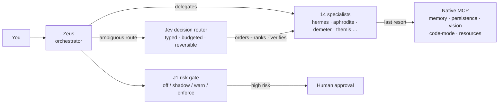
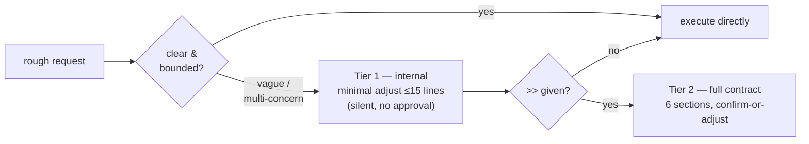
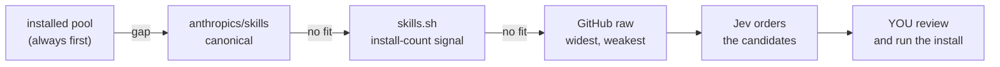
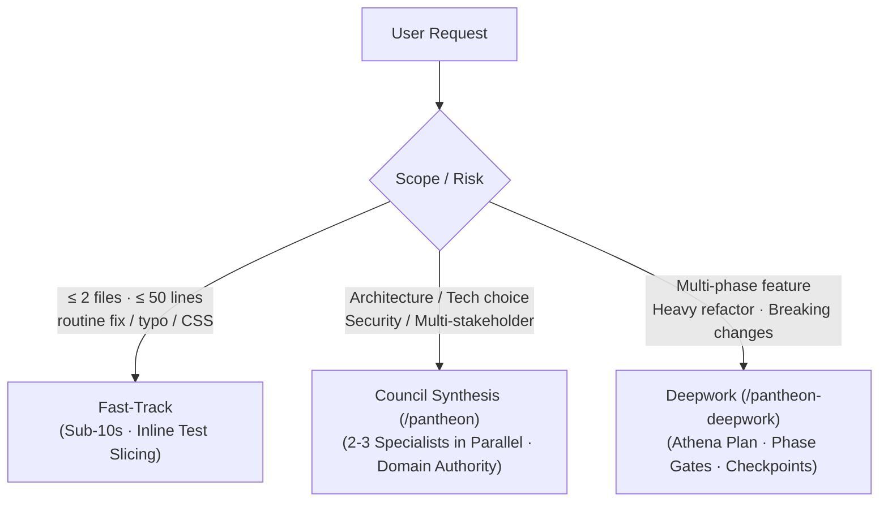

# Pantheon

**A clearer, faster way to work with OpenCode on real software projects.** Pantheon
brings planning, implementation, review, and documentation into one guided,
token-efficient experience. It is an OpenCode plugin and installer for developers
and teams who want useful structure without giving up speed or control of their code.

[Português (Brasil)](README.pt-BR.md) ·
[Repository](https://github.com/ils15/pantheon-opencode) · [MIT License](LICENSE)

[](https://github.com/ils15/pantheon-opencode/releases/latest)
[](https://github.com/ils15/pantheon-opencode/actions)
[](https://doi.org/10.5281/zenodo.22650136)

## What is it?

Pantheon is a companion for [OpenCode](https://opencode.ai/) that helps you move
from an idea to a reviewed, verified change. Fourteen specialized agents share one
streamlined workflow: plan, implement, check, review, and record what mattered.
You stay in charge of every decision and every merge.



**The escalation ladder every agent follows**: session context first → free local selector → one typed Jev decision when genuinely ambiguous → native MCP call only as the last resort for state the session cannot reconstruct.



**Skill discovery runs a trust cascade** — canonical first, popularity never compensates for provenance:



## Why use it?

- **Fast-Track execution:** Bounded micro-edits (<= 2 files, <= 50 lines) bypass all heavy ceremony and verify in < 10 seconds.
- **Mandatory test slicing:** Sub-second targeted test execution instead of running sluggish repository-wide test suites during dev loops.
- **Assertive council (`/pantheon`):** Parallel specialist consultations resolved decisively via domain authority and JEV multi-criteria decisions without endless debate turns.
- **You stay in charge:** Pantheon supports your judgment; it never silently alters permissions or runs unapproved destructive actions.
- **Non-destructive upgrades:** Updating Pantheon (`pantheon-opencode update`) refreshes skills, MCPs, and instructions while strictly preserving all user models, presets, permissions, and custom configs.

## Start in 2 minutes

Requirements: [OpenCode](https://opencode.ai/docs/) **2.x** and Node.js **>=26.4.0**. (See [Compatibility](docs/COMPATIBILITY.md)).

### 1. Install

**Option A — Quick Plugin Add (Global or Project):**
```bash
opencode plugin add pantheon-opencode
# Or pin a specific version:
opencode plugin add pantheon-opencode@2.0.0-rc.1
```

**Option B — Global CLI Install with Full MCP Tooling:**
```bash
npm install -g pantheon-opencode@beta
pantheon-opencode init --yes
```

### 2. Verify Health
```bash
pantheon-opencode doctor
```
Runs a diagnostic checking Decision Router & budget ledger accessibility, MCP initialization, Python virtual environments, Node version, permissions, and config integrity. In containerized or JupyterHub environments with group-writable homes, set `PANTHEON_ALLOW_GROUP_WRITABLE=1` if needed.

### 3. Updating Pantheon Without Overwriting Settings
When a new version is released:
```bash
pantheon-opencode update
```
The updater verifies package identity, pulls the latest release, and runs a non-destructive configuration refresh. **Your custom models, active preset, custom permissions, plugin options, and user-defined AGENTS.md sections are preserved verbatim.**

---

## Optimal Workflow & Execution Modes

Pantheon balances speed and rigor through three distinct execution modes:



### 1. Fast-Track & Test Slicing (Micro-Edits < 10s)
For routine bug fixes, style adjustments, or localized refactors:
- **No planning ceremony:** Directly executes bounded changes.
- **Targeted test slicing:** Runs ONLY the test slice relevant to the modified file (e.g. `node --test tests/foo.test.mjs` or `pytest -k <func>`). Full repository test suites are reserved for CI and release gates.
- **Single-turn delivery:** Verifies and completes in under 10 seconds.

### 2. Assertive Council Synthesis (`/pantheon`)
When confronting architectural crossroads, technology evaluations, or security tradeoffs:
```text
/pantheon Should we use WebSockets or Server-Sent Events for live push notifications?
```
- **Parallel Dispatch:** Dispatches 2–3 specialist agents simultaneously with independent prompts.
- **Assertive Arbitration:** Rather than looping in repetitive debate rounds, divergences are resolved immediately via **Domain Authority Precedence**:
  - **Security / Auth:** `@themis` has veto power over vulnerable designs.
  - **Database / Schema:** `@demeter` carries authoritative weight on query performance and transaction safety.
  - **Frontend / UX / A11y:** `@aphrodite` governs user interface responsiveness and accessibility.
  - **Infrastructure / CI:** `@prometheus` governs deployment contracts and container isolation.
  - **API / Protocols:** `@hermes` governs contract consistency and transport schemas.
  - **Architecture / Modularity:** `@athena` governs separation of concerns.
- **JEV Multi-Criteria Decision:** If trade-offs balance competing requirements equally, Zeus invokes `pantheon_jev_decide` (or local decision matrix) to rank candidates deterministically in one tool call.

### 3. Checkpointed Deepwork (`/pantheon-deepwork`)
For multi-phase tasks spanning 10+ turns or multiple sessions:
```text
/pantheon-deepwork "Implement OAuth2 PKCE authentication flow"
```
- **Phase 0 (Plan):** Athena maps affected modules and returns a complete Markdown plan displayed directly in the main conversation.
- **Phase 1 (Discovery):** Apollo performs structured exploration.
- **Phase 2–N (Implementation):** Specialists implement features in parallel phases.
- **Phase Gates:** Themis audits each phase (`PASS` or `FAIL`).
- **Resumability:** Checkpoints persisted to `.pantheon/deepwork/<slug>/`. Resume anytime with `/pantheon-deepwork --resume <slug>`.

---

## The 14 Specialized Agents

Every root dispatch carries a concise handoff brief — objective, bounded scope, relevant inputs, constraints, expected return format, and verification. Work is routed qualitatively — uncertainty, domain expertise, dependencies, risk, and verification — not by fixed file or line thresholds. Return contracts are role-specific: implementation uses `## subtask_summary`, investigation returns structured findings, Athena returns the complete plan, and council responses use `## specialist_response`.

| Agent | Domain Authority | Core Responsibilities |
|---|---|---|
| **@zeus** | Central Orchestrator | Directs workflow, manages delegations, arbitrates council decisions, enforces token efficiency. Never implements directly. |
| **@athena** | Architecture & Planning | Research-first planning, system boundaries, LTS policy, dependency analysis. Plan-only; never implements. |
| **@hermes** | Backend & APIs | FastAPI, Python async, Node/TypeScript backends, API contracts, protocol conformance. |
| **@aphrodite** | Frontend & UX | React 19, strict TypeScript, responsive design, WCAG accessibility, CSS optimization. |
| **@demeter** | Database & Persistence | Schema migrations, query optimization, N+1 query prevention, transaction integrity. |
| **@themis** | Security & Quality Gate | OWASP audits, static analysis (Biome/ruff), authorization gates, dead code removal. Reviews material changes. |
| **@prometheus** | DevOps & Infrastructure | Docker, CI/CD pipelines, runtime configuration, provider abstraction, telemetry infra. |
| **@talos** | Hotfix Fast Lane | Rapid, standalone fixes for small bugs, typos, and minor logic without subagent overhead. |
| **@apollo** | Investigation Scout | Read-only discovery: parallel codebase and web searches. Returns structured findings. |
| **@hephaestus**| AI Pipelines & RAG | Embeddings, vector stores, prompt engineering, agent pipelines. |
| **@gaia** | Geospatial & Sensing | Remote sensing, SAR, geospatial analysis, ML/DL raster classification (read-only). |
| **@iris** | Git & Release Ops | Branching, PRs, issue triage, release notes. Never pushes or merges without human approval. |
| **@mnemosyne** | Project Memory Bank | Maintains `.pantheon/memory-bank/` and records ADRs when explicitly requested. |
| **@nyx** | Observability & Telemetry| OpenTelemetry tracing, token/cost monitoring, execution profiling. |

---

## Skills & MCP Tooling

- **In-Process Skill Search (`pantheon_skill_search`):** Quickly discovers local skills and external ecosystem skills without requiring shell execution permissions.
- **25 Production Skills:** Includes `test-slicing`, `fast-path-execution`, `tdd-with-agents`, `instruction-forge`, and `incremental-implementation`.
- **5 Local MCP Servers:**
  - `pantheon-memory`: Shared project memory with atomic SQLite locking.
  - `pantheon-persistence`: File and context persistence.
  - `pantheon-resources`: Local documentation and asset serving.
  - `pantheon-code-mode`: Sandboxed Python execution.
  - `pantheon-vision`: Image analysis and diagnostic visual inspection.
- **Advisory JEV Decision Router:** Evaluates candidate options (`pantheon_jev_decide`), orders trade-offs, and provides formal multi-criteria decision making without modifying permissions.

---

## Settings & TUI Window (`/pantheon-settings`)

Run `/pantheon-settings` (or `Pantheon: Settings` in the command palette) to open the interactive settings window:

- **Gates & Overrides:** Toggle named behaviors live; persists to `pantheon-overrides.json`.
- **Model Presets:** Switch active model tier globally or per project.
- **Decision Model Selector:** Interactive selector to cycle across all remote decision models (`openrouter-jev`, `typesafe-jev`, `openai-decisions`, `vercel-gateway-jev`, etc.) directly from the UI.
- **Bilingual Settings (PT-BR / EN):** Full visual localization for Decision, Autonomy, and Safety tabs, auto-detecting environment locale with manual toggle in the TUI tab.
- **Updates:** Check registry channel (`beta` / `stable`) and trigger upgrades.
- **Doctor:** Run inline system health diagnostics.
- **TUI Personalization:** Adjust spacing (`comfortable` vs `compact`), separators, gauge bar styles, context display rows, and language.
- **Non-Destructive Overlay & Mouse Navigation:** Opens as a floating dialog overlay over the active session without blanking the workspace (configurable via `dialog` vs `fullscreen`), with full mouse click support for tabs, sidebar, rows, value cyclers, and actions.
- **Modernized What's New Window:** Card layout with rounded border, pagination buttons, and a dedicated `[OK, Entendido]` button with keyboard (`Enter`/`Esc`/`Q`) and mouse click support.

---

## Documentation

| Start Here | Architecture & Deep Dives | Reference & Operations |
|---|---|---|
| [Quick Start](docs/QUICKSTART.md) | [Architecture](docs/ARCHITECTURE.md) | [MCP Tools](docs/mcp-tools.md) |
| [Installation Guide](docs/INSTALLATION.md) | [Delegation & Gates](docs/PERMISSIONS-QUALITY-DELEGATION.md) | [Native Decisions (Jev)](docs/reference/native-decisions.md) |
| [Compatibility](docs/COMPATIBILITY.md) | [Memory System](docs/MEMORY.md) | [Model Routing](docs/reference/model-routing.md) |
| [Upgrading](docs/UPGRADING.md) | [OpenCode 2.x Integration](docs/opencode.md) | [Changelog](CHANGELOG.md) |

---

## What's New in v2.0.1

- **Bilingual TUI Settings (PT-BR / EN):** Visual localization for Decision Router, Autonomy & Budgets, and J1 Safety Gate tabs, with intelligent system locale auto-detection (`LANG` / `LC_ALL`) and manual preference cycling (`auto`, `pt-BR`, `en`).
- **Interactive Decision Model Selector:** Permanently accessible selector row in `/pantheon-settings` to cycle across all 6 remote decision models without manual JSON configuration.
- **Modernized Council Synthesis (`/pantheon`):** Rich synthesis artifacts featuring Domain Authority breakdown, Mermaid arbitration diagrams, and immediate action checklists.
- **Modernized Strategic Planning (`/pantheon-deepwork`):** Athena plans now enforce mandatory sub-10s test slicing, execution dependency diagrams, blast radius impact matrix, and rollback blueprints.
- **Demystified J1 Safety Ladder:** Plain-language descriptions for J1 execution modes (`shadow`, `enforce`, `off`), making telemetry and protection gates clear.

---

## What's New in v2.0.0-rc.1

- **Release Candidate Series Inauguration:** Production-ready multi-agent orchestration for OpenCode 2.x.
- **Agent Token Compaction (-44.3%):** Removed duplicated backend code in Apollo/Prometheus, saving 8,150 tokens per turn (~29.3M tokens/month).
- **Pragmatism & Anti-Pedantry Directive:** Safe diagnostic operations are authorized without bureaucratic gates, ending agent sluggishness.
- **Batched Suite TDD & Test-Slicing:** Cohesive multi-endpoint testing and sub-100ms targeted test execution.
- **Proactive Skill Discovery & Query Caching:** Cached skill lookups (24h TTL) and automated recommendation for external tools.
- **Live JEV Scorecard & Sandbox Web App:** 16/16 pass rate ($0.0000238/decision) verified with an end-to-end sandbox application.

See [CHANGELOG.md](CHANGELOG.md) for full historical release notes.

## Contributing

Ideas, bug reports, and contributions are welcome! Please read [CONTRIBUTING.md](CONTRIBUTING.md) before submitting a PR.

## Citation and License

Pantheon is open-source software licensed under the [MIT License](LICENSE).
Cite via Zenodo concept DOI: [10.5281/zenodo.22650136](https://doi.org/10.5281/zenodo.22650136). Citation metadata is available in [CITATION.cff](CITATION.cff).

Canonical repository: <https://github.com/ils15/pantheon-opencode>
