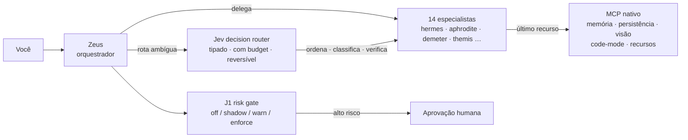
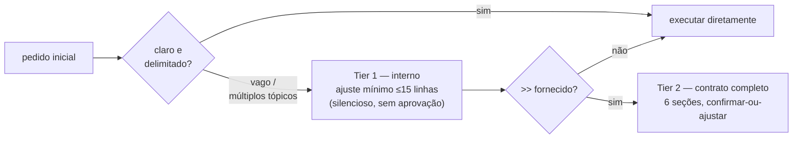
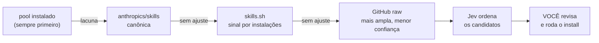
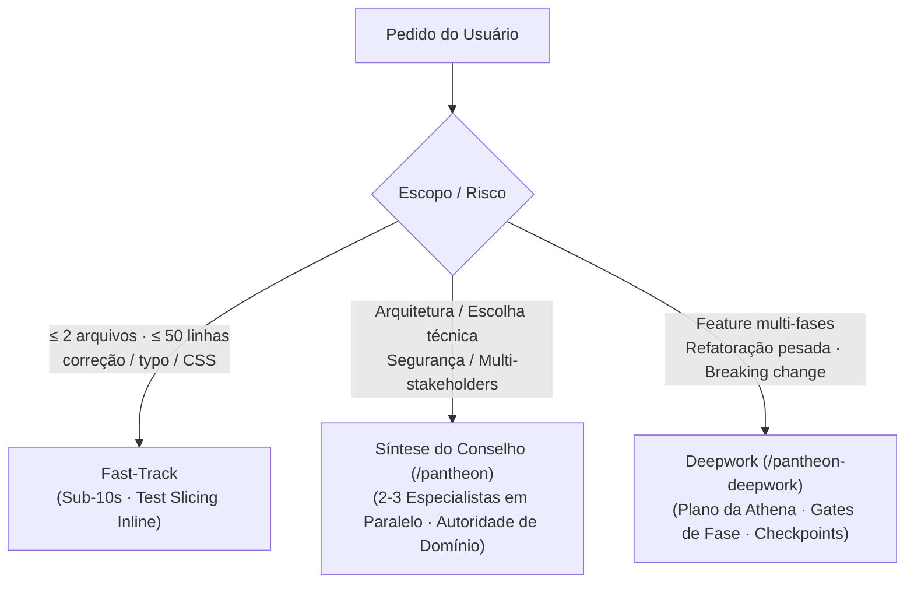

<!-- synced-from: README.md -->
# Pantheon

**Uma forma mais clara, rápida e eficiente de trabalhar com OpenCode em projetos de software reais.**
O Pantheon reúne planejamento, implementação, revisão e documentação numa experiência guiada e otimizada para tokens. É um plugin e instalador para OpenCode feito para desenvolvedores e equipes que querem estrutura útil sem abrir mão de velocidade ou do controle sobre seu código.

[English](README.md) ·
[Repositório](https://github.com/ils15/pantheon-opencode) · [Licença MIT](LICENSE)

[](https://github.com/ils15/pantheon-opencode/releases/latest)
[](https://github.com/ils15/pantheon-opencode/actions)
[](https://doi.org/10.5281/zenodo.22650136)

## O que é?

O Pantheon é um companheiro do [OpenCode](https://opencode.ai/) que ajuda você a ir de uma ideia até uma alteração revisada e verificada. Quatorze agentes especializados compartilham um fluxo direto e consistente: planejar, implementar, checar, revisar e registrar o que foi importante. Você permanece no controle de cada decisão e de cada merge.



**A escada de escalonamento que todo agente segue**: contexto da sessão primeiro → seletor local gratuito → uma decisão Jev tipada quando genuinamente ambíguo → chamada a MCP nativo apenas como último recurso para estado que a sessão não puder reconstruir.



**A descoberta de skills segue uma cascata de confiança** — canônicas primeiro, popularidade nunca compensa proveniência:



## Por que usar?

- **Execução Fast-Track:** Micro-edições delimitadas (<= 2 arquivos, <= 50 linhas) pulam cerimônias pesadas e validam em < 10 segundos.
- **Fatiamento mandatório de testes (test slicing):** Execução direcionada em submissegundos em vez de rodar suites lentas do repositório inteiro durante loops de desenvolvimento.
- **Barramento reativo de eventos sem polling:** Event bus em memória distribui atualizações de jobs e agentes em tempo real com latência zero.
- **Loops de reflexo local Themis:** Auto-remediação direta de falhas isoladas de lint ou fatias de teste antes de escalar para o Zeus.
- **Conselho assertivo (`/pantheon`):** Consultas paralelas entre especialistas resolvidas decisivamente via autoridade de domínio e decisões multi-critério JEV sem loops infinitos de debate.
- **Você no comando:** O Pantheon apoia seu julgamento; ele nunca altera permissões silenciosamente nem executa ações destrutivas sem aprovação.
- **Atualizações não-destrutivas:** Atualizar o Pantheon (`pantheon-opencode update`) renova skills, MCPs e instruções preservando rigorosamente todos os modelos do usuário, presets ativos, permissões e regras customizadas no `AGENTS.md`.

## Comece em 2 minutos

Requisitos: [OpenCode](https://opencode.ai/docs/) **2.x** e Node.js **>=26.4.0**. (Veja [Compatibilidade](docs/COMPATIBILITY.md)).

### 1. Instalação

**Opção A — Adição Rápida de Plugin (Global ou no Projeto):**
```bash
opencode plugin add pantheon-opencode
# Ou fixe uma versão específica:
opencode plugin add pantheon-opencode@2.0.0-rc.1
```

**Opção B — Instalação Global via CLI com Tooling MCP Completo:**
```bash
npm install -g pantheon-opencode@beta
pantheon-opencode init --yes
```

### 2. Verificação de Saúde
```bash
pantheon-opencode doctor
```
Executa um diagnóstico de 28 pontos checando inicialização de MCPs, ambientes virtuais Python, versão do Node, permissões e integridade de configuração.

### 3. Atualizando o Pantheon sem Sobrescrever Configurações
Quando uma nova versão for lançada:
```bash
pantheon-opencode update
```
O atualizador valida a identidade do pacote, baixa a versão mais recente e executa uma atualização de configuração totalmente não-destrutiva. **Seus modelos personalizados, preset ativo, permissões customizadas, opções de plugins e seções próprias no AGENTS.md são preservados sem alterações.**

---

## Modos de Execução & Fluxo Ótimo

O Pantheon equilibra velocidade e rigor através de três modos de execução:



### 1. Fast-Track & Test Slicing (Micro-Edições < 10s)
Para correções de bugs pontuais, ajustes de estilo ou refatorações localizadas:
- **Sem cerimônia de planejamento:** Executa diretamente as alterações delimitadas.
- **Fatiamento direcionado de testes:** Executa APENAS a fatia de testes correspondente ao arquivo modificado (ex: `node --test tests/foo.test.mjs` ou `pytest -k <func>`). Suites completas são reservadas para CI e release gates.
- **Entrega em turno único:** Valida e finaliza em menos de 10 segundos.

### 2. Síntese Assertiva do Conselho (`/pantheon`)
Ao enfrentar encruzilhadas arquiteturais, avaliações tecnológicas ou trade-offs de segurança:
```text
/pantheon Devemos usar WebSockets ou Server-Sent Events para notificações push em tempo real?
```
- **Despacho Paralelo:** Dispara 2 a 3 especialistas simultaneamente com prompts independentes.
- **Arbitragem Assertiva:** Em vez de travar em rodadas repetitivas de debate, divergências são resolvidas de imediato via **Precedência de Autoridade de Domínio**:
  - **Segurança / Auth:** `@themis` tem poder de veto sobre propostas vulneráveis.
  - **Banco de Dados / Schema:** `@demeter` tem autoridade técnica sobre consultas e integridade transacional.
  - **Frontend / UX / A11y:** `@aphrodite` rege acessibilidade e ergonomia visual.
  - **Infraestrutura / CI:** `@prometheus` rege limites de runtime, containers e pipelines.
  - **API / Protocolos:** `@hermes` rege conformidade contratual e esquemas de transporte.
  - **Arquitetura / Modularidade:** `@athena` rege desacoplamento e manutenibilidade a longo prazo.
- **Decisões Multi-Critério JEV:** Se os trade-offs equilibrarem demandas concorrentes de mesmo peso, Zeus invoca `pantheon_jev_decide` (ou a matriz de decisão local) para ordenar as opções deterministicamente em uma única chamada.

### 3. Deepwork com Checkpoints (`/pantheon-deepwork`)
Para tarefas complexas com mais de 10 turnos ou distribuídas em várias sessões:
```text
/pantheon-deepwork "Implementar autenticação OAuth2 PKCE"
```
- **Fase 0 (Plano):** Athena mapeia os módulos e devolve o plano completo em Markdown exibido diretamente na conversa principal.
- **Fase 1 (Descoberta):** Apollo realiza exploração estruturada.
- **Fases 2–N (Implementação):** Especialistas implementam os módulos em fases paralelas.
- **Gates de Revisão:** Themis audita cada fase (`PASS` ou `FAIL`).
- **Resumibilidade:** Progresso salvo em `.pantheon/deepwork/<slug>/`. Retome a qualquer momento com `/pantheon-deepwork --resume <slug>`.

---

## Os 14 Agentes Especializados

Toda delegação raiz carrega um brief conciso — objetivo, escopo delimitado, entradas relevantes, restrições, formato de retorno esperado e critérios de verificação. O trabalho é roteado de forma qualitativa — incerteza, especialidade de domínio, dependências, risco e verificação — nunca por limites arbitrários de linhas. Os contratos de retorno são específicos por papel: implementação usa `## subtask_summary`, investigações retornam achados estruturados, Athena entrega o plano completo e respostas ao conselho usam `## specialist_response`.

| Agente | Autoridade de Domínio | Responsabilidades Principais |
|---|---|---|
| **@zeus** | Orquestrador Central | Direciona o fluxo, delega tarefas, arbitra decisões do conselho e garante economia de tokens. Nunca implementa código diretamente. |
| **@athena** | Arquitetura e Planejamento | Planejamento research-first, fronteiras de sistema, LTS e análise de dependências. Plan-only; nunca implementa. |
| **@hermes** | Backend e APIs | FastAPI, Python assíncrono, backends Node/TypeScript, contratos de API e conformidade de protocolos. |
| **@aphrodite** | Frontend e UX | React 19, TypeScript estrito, design responsivo, acessibilidade WCAG e CSS moderno. |
| **@demeter** | Banco de Dados e Persistência | Migrações de schema, otimização de queries, prevenção de queries N+1 e integridade transacional. |
| **@themis** | Gate de Qualidade e Segurança | Auditorias OWASP, análise estática (Biome/ruff), autorização e limpeza de código legado. Revisa mudanças materiais. |
| **@prometheus** | DevOps e Infraestrutura | Docker, pipelines CI/CD, configuração de runtime, abstração de provedores e infra de telemetria. |
| **@talos** | Linha Rápida de Hotfixes | Correções rápidas e autônomas para bugs pequenos, typos e lógica simples sem sobrecarga de subagentes. |
| **@apollo** | Batedor de Investigação | Descoberta somente-leitura: buscas paralelas no código e na documentação. Retorna achados estruturados. |
| **@hephaestus**| Pipelines de IA e RAG | Embeddings, vector stores, engenharia de prompt e pipelines de agentes. |
| **@gaia** | Sensoriamento e Geoespacial | Sensoriamento remoto, SAR, análise geoespacial e classificação raster ML/DL (somente-leitura). |
| **@iris** | Operações Git e Release | Branches, PRs, triagem de issues e notas de lançamento. Nunca faz push ou merge sem aprovação humana explícita. |
| **@mnemosyne** | Banco de Memória do Projeto | Mantém o `.pantheon/memory-bank/` e registra ADRs quando explicitamente solicitado. |
| **@nyx** | Observabilidade e Telemetria| Rastreamento OpenTelemetry, monitoramento de tokens/custos e profiling de execução. |

---

## Skills & Ferramental MCP

- **Busca de Skills In-Process (`pantheon_skill_search`):** Encontra rapidamente skills locais e do ecossistema aberto sem depender de permissões de shell.
- **25 Skills de Produção:** Inclui `test-slicing`, `fast-path-execution`, `tdd-with-agents`, `instruction-forge` e `incremental-implementation`.
- **5 Servidores MCP Locais:**
  - `pantheon-memory`: Memória compartilhada com travas atômicas SQLite.
  - `pantheon-persistence`: Persistência de contexto e arquivos de projeto.
  - `pantheon-resources`: Disponibilização de documentação e recursos locais.
  - `pantheon-code-mode`: Execução confinada de scripts Python.
  - `pantheon-vision`: Análise e inspeção visual diagnóstica de imagens.
- **Roteador Consultivo de Decisões JEV:** Avalia candidatos (`pantheon_jev_decide`), ordena trade-offs e fornece suporte a decisões multi-critério sem modificar permissões.

---

## Configurações & Janela TUI (`/pantheon-settings`)

Execute `/pantheon-settings` (ou `Pantheon: Settings` na paleta de comandos) para abrir o painel de configurações:

- **Gates & Overrides:** Habilite ou desabilite comportamentos nomeados em tempo real (salvo em `pantheon-overrides.json`).
- **Presets de Modelos:** Alterne o tier de modelos ativo globalmente ou no projeto.
- **Seletor de Modelo de Decisão:** Alterne interativamente entre os modelos remotos de decisão (`openrouter-jev`, `typesafe-jev`, `openai-decisions`, etc.) diretamente na interface.
- **Suporte Multilíngue (PT-BR / EN):** Tradução visual completa das abas Decisões, Autonomia e Segurança, com detecção automática da linguagem do sistema e troca manual na aba TUI.
- **Atualizações:** Verifique o canal do registro (`beta` / `stable`) e dispare upgrades.
- **Doctor:** Execute o diagnóstico de saúde do sistema diretamente na interface.
- **Personalização da TUI:** Ajuste espaçamento (`comfortable` vs `compact`), separadores, estilo das barras de progresso, linhas de contexto e idioma.
- **Overlay Não-Destrutivo e Navegação por Clique:** Abre como diálogo flutuante sobre a sessão ativa mantendo a TUI visível (configurável entre `dialog` e `fullscreen`), com suporte completo a cliques de mouse em abas, menu lateral, linhas, seletores e botões de ação.
- **Janela de Novidades Modernizada:** Layout em card com bordas arredondadas, paginação visual e botão dedicado `[OK, Entendido]` com confirmação via mouse ou teclado (`Enter`/`Esc`/`Q`).

---

## Documentação

| Comece por aqui | Arquitetura e Aprofundamento | Referência e Operações |
|---|---|---|
| [Início Rápido](docs/QUICKSTART.md) | [Arquitetura](docs/ARCHITECTURE.md) | [Ferramentas MCP](docs/mcp-tools.md) |
| [Guia de Instalação](docs/INSTALLATION.md) | [Delegação & Gates](docs/PERMISSIONS-QUALITY-DELEGATION.md) | [Decisões Nativas (Jev)](docs/reference/native-decisions.md) |
| [Compatibilidade](docs/COMPATIBILITY.md) | [Sistema de Memória](docs/MEMORY.md) | [Roteamento de Modelos](docs/reference/model-routing.md) |
| [Atualização](docs/UPGRADING.md) | [Integração OpenCode 2.x](docs/opencode.md) | [Changelog](CHANGELOG.md) |

---

## O Que Há de Novo na v2.0.1

- **Configurações TUI Bilíngues (PT-BR / EN):** Localização visual para o Assistente de Decisão Jev, Autonomia & Orçamentos e Portão de Segurança J1, com detecção inteligente da linguagem do ambiente (`LANG` / `LC_ALL`) e seleção manual (`auto`, `pt-BR`, `en`).
- **Seletor Interativo de Modelos Jev:** Linha de seleção sempre visível em `/pantheon-settings` para alternar entre os 6 modelos remotos suportados sem editar arquivos JSON manualmente.
- **Síntese do Conselho Modernizada (`/pantheon`):** Artefatos com Autoridade por Domínio, diagrama visual de arbitragem em Mermaid e checklist de ações imediatas.
- **Planejamento Estratégico Modernizado (`/pantheon-deepwork`):** Planos da Athena com fluxo visual em Mermaid, fatiamento rigoroso de testes (< 10s), análise de raio de impacto e plano de rollback.
- **Desmistificação da Escala de Segurança J1:** Descrições claras dos modos de execução (`shadow`, `enforce`, `off`), eliminando ambiguidades sobre bloqueio e telemetria.

---

## O Que Há de Novo na v2.0.0-rc.1

- **Inauguração da Série Release Candidate:** Orquestração multi-agente pronta para produção no OpenCode 2.x.
- **Compactação de Tokens dos Agentes (-44.3%):** Remoção de código duplicado no Apollo/Prometheus, economizando 8.150 tokens por turno (~29,3M tokens/mês).
- **Diretiva de Pragmatismo e Anti-Pedantismo:** Diagnósticos seguros autorizados sem burocracia excessiva, eliminando lentidão e morosidade.
- **TDD em Lote (Batched Suite) e Test-Slicing:** Implementação coesa de módulos completos e execução de testes em menos de 100ms.
- **Descoberta Proativa de Skills com Cache:** Buscas de skills cacheadas (TTL 24h) e recomendação proativa de ferramentas pelo Zeus.
- **Scorecard JEV ao Vivo e App Web no Sandbox:** 16/16 cenários aprovados ($0,0000238/decisão) validados com app real no sandbox.

Consulte o [CHANGELOG.md](CHANGELOG.md) para o histórico completo de lançamentos.

## Contribuição

Ideias, relatórios de bugs e contribuições de código são muito bem-vindos! Por favor, leia [CONTRIBUTING.md](CONTRIBUTING.md) antes de abrir um PR.

## Citação e Licença

O Pantheon é software de código aberto sob a [Licença MIT](LICENSE).
Cite via Zenodo concept DOI: [10.5281/zenodo.22650136](https://doi.org/10.5281/zenodo.22650136). Metadados de citação disponíveis em [CITATION.cff](CITATION.cff).

Repositório canônico: <https://github.com/ils15/pantheon-opencode>
