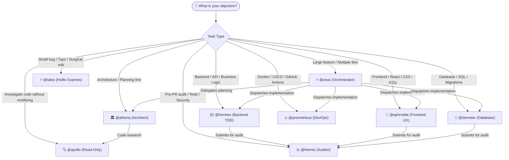

# Pantheon Agent Capability Matrix

> 🇧🇷 **Versão em Português disponível:** [Leia em Português](pt-BR/AGENT-CAPABILITY-MATRIX.md)

This matrix consolidates the domain authority, host permissions, permitted MCP servers, and absolute constraints for each of the 14 canonical Pantheon agents in OpenCode.

---

## 1. Decision Flowchart: Who to Call?

Use this visual decision guide to pick the right specialist for your objective:



---

## 2. Permissions and Tooling Overview

| Agent | Domain Authority | Edit Code? | Bash / Shell? | Subagents (`task`) | Question Tool? | Permitted MCPs |
|---|---|:---:|:---:|:---:|:---:|---|
| **@zeus** | Central Orchestration & Routing | ❌ `deny` | ❌ `deny` | ✅ `all` | ✅ `allow` | `resources`, `memory_store`, `persistence`, `vision` |
| **@athena** | Architecture & Planning | ❌ `deny` | ❌ `deny` | ❌ `deny` (child) | ✅ `allow` | `resources`, `memory_search` |
| **@hermes** | Backend, APIs & Business Logic | ✅ `allow` | ✅ `allow` | ⚠️ `@apollo` | ❌ `deny` | `resources`, `memory_search`, `code-mode` |
| **@aphrodite** | Frontend, UX, React & CSS | ✅ `allow` | ✅ `allow` | ⚠️ `@apollo` | ✅ `allow` | `resources`, `memory_search`, `vision` |
| **@demeter** | Database, SQL & Migrations | ✅ `allow` | ✅ `allow` | ❌ `deny` | ❌ `deny` | `resources`, `memory_search` |
| **@themis** | Security Audit & Quality Gate | ❌ `deny` | ✅ `allow` (read-only) | ❌ `deny` | ❌ `deny` | `resources`, `memory_search` |
| **@prometheus**| DevOps, Docker, CI/CD & Deploy | ✅ `allow` | ✅ `allow` | ⚠️ `@apollo` | ❌ `deny` | `resources`, `memory_search` |
| **@talos** | Quick Hotfixes & Micro-edits | ✅ `allow` | ✅ `allow` | ❌ `deny` | ❌ `deny` | `resources`, `memory_search` |
| **@apollo** | Codebase Research & Exploration | ❌ `deny` | ❌ `deny` | ❌ `deny` | ❌ `deny` | `resources`, `webfetch` |
| **@hephaestus**| AI Pipelines, RAG & Embeddings | ✅ `allow` | ✅ `allow` | ⚠️ `@apollo` | ❌ `deny` | `resources`, `memory_search`, `code-mode` |
| **@gaia** | Remote Sensing & Geospatial ML | ❌ `deny` | ❌ `deny` | ❌ `deny` | ❌ `deny` | `resources`, `memory_search` |
| **@iris** | Git & Release Operations | ✅ `allow` | ✅ `allow` (git) | ❌ `deny` | ❌ `deny` | `resources`, `memory_search` |
| **@mnemosyne** | Memory Bank Custody & ADRs | ⚠️ `.pantheon/**` | ❌ `deny` | ❌ `deny` | ❌ `deny` | `memory_search`, `memory_store` |
| **@nyx** | Observability, Tracing & Costs | ❌ `deny` | ❌ `deny` | ❌ `deny` | ❌ `deny` | `pantheon_cost`, `resources` |

---

## 3. What Each Agent CAN and CANNOT Do

### @zeus (Orchestrator)
- **CAN:** Decide task flow, dispatch specialists, arbitrate uncertainties via Jev (`pantheon_jev_decide`), discover project skills (`pantheon_skill_search`), prompt human decisions (`question`), read up to 50 lines for fast routing.
- **CANNOT:** Edit code directly (`edit: deny`), execute commands in terminal (`bash: deny`), ask user to run terminal commands, or perform broad recursive scans across `.git/**` or `node_modules/**`.

### @athena (Architect)
- **CAN:** Create architectural specs, analyze trade-offs, define implementation blueprints and detailed technical plans (`PLAN.md`).
- **CANNOT:** Implement or edit code (`edit: deny`), run tests/shell (`bash: deny`), or prompt approval dialogs within the child session (always hands the plan back to Zeus).

### @hermes (Backend)
- **CAN:** Write FastAPI/Node endpoints, business logic, unit tests in TDD, run testing and linting commands via bash.
- **CANNOT:** Mutate database schemas (delegates to `@demeter`), create visual UIs (delegates to `@aphrodite`), or configure Docker/CI pipelines (delegates to `@prometheus`).

### @aphrodite (Frontend)
- **CAN:** Create React/Next components, style with Tailwind/CSS, enforce WCAG accessibility, run dev servers and UI tests (Vitest/Playwright).
- **CANNOT:** Implement backend routes or persistence schemas, or ignore accessibility contrast guidelines.

### @demeter (Database)
- **CAN:** Create and migrate schemas (Alembic/Prisma), optimize SQL queries, prevent N+1 queries, assert referential integrity.
- **CANNOT:** Touch frontend components or implement business logic outside data persistence.

### @themis (Auditor)
- **CAN:** Run test suites and linters in read-only evaluation mode (Biome, ruff, pytest), issue compliance verdicts (`PASS`, `PASS_WITH_NOTES`, `BLOCK`, `BLOCK_INTENT`).
- **CANNOT:** Modify files or fix issues found (`edit: deny` absolute — strict separation of powers).

### @prometheus (DevOps)
- **CAN:** Maintain Dockerfile, docker-compose, GitHub Actions workflows, build/deploy scripts, monitoring configurations.
- **CANNOT:** Implement feature code or business logic.

### @talos (Hotfixer)
- **CAN:** Fix localized bugs, typos, missing imports, and micro-edits directly in a single turn without TDD ceremony.
- **CANNOT:** Execute architectural refactoring or high-risk multi-file tasks.

### @apollo (Investigator)
- **CAN:** Search codebase with `grep`, `glob`, and `read`, fetch external documentation with `webfetch`, synthesize structured findings.
- **CANNOT:** Modify files (`edit: deny`), run arbitrary terminal commands (`bash: deny`).

### @mnemosyne (Memory Bank)
- **CAN:** Read and update markdown files strictly inside `.pantheon/memory-bank/` and record approved ADRs.
- **CANNOT:** Touch files outside `.pantheon/` (e.g. `README.md` is updated by `@hermes` or `@talos`).

---

## 4. Subagents and Jev Arbitration

By default, only the `@zeus` orchestrator invokes `pantheon_jev_decide`. Specialists can be explicitly authorized by setting the environment variable:

```bash
export PANTHEON_JEV_SPECIALIST_CALLERS="athena,hermes,aphrodite,apollo"
```
