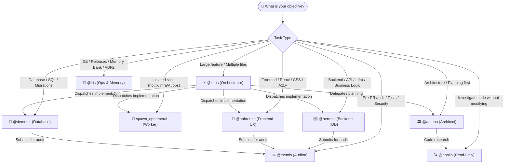

# Pantheon Agent Capability Matrix

> 🇧🇷 **Versão em Português disponível:** [Leia em Português](pt-BR/AGENT-CAPABILITY-MATRIX.md)

This matrix consolidates the domain authority, host permissions, permitted MCP servers, and absolute constraints for each of the 8 canonical Pantheon agents in OpenCode (plus `spawn_ephemeral` slice archetypes).

---

## 1. Decision Flowchart: Who to Call?

Use this visual decision guide to pick the right specialist for your objective:



---

## 2. Permissions and Tooling Overview

| Agent | Domain Authority | Edit Code? | Bash / Shell? | Subagents (`task`) | Question Tool? | Permitted MCPs |
|---|---|:---:|:---:|:---:|:---:|---|
| **@zeus** | Central Orchestration & Routing | ❌ `deny` | ❌ `deny` | ✅ `all` | ✅ `allow` | `resources`, `memory_search`, `persistence`, `vision` |
| **@athena** | Architecture & Planning | ❌ `deny` | ❌ `deny` | ❌ `deny` (child) | ✅ `allow` | `resources`, `memory_search` |
| **@hermes** | Backend, APIs, Infra & Execution | ✅ `allow` | ✅ `allow` | ⚠️ `@apollo` | ❌ `deny` | `resources`, `memory_search`, `code-mode` |
| **@aphrodite** | Frontend, UX, React & CSS | ✅ `allow` | ✅ `allow` | ⚠️ `@apollo` | ❌ `deny` | `resources`, `memory_search`, `vision`, `code-mode` |
| **@demeter** | Database, SQL & Migrations | ✅ `allow` | ✅ `allow` | ❌ `deny` | ❌ `deny` | `resources`, `memory_search`, `code-mode` |
| **@themis** | Security Audit & Quality Gate | ❌ `deny` | ✅ `allow` (read-only) | ❌ `deny` | ❌ `deny` | `resources`, `memory_search` |
| **@apollo** | Codebase Research & Exploration | ❌ `deny` | ❌ `deny` | ❌ `deny` | ❌ `deny` | `resources`, `memory_search`, `webfetch` |
| **@iris** | Git, Releases, Memory Bank & ADRs | ❌ `deny` | ✅ `allow` (git/gh) | ❌ `deny` | ❌ `deny` | `resources`, `memory_store`, `code-mode` |

The `pantheon_strategy` plugin tool (per-step strategy outcomes and success
rates) is granted only to `@zeus`, `@athena` and `@themis`; every other agent
inherits the host default deny.

---

## 3. What Each Agent CAN and CANNOT Do

### @zeus (Orchestrator)
- **CAN:** Decide task flow, dispatch specialists or `spawn_ephemeral` workers (`hotfix`, `infra-ci`, `ai-pipeline`, `observability`, `geospatial`, `memory-adr`), coordinate `pantheon_board`, arbitrate via Jev (`pantheon_jev_decide`), prompt human decisions (`question`), read up to 50 lines for fast routing.
- **CANNOT:** Edit code directly (`edit: deny`), execute commands in terminal (`bash: deny`), ask user to run terminal commands, or perform broad recursive scans across `.git/**` or `node_modules/**`.

### @athena (Architect)
- **CAN:** Create architectural specs, analyze trade-offs, define implementation blueprints and detailed technical plans (`PLAN.md`).
- **CANNOT:** Implement or edit code (`edit: deny`), run tests/shell (`bash: deny`), or prompt approval dialogs within the child session (always hands the plan back to Zeus).

### @hermes (Backend & Execution)
- **CAN:** Write FastAPI/Node endpoints, business logic, infra/CI configs, hotfixes, and unit tests in TDD; run testing and linting commands via bash.
- **CANNOT:** Mutate database schemas (delegates to `@demeter`) or create visual UIs (delegates to `@aphrodite`).

### @aphrodite (Frontend)
- **CAN:** Create React/Next components, style with Tailwind/CSS, enforce WCAG accessibility, run dev servers and UI tests (Vitest/Playwright).
- **CANNOT:** Implement backend routes or persistence schemas, or ignore accessibility contrast guidelines.

### @demeter (Database)
- **CAN:** Create and migrate schemas (Alembic/Prisma), optimize SQL queries, prevent N+1 queries, assert referential integrity.
- **CANNOT:** Touch frontend components or implement business logic outside data persistence.

### @themis (Auditor)
- **CAN:** Run test suites and linters in read-only evaluation mode (Biome, ruff, pytest), issue compliance verdicts (`PASS`, `PASS_WITH_NOTES`, `BLOCK`, `BLOCK_INTENT`).
- **CANNOT:** Modify files or fix issues found (`edit: deny` absolute — strict separation of powers).

### @apollo (Investigator)
- **CAN:** Search codebase with `grep`, `glob`, and `read`, fetch external documentation with `webfetch`, synthesize structured findings.
- **CANNOT:** Modify files (`edit: deny`), run arbitrary terminal commands (`bash: deny`).

### @iris (GitHub Ops & Memory Custody)
- **CAN:** Manage Git branches/PRs/issues/releases (via `git`/`gh`), run `/pantheon-consolidate`, and curate durable `pantheon-memory` entries (`memory_store`/`memory_forget`) and `.pantheon/memory-bank/` ADRs on explicit request.
- **CANNOT:** Push or merge without explicit human approval, or edit application source code.

---

## 4. Subagents and Jev Arbitration

By default, only the `@zeus` orchestrator invokes `pantheon_jev_decide`. Specialists can be explicitly authorized by setting the environment variable:

```bash
export PANTHEON_JEV_SPECIALIST_CALLERS="athena,hermes,aphrodite,apollo"
```
