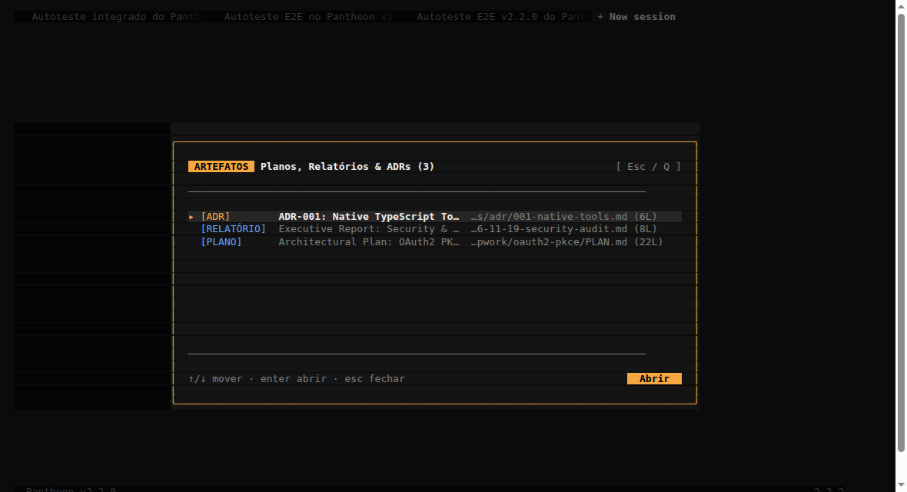
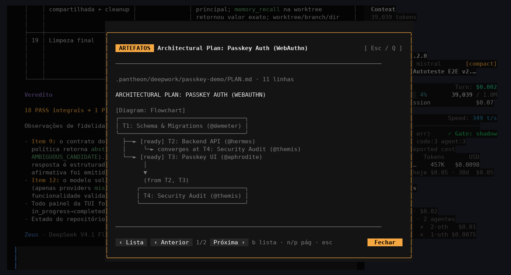

# Artifacts & `/pantheon-artifacts` Viewer

> 🇧🇷 **Versão em Português disponível:** [Leia em Português](pt-BR/ARTIFACTS.md)

Pantheon stores structured engineering plans, investigation/audit reports, and
Architecture Decision Records (ADRs) as high-density Markdown files inside your
repository, keeping the project root clean and making every decision reviewable
in both **OpenCode CLI (TUI)** and **OpenCode Desktop**.

---

## 1. Where Artifacts Live & Who Creates Them

| Type | Location | Produced By | Lifecycle |
|---|---|---|---|
| **Plans (`PLAN`)** | `.pantheon/deepwork/<slug>/PLAN.md` | `@athena` / `/pantheon-deepwork` | Durable per task/sprint (gitignored) |
| **Reports (`REPORT`)** | `.pantheon/reports/<YYYY-MM-DD>-<topic>.md` | `@apollo` / `@themis` | Audit & discovery trail |
| **ADRs (`ADR`)** | `docs/adr/<NNN>-<slug>.md` (and `.pantheon/memory-bank/adr/*.md`) | `@iris` (or `spawn_ephemeral` `memory-adr`) | Permanent architecture decisions |

> [!TIP]
> Linked git worktrees resolve back to the main repository automatically, so
> `/pantheon-artifacts` inside a task worktree still sees the repository's plans,
> reports, and ADRs.

---

## 2. Viewing Artifacts in OpenCode CLI (`/pantheon-artifacts`)

Inside any OpenCode terminal session, run `/pantheon-artifacts` (alias
`/artifacts`, or **Pantheon: Artifacts** in the `Ctrl+P` command palette) — or
simply click the **`▸ Plan: ...`** / **`◈ Artefatos (N)`** links directly in
the **Sidebar** or **Home footer** whenever artifacts exist in the workspace:

### Selecting and Reading

- Press `↑` / `↓` (`k` / `j`) or click a row to select an artifact, then press
  `Enter` (or click **Abrir / Open**) to open it in the paginated reader.
- If the workspace currently has a single artifact, `/pantheon-artifacts` opens
  it directly in reader mode.

### Keyboard & Mouse Controls

| Context | Key / Action | Effect |
|---|---|---|
| List view | `↑` / `k`, `↓` / `j`, mouse click | Select artifact |
| List view | `Enter` / `Space` / second click | Open selected artifact |
| Reader view | `n` / `→` / click `Próxima ›` | Next page |
| Reader view | `p` / `←` / click `‹ Anterior` | Previous page |
| Reader view | `b` / `Backspace` / click `‹ Lista` | Return to artifact list |
| Any view | `Esc` / `q` / click `[ Esc / Q ]` | Close dialog |

The reader automatically formats GFM alerts (`[NOTE]`, `[TIP]`, `[IMPORTANT]`,
`[WARNING]`, `[CAUTION]`), renders Mermaid diagrams (`flowchart`, `graph`,
`sequenceDiagram`, `stateDiagram`) as Unicode box-and-arrow graphs, simplifies
`file://` line anchors, and wraps headings/bullets so large plans never overflow
the terminal.

---

## 3. Viewing Artifacts in OpenCode Desktop

OpenCode Desktop renders GitHub-Flavored Markdown inline:

- **Clickable file links:** links written as
  `[auth.ts](file:///abs/path/to/src/auth.ts#L1-L40)` jump directly to the
  referenced file and line range.
- **GFM Alerts & Mermaid diagrams:** `> [!NOTE]`, `> [!IMPORTANT]`, comparison
  tables, and quoted Mermaid blocks render natively in the Desktop UI.
- **Clean chat handoffs:** agents persist the full specification in the artifact
  file and post only a concise executive summary plus the approval prompt in chat
  instead of repeating the entire document.
