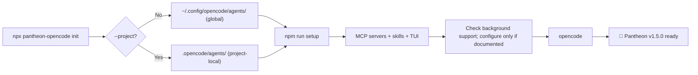

# Pantheon Installation Guide — v1.6.0 (OpenCode 2)

Pantheon v1.6.0 is **compatible with OpenCode 2**. `npx pantheon-opencode init` installs the selected generation. The interactive V1 selector offers **Inherit**, **OpenCode Go**, **OpenAI**, and **Anthropic**; it asks for the write scope only for a saved profile and is not a V2 model route. On V2, `pantheon_model` offers only manual `status`, `show`, `set`, and `reset`, with no preset wizard: the host default stays intact without an explicit per-agent override; `preset` markers and `PANTHEON_MODEL_PRESET` are ignored and preserved. Native inheritance for delegates: without a preset, children inherit the parent chat model on the V1 path. The preset tables below are legacy V1 reference and derived from [`src/routing.yml`](https://github.com/ils15/pantheon-opencode/blob/main/src/routing.yml) (no hardcoded secrets: only variable names and `baseURL`s).

## TL;DR (Quick Start)

```bash
# Install Pantheon agents globally (preset selection is V1 legacy)
npx pantheon-opencode init

# Headless (CI/scripts, uses defaults) — non-interactive apply requires --yes
npx pantheon-opencode init --headless --yes

# (Optional) MCP servers + skills + TUI plugin
npm run setup

# Verify installation
npm run doctor
```

- **Requirements:** **Node.js >=26.4.0** for Pantheon's CLI/installer/Node tooling, **Python 3.11+** (optional, MCP servers), and a supported host: **OpenCode 1.19.x** (V1 contract) or **OpenCode 2.x** (V2 contract).
- **Known broken:** OpenCode 2.0.22 does not expose `ctx.permission.assert`. Node 22, Node 24, and Node 26.0–26.3 are outside the supported range.
- With npm's default configuration, mismatched versions can emit `EBADENGINE` as a warning during install. Pantheon's postinstall then skips Node/config sync and lets the package finish installing; the CLI blocks configuration with an explicit message before writing files.
- `engine-strict=true` can make npm itself stop the install. To switch without a global/system-wide install, use a user-managed Node version manager:

  ```bash
  nvm install 26.4.0 && nvm use 26.4.0
  # or: fnm install 26.4.0 && fnm use 26.4.0
  # or: volta install node@26.4.0
  ```
- This does not assume a universal Node runtime for the OpenCode host: official OpenCode 2.x — a supported host — has a Bun runtime path and a separate Node build pinned to Node 26.4.0.
- That host runtime does not change the package floor, and no Bun minimum is declared.
- `node:sqlite` >=22.5 is only a capability threshold for the optional `pantheon_cost` backend, not the package's support requirement.
- In an interactive TTY setup summary, the installer recommends a persistent external location for future worktrees: `<project-parent>/.pantheon-worktrees/<exact-repository-directory-basename>/<task>` (for example, `/home/user/.pantheon-worktrees/My Project/feature-name`). Use the project directory's exact basename, including spaces; do not normalize it into a slug.
- The recommendation is guidance for agents only; Pantheon does not create Git worktrees or directories automatically.
- Interactive TTY configuration uses Clack prompts to select components, choose a global/project install, and confirm the review before applying. Canceling changes nothing.
- `--yes`, `--headless`, `--dry-run`, and non-TTY paths keep their existing behavior.
- Delegation and background mode depend on the tools exposed by the host version/runtime. In the reported Beta 10 session, Zeus had the `subagent` tool, with no `task_status`/`cancel_task` or guarantee of tracking/recovery.
- Check the runtime's schema and documentation; do not assume `task()` or background are available. The experimental variable below applies only to hosts/versions that document it.
- 5-minute walkthrough: [QUICKSTART.md](QUICKSTART.md).

## Installer review, authorization, and recovery

`init --dry-run` shows the managed-file operations without applying them. To
review in one invocation and authorize in another, save a versioned plan:

```bash
# Human-readable or JSON preview (stdout only)
npx pantheon-opencode init --project --no-mcp --components agents --dry-run
npx pantheon-opencode init --project --no-mcp --components agents --dry-run --json

# Save and apply the reviewed plan; without --yes, a TTY session asks
npx pantheon-opencode init --project --no-mcp --components agents --dry-run \
  --save-plan .pantheon-install-plan.json
npx pantheon-opencode init --apply-plan .pantheon-install-plan.json --yes
```

The artifact is versioned JSON written atomically with `0600` permissions; it
stores identities, options, snapshots/fingerprints, and operations, not the
contents of generated files. It is bound to the plan's original path, target,
and package identity. On apply, the installer recomputes the plan and compares
source and destinations; on drift it aborts before writing (exit code `3`).
`--apply-plan` accepts only the plan path and authorization (`--yes`/`-y` or a
TTY prompt). Saved plans with `--force`/`--clean` are not supported.

A dry run resolves the generation with the same resolver as apply, including the
`--version` probe. The probe runs in a throwaway HOME/XDG sandbox with a
2-second timeout, so the preview writes nothing. V1 is assumed only when the
probe fails or is unreadable; the plan then says that it assumes V1 and may
diverge, and `--json` adds an entry to its `advisories` array, while
`--opencode-version v1|v2` pins the preview. The plan describes
managed-file operations; it does not represent every bulk or external effect,
such as creating or updating a Python environment. `postinstall`/`sync-tui` is
also outside the `init` approval flow and may update TUI artifacts without a
prompt. Do not treat the preview as a transaction or as a promise of automatic
rollback.

Before the first managed write, `init` creates an exact backup under
`.pantheon/backups/<timestamp>/` (directory `0700`, files `0600`, retaining the
5 most recent). Because the backup is byte-for-byte, it can contain credentials
already present in your files; do not share it. To recover, use
`npx pantheon-opencode restore [--project] [--yes]`. A failure or interruption
may leave partial changes; recovery is manual through the `restore` command, not
an automatic rollback.

### Removal and purge

The uninstaller can also be reviewed before applying:

```bash
npx pantheon-opencode uninstall --project --dry-run
npx pantheon-opencode uninstall --project --force
```

Without `--force`, applying asks for confirmation on a TTY and fails closed in a
non-interactive environment. The uninstaller removes only items identified as
Pantheon's, preserves symlinks, and backs up regular files it will change or
remove; backups are not deleted by uninstall. On V2 global installs it also
undoes the native Context negation in `cli.json`, removing only the
`-opencode.sidebar.context` directive (and the whole file when Pantheon created
it), so the native Context block returns. `--purge-data` is narrower: it only
allows removing `.pantheon/install-state.json` when it is a regular file and a
verifiable schema-v2 state. It is not a general cleanup of `.pantheon` and does
not remove backups. Review with `--dry-run` first; to apply purge
non-interactively, combine `--purge-data --force`.

### Review drift in installed files

New installs keep a versioned per-file inventory for regular managed files
(exact relative path, component/layout, hash, and mode; no content is stored).
Use `reconcile` to identify files that have left the current source and remain
identical to the installer's last write:

```bash
# Read-only preview; select --global or --target PATH when appropriate
npx pantheon-opencode reconcile --project --dry-run
npx pantheon-opencode reconcile --project --dry-run --components agents,skills
npx pantheon-opencode reconcile --global --target /caminho/config-opencode --dry-run
npx pantheon-opencode reconcile --target /caminho/projeto --dry-run

# Reviewable plan, applied in a separate invocation with explicit authorization
npx pantheon-opencode reconcile --project --components agents --save-plan .pantheon-reconcile.json
npx pantheon-opencode reconcile --apply-plan .pantheon-reconcile.json --yes

# Alternative: review and apply in the same invocation
npx pantheon-opencode reconcile --project --apply --yes
```

The preview writes or removes nothing. Apply revalidates the inventory, hashes,
and exact operation set; any drift cancels before removal. Before deleting, it
creates a restorable backup under `.pantheon/backups/`; use
`pantheon-opencode restore` to recover. Only exact regular files are removed —
directories are never deleted recursively. Unselected components remain outside
reconciliation.

v1/v2 states and installs older than the inventory migrate to an empty list:
their existing files are unknown/ambiguous and are never inferred as
Pantheon-owned or removed automatically. Changed, missing, symlinked,
invalid-path, or incompatible-layout files are also preserved. `doctor`
distinguishes previously managed files that were modified or disappeared; when
the current payload is unavailable, it reports that only the recorded hash was
checked. `reconcile` accepts `--project`, `--global`, or `--target PATH`; an
explicit target uses the project layout by default. Combine `--global --target
PATH` to indicate that an explicit global target uses the flat global layout.
This choice is neither inferred nor reinterpreted from the path. Without a
readable inventory, there is no automatic cleanup.

## Prerequisites

- **OpenCode 1.19.x**, or **2.x** — [Install OpenCode](https://opencode.ai/docs/). **OpenCode 2.0.22 is known broken** (no `ctx.permission.assert`).
- **Node.js >=26.4.0** — for `npx pantheon-opencode init` and Node-based Pantheon tooling (`engines.node` = `>=26.4.0`). Node 22, Node 24, and Node 26.0–26.3 are unsupported.
- The optional `pantheon_cost` backend separately needs `node:sqlite` (Node >=22.5); this capability threshold does not lower package support.
- Official OpenCode 2.x — a supported host — has a Bun runtime path and a separate Node build pinned to 26.4.0; no Bun minimum is implied.
- **Python 3.11+** — for MCP servers (optional, used by `npm run setup`)
- **Git** — for version detection in TUI sidebar

## Package and dependency contract

The TUI plugin is a **root workspace**. `package.json` declares
`"workspaces": ["src/plugins/tui"]`, and the root `package-lock.json` carries a
`link: true` entry for `node_modules/pantheon-tui` resolving to
[`src/plugins/tui`](https://github.com/ils15/pantheon-opencode/tree/main/src/plugins/tui). A single `npm ci --ignore-scripts` at the root installs the
root project **and** the TUI subpackage; there is no second install step, and
`npm ci --prefix src/plugins/tui` is no longer part of any workflow.

For a checkout validation:

```bash
npm ci --ignore-scripts
```

`npm ci` is the only accepted path: there is no fallback to `npm install`, and
`PANTHEON_ALLOW_NPM_INSTALL_FALLBACK` is not a supported escape hatch. The
post-install TUI sync likewise propagates a failing `npm ci`; it does not
silently repair or rewrite a lockfile.

### The nested TUI lockfile is still shipped, and still load-bearing

Two lockfiles exist and both are committed, but they now serve **different**
consumers, which is worth being explicit about:

- **root `package-lock.json`** — what the workspace install and CI use.
- **[`src/plugins/tui/package-lock.json`](https://github.com/ils15/pantheon-opencode/blob/main/src/plugins/tui/package-lock.json)** — a *published artifact*. It is
  copied by `scripts/sync-tui.mjs` into the user's live plugin dir, where
  `npm ci --omit=dev` runs against **it**, not the root one. A manifest/lock
  divergence there makes every end user's `npm install pantheon-opencode`
  hard-fail inside `postinstall`.

That second lock can no longer be regenerated in place: under a `workspaces`
parent, `npm install --package-lock-only` in the member directory reports "up
to date" and folds the change into the root lock instead, and neither
`--workspaces=false` nor `--ignore-workspace-root-check` changes that. Hand
applying the same version to both files is valid **only for a version change on
a dependency already present in the lock's tree**; adding or removing one
requires generating the lock in an isolated directory (no workspace parent)
and copying it back — and that regeneration re-resolves the entire transitive
tree, so its diff must be reviewed. `tests/tui-workspace-lock.test.mjs` is the
gate that catches a drift in either direction.

### Why `overrides: { "rolldown": "1.2.7" }` exists

`tsdown@0.23.0` requires `rolldown: "~1.2.7"`. The exact `1.2.7` override
satisfies that range and keeps the workspace and standalone TUI installs on
the same bundler, whose minifier output is part of the committed bundle. Pinning
tsdown alone does not pin its dependency; a direct `devDependency` would not
hold either because Node resolution can prefer a nearer nested copy. The root
and standalone TUI overrides both enforce the same version. tsdown 0.23.0's
engine range (`^22.18.0 || ^24.11.0 || >=26.0.0`) includes the project's
declared Node support floor (`>=26.4.0`).

Two consequences a maintainer must know before touching it:

- `overrides` **bypasses** range validation rather than erroring, so it can
  silently contradict a dependent's declared range. `tests/tui-workspace-lock.test.mjs`
  asserts the override against `tsdown`'s declared range and that the root lock
  resolves exactly one `rolldown`; CI additionally asserts the installed
  version is exactly `1.2.7`.
- Changing it can alter minifier output and break the `TUI dist freshness`
  gate. Update both overrides, regenerate both locks, rebuild `dist`, and
  review the generated diff together.

## TUI production security overrides

The root and standalone TUI manifests override `@babel/core` to `7.29.7`
(security floor `>=7.29.6`) and `seroval` to `1.6.8` (security floor
`>=1.6.3`). The affected packages are reachable from the shipped TUI runtime;
these pins clear the audited production advisories while upstream
`@opentui/solid@0.5.10` still pins Babel `7.28.0` and Solid `1.9.12`.

`seroval@1.6.8` is outside Solid `1.9.12`'s declared `~1.5.0` range. Keep
`solid-js` pinned to the exact `1.9.12` peer required by OpenTUI rather than
allowing a workspace copy of `1.9.15`; `tests/tui-workspace-lock.test.mjs`
checks both lock trees and exercises the Seroval serializer API used by
Solid's server renderer. Run that regression, both clean install paths, and
the production audit before changing these overrides. Remove them only when
upstream dependency ranges accept patched releases and the production audit
remains clear without them.

## Coverage reporting

`npm run coverage` runs `test:node` under Node's built-in
`--experimental-test-coverage` and prints line/branch/function coverage for the
`.mjs`/`.js` modules under `scripts/`, [`src/`](https://github.com/ils15/pantheon-opencode/tree/main/src) and `bin/`. It adds **no**
dependencies and enforces **no** threshold — the repository has no established
coverage floor, so a percentage gate would fail immediately on pre-existing
untested code and block unrelated work. The number is a baseline to improve
against, not a gate.

What it does **not** cover: `test:ts` is a hand-rolled `tsx` loop with no
`node --test` runner, so the 41 TypeScript files under [`src/`](https://github.com/ils15/pantheon-opencode/tree/main/src) and `bin/` are
entirely unmeasured by this command; `test:ci` is pytest and reports no
JavaScript coverage at all. Python coverage additionally requires
`pytest-cov`, which is not declared in any requirements file — see
[`src/mcp/requirements-mcp.txt`](https://github.com/ils15/pantheon-opencode/blob/main/src/mcp/requirements-mcp.txt).

## OpenCode generation and plugin contract

The installer selects exactly one plugin generation. V1 registers [`src/plugin.ts`](https://github.com/ils15/pantheon-opencode/blob/main/src/plugin.ts)
plus [`src/plugins/pantheon-hooks.ts`](https://github.com/ils15/pantheon-opencode/blob/main/src/plugins/pantheon-hooks.ts) under the singular `plugin` key. V2
registers the `<installed>/src/plugin-v2` directory under the plural `plugins`
key.

| Selection | Key | Registration | Surface |
|---|---|---|---|
| `v1` | `plugin` | [`src/plugin.ts`](https://github.com/ils15/pantheon-opencode/blob/main/src/plugin.ts) + [`src/plugins/pantheon-hooks.ts`](https://github.com/ils15/pantheon-opencode/blob/main/src/plugins/pantheon-hooks.ts) | Six tools, board lifecycle, V1 hooks and compaction |
| `v2` | `plugins` | `<installed>/src/plugin-v2` | Host-native tools and hooks, read-only enforcement, optional delegation matrix |

Choose explicitly when needed:

```bash
npx pantheon-opencode init --opencode-version v1
npx pantheon-opencode init --opencode-version v2
npx pantheon-opencode init --opencode-version auto
```

`auto` is the default. The resolution order and fallback behavior are documented
once in [Compatibility](COMPATIBILITY.md#how-the-generation-is-selected). The
exact tool list per generation is in
[Architecture](ARCHITECTURE.md#what-each-generation-registers); user-facing V2
behavior is in [OpenCode V2](opencode-v2.md).

The installer removes Pantheon references from both config shapes before writing
the selected one, so a host never loads both generations. Third-party entries
are retained and not converted.

### V2 config fields

The V2 installer writes native V2 fields instead of V1 shims: `providers`,
`permissions`, and MCP entries under `mcp`. The enforceable MCP rule is
`{ "action": "<server>_*", "resource": "*", "effect": "deny" }` (or the exact
tool name). `action: "mcp"` and the V1 key `permission.mcp.<server>` are not
evaluated by the host; the installer converts `allow`/`deny` and emits no rule
for `ask`, because `ask` hides the tool instead of prompting.

## Interactive model setup (V1 legacy routing)

The TTY wizard applies to the legacy V1 preset path only. V2 ignores static
presets and `PANTHEON_MODEL_PRESET`; use `pantheon_model` for explicit per-agent
overrides. In V1, **Inherit** is the default and writes no
`active-preset.json`, so delegates keep the parent chat model.

| Choice | Saved preset | Provider / model | Environment variable |
|---|---|---|---|
| Inherit | none | Current chat model | — |
| OpenCode Go | `go-hybrid` | OpenCode Go; premium routes for Zeus, Athena, Themis, Hephaestus | `PANTHEON_OPENCODE_API_KEY` |
| OpenAI | `openai` | OpenAI profile | `OPENAI_API_KEY` |
| Anthropic | `anthropic` | `anthropic/claude-sonnet-5-5` | `ANTHROPIC_API_KEY` |

The wizard reports the required variable **name only**. It does not read or
validate keys, print values, write `.env`, or contact a catalog. Legacy
`go-free`, `go-fast`, and `go-premium` presets remain for old settings and
explicit `--preset` use.

```bash
npx pantheon-opencode init                     # interactive in a TTY; plan-only without --yes
npx pantheon-opencode init --interactive       # force the wizard
npx pantheon-opencode init --preset go-hybrid  # explicit V1 preset
npx pantheon-opencode init --headless --yes    # non-interactive defaults
npx pantheon-opencode init --headless --yes --no-mcp  # no Python/MCP
```

With no preset, V1 inherits the parent chat model: `resolveActivePreset()`
returns `null`, no model is imposed on children, and `small_model` is never
used. The child model resolves as: per-agent override in
`.pantheon/active-preset.json`, then the active preset's agent model, then
native inheritance. The installer removes legacy top-level `model`/
`small_model` values from managed agents; `--model`/`--small-model` remain for
an explicit override and validate `provider/model-id`.

### Optional vision step

After the wizard, an interactive TTY session offers an optional vision step:
automatic discovery (default, writes nothing), pin a `provider/model` (merges
`visionModel` into the global `opencode-vision.json` atomically with a `.bak`),
or skip. Non-interactive flows never prompt and never write vision config.
`/pantheon-vision` shows the resolved target and origin, and its picker applies
`visionModel` with the same atomic merge. See
[MCP](MCP.md#pantheon-vision) for model precedence and the degradation chain.

## `/pantheon-model` (V1 legacy)

Both paths write overrides to `active-preset.json` and never write `.env` or
top-level `model`/`small_model`. V1 accepts `project` and (with separate
`confirm` + `authorize-global`) `global`; V2 is project-only and rejects
`scope=global` and authorization flags in the same call.

```text
/pantheon-model status
/pantheon-model set --agent hermes --model opencode-go/gpt-5.6-terra --effort medium --scope project
/pantheon-model reset --agent hermes --scope project
```

V1 also has an interactive wizard when called with no arguments. Validation
errors name the accepted agents, require `provider/model-id`, reject an unknown
model or invalid effort (a valid effort above the model ceiling is clamped with
a warning), and warn when a text-only model is requested for vision. V2 exposes
`pantheon_model` with explicit `status`, `show`, `set`, and `reset` actions and
no wizard. See [MCP Tools](mcp-tools.md#opencode-plugin-tools).

## Delegation on V2

OpenCode V2 documents `subagent` as the child-session tool. It is a host tool,
not a Pantheon-specific API; availability, schema, background support, and
completion observability depend on the active runtime. A foreground call waits
for the result; with `background: true`, where the schema supports it, the call
returns a `sessionID` and the parent is notified on completion. `task()` is
host/API terminology, not a guaranteed root tool name.

The brief, return contracts, retry rule, and the caller/target matrix are in
[Architecture](ARCHITECTURE.md#delegation-mechanics). The installer does not
register a Pantheon delegation tool.

## TUI installation

The TUI is an optional component installed by `npm run setup` or an install that
includes the `plugins` component. The installer selects the host-specific entry:
OpenCode V1 uses `tui.json`; OpenCode V2 discovers the local plugin's
`index.ts` + `tui.ts` pair. Without the `plugins` component, neither entry is
installed.

On V2 the installer also cancels the host's builtin Context block by appending
`-opencode.sidebar.context` to the global `~/.config/opencode/cli.json`
`plugins` array. The negation is global-only: a project install neither creates
nor edits `cli.json`, so the native Context block can appear duplicated.
`uninstall` removes exactly that directive (and the file when Pantheon created
it). A `cli.json` that is not valid JSON, or whose `plugins` is not an array, is
never overwritten; the install warns and continues.

The sidebar block and `/dispatch` panel are documented in
[OpenCode V2](opencode-v2.md#dispatch-sidebar-block).

### TUI dev build

```bash
npm ci --ignore-scripts --no-audit --no-fund
npm run build --prefix src/plugins/tui
```

For V1, register the repo path with
`registerPlugin('.opencode/tui.json', process.cwd() + '/src/plugins/tui')`.
For V2, install the built plugin into `.opencode/plugins/pantheon-tui` so the
directory contains the V2 `index.ts` and `tui.ts` entrypoints. TUI plugins load
at process start, so restart OpenCode after each build.

`.opencode/tui.json` is gitignored. Never add [`src/plugins/tui`](https://github.com/ils15/pantheon-opencode/tree/main/src/plugins/tui) to
`opencode.json`; that file is packaged and merged into user configs.

## Commands

Type these in the OpenCode chat:

| Command | Description |
|---------|-------------|
| `/pantheon` | Multi-perspective council synthesis via inline agents |
| `/pantheon-audit` | 3-layer code audit: heuristic scan → Themis deep review → OWASP Top 10 |
| `/pantheon-deepwork` | Heavy multi-phase task with persisted checkpoints and Themis review gates |
| V1 `/pantheon-model` (wizard) and actions; V2 `pantheon_model` tool (`status\|show\|set\|reset`) | Manual per-agent overrides in `active-preset.json` (`overrides.agents[agent]`). V2: explicit actions without a preset wizard, project-only; `status` shows project overrides and warnings; `set` takes `agent`, `model`, optional `effort`, and optionally `scope: project`; `reset` takes `agent` and optionally `scope: project`. Global files are neither read nor applied. Global mutation requires future explicit human authorization, unavailable in this tool; `scope=global` and authorization flags are rejected. Atomic write `.bak`+lock; never writes `.env` or top-level `model`. The wizard with no arguments is V1 legacy only. |
| `/pantheon-optimize` | Project optimization: bloat scan, deepwork archive, cache migration, token report |
| `/pantheon-consolidate` | Merge and deduplicate memory entries through the persistence MCP server |

## Troubleshooting — Keys and Presets

> This section describes the legacy V1 install and preset path. On OpenCode V2,
> `PANTHEON_MODEL_PRESET` and `preset` markers do not activate models; only
> explicit project per-agent overrides are applied, global files are ignored,
> and without an override the host model stays intact. Global mutation requires
> future explicit human authorization and is not supported by the tool. V1
> remains unchanged until the compatibility decision.

**No hardcoded secrets — only env var names + `baseURL`s below.**

### Quick diagnosis

```bash
# see the active preset (env wins over the file)
echo $PANTHEON_MODEL_PRESET
cat .pantheon/active-preset.json 2>/dev/null || cat ~/.config/opencode/.pantheon/active-preset.json 2>/dev/null || echo "nenhum active-preset.json (herança nativa)"
cat ~/.config/opencode/opencode.json | grep -A2 '"model"' || echo "sem model top-level (esperado no fluxo 1.5.0)"

# per-agent status (no secrets)
/pantheon-model status
# or
/pantheon-model show

# validate preset defs
node scripts/validate-routing.mjs
# or
node -e "import('./src/pantheon/presets.mjs').then(m=>console.log(m.validatePresetDefs(m.loadPresetDefs())))"
```

### Environment variables per preset (names, no values)

| Preset | Provider | BaseURL | Key env (name) | Compatibility alias | When required |
|---|---|---|---|---|---|
| `go-free` (legacy) | `opencode` | `https://opencode.ai/zen/v1` | `PANTHEON_OPENCODE_API_KEY` | `OPENCODE_GO_API_KEY` | When that V1 profile is applied |
| `go-fast` (legacy) | `opencode-go` | `https://opencode.ai/zen/go/v1` | `PANTHEON_OPENCODE_API_KEY` | `OPENCODE_GO_API_KEY` | When that V1 profile is applied |
| `go-premium` (legacy) | `opencode-go` | `https://opencode.ai/zen/go/v1` | `PANTHEON_OPENCODE_API_KEY` | `OPENCODE_GO_API_KEY` | When that V1 profile is applied |
| `go-hybrid` (OpenCode Go) | `opencode-go` | `https://opencode.ai/zen/go/v1` | `PANTHEON_OPENCODE_API_KEY` | `OPENCODE_GO_API_KEY` | When that V1 profile is applied |
| `openai` | `openai` | `https://api.openai.com/v1` | `OPENAI_API_KEY` | — | When that V1 profile is applied |
| `anthropic` | `anthropic` | `https://api.anthropic.com/v1` | `ANTHROPIC_API_KEY` | — | When that V1 profile is applied |
| (no preset) | — | — | — | — | Native inheritance — uses the chat model (`/model ...`) |

- Configure the appropriate variable in the environment before using the profile. The wizard shows only the variable name: it does not collect or validate keys, print secret values, or write `.env`.
- Provider configuration on the V1 runtime keeps using the appropriate variable when the preset is active. Install logs report names/state, never key values.

### Common errors

| Symptom | Cause | Solution |
|---|---|---|
| Provider without a credential on the V1 runtime | Go/OpenAI/Anthropic profile active, but the expected variable is unavailable | Configure `PANTHEON_OPENCODE_API_KEY` (alias `OPENCODE_GO_API_KEY` for Go), `OPENAI_API_KEY`, or `ANTHROPIC_API_KEY`, as the profile requires |
| `unknown agent "foo"` in `/pantheon-model set` | non-canonical agent | Use one of the 14: `zeus`, `athena`, `apollo`, `hermes`, `aphrodite`, `demeter`, `themis`, `prometheus`, `hephaestus`, `nyx`, `gaia`, `iris`, `mnemosyne`, `talos` |
| `model must use provider/model-id format` | model without a slash, or with a space/`..` | Use `provider/model-id`, e.g. `openai/gpt-5.6-sol`, `opencode-go/kimi-k2.7-code` (validates `MODEL_REF_PATTERN`) |
| On V1, `global set/reset requires explicit confirmation...` | `--scope global` without confirmation | On V1, add `--confirm --authorize-global` (or use `--scope project`, the safe default). The V2 tool does not support global. |
| `.pantheon/active-preset.json has invalid JSON` | corrupted file | Delete or fix the JSON; `readActivePresetRaw` treats it as absent + logs `warn` without secrets; `write` preserves the previous file on failure |
| `health-check: active-preset.json verification failed` | `writeActivePreset` wrote, but `preset` mismatched | Check permissions (`mode` default `600`, `O_NOFOLLOW`, `fsync` dir); the wizard logs a warning and does not expose the key |
| `[pantheon-delegate] no model resolved for agent "X" — omitting model...` | no preset and no override, native inheritance | Normal on the default (native inheritance); to pin, `npx pantheon-opencode set-tier <preset>` or `/pantheon-model set --agent X ...` |
| `text-only` model with a `hasVision` warning | used `big-pickle`/`kimi-k2.7-code` etc. for vision | Switch to a multimodal model (`mimo-v2.5*`, `gpt-5.6*`, `minimax-m3`) or accept the limitation (`vision:false` in the `CAPABILITY_TABLE`) |
| `Presets defined: 6` fails in `validate-routing.mjs` | corrupted `routing.yml` | `node --check src/pantheon/presets.mjs` + `yamllint src/routing.yml` |

### Headless / CI (no TTY)

> **A non-interactive apply requires `--yes`.** Without a TTY, `init` prints the
> plan and **changes nothing** without `--yes` (alias `-y`). Exit codes: `0`
> ok/plan-only (nothing applied) · `2` apply requested without authorization ·
> `3` drift (a planned target changed between plan and apply) · `130` canceled ·
> `1` failure.

#### Backup, restore, and approval flow

- **Preview**: `init --dry-run` prints the plan and **does not write to the
  target**. For review across invocations, use `--save-plan <file>`; to apply
  the reviewed artifact, use `--apply-plan <file> --yes` (or confirm on the
  TTY). The versioned plan is written with mode `0600`, includes
  metadata/fingerprints, and does not include generated content. It is bound to
  the original path, target, and package; apply recomputes operations and
  snapshots and aborts with code `3` on drift. Saved plans with
  `--force`/`--clean` are not accepted.
- **OpenCode generation in the preview**: a dry run resolves the generation with
  the same resolver as apply, including the `--version` probe, which runs in a
  throwaway HOME/XDG sandbox with a 2-second timeout. V1 is assumed only when
  the probe fails or is unreadable; the plan then says that it assumes V1 and
  may diverge, and `--json` adds an entry to its `advisories` array. Pass
  `--opencode-version v1` or `v2` to pin the preview.
- **Preview limits**: the plan represents managed-file operations, not every
  bulk or external effect, such as Python environment setup.
  `postinstall`/`sync-tui` is outside the approval flow. It is not a transaction
  and does not guarantee automatic rollback.
- **Exact backup**: before the first write, `init` saves an exact set under
  `.pantheon/backups/<timestamp>/` (directory `0700`, files and manifest `0600`;
  keeps the **5** most recent). It is a byte-for-byte copy and therefore
  **also contains any API keys/tokens already present in your files** — so it is
  never printed (nor are its hashes).
- **Restore**: `pantheon-opencode restore [--project] [--from <dir>] [--dry-run] [--yes]`.
  It verifies the manifest integrity and refuses to restore a tampered set; it
  backs up the current state before reverting. In a non-interactive run it
  requires `--yes`; on a TTY it asks (default **no**).
- **Failure mid-apply**: it aborts the remaining writes, cleans temporary files
  (`<file>.tmp-<pid>`), lists the paths already applied (without content), and
  prints the recovery instruction. **There is no automatic rollback** — the
  exact backup + `restore` is the recovery path (an interrupted apply is
  recoverable the same way).
- **Outside the approval flow**: `postinstall`/`sync-tui` only resynchronizes
  TUI artifacts; it does not prompt or pass through the `--yes` gate.

```bash
# Explicit preset skips the interactive selector
PANTHEON_OPENCODE_API_KEY=... npx pantheon-opencode init --headless --yes --preset go-fast
OPENAI_API_KEY=... npx pantheon-opencode init --headless --yes --preset openai --project

# Env override (wins over the file) — useful in CI
PANTHEON_MODEL_PRESET=go-premium opencode run "hello"

# No preset (native inheritance) in CI
PANTHEON_MODEL_PRESET=none opencode run "hello"
# or simply do not define a preset and do not write active-preset.json

# Per-agent override headless (via Node, no TUI)
node -e "
import('./src/pantheon/model-command.ts').then(m=>console.log('import ok'))
"
# or in the OpenCode chat (deterministic, .bak backup):
# /pantheon-model set --agent hermes --model opencode-go/gpt-5.6-terra --effort medium --scope project
```

## Verification

After installation, verify everything works:

```bash
# 1. Check agents are installed
ls ~/.config/opencode/agents/
# Should show 14 .md files

# 2. Check MCP servers
ls ~/.config/opencode/scripts/

# 3. Launch normally; use the conditional setting below only when supported.
opencode

# 4. Test delegation with the actual tool schema shown to Zeus
# In the reported Beta 10 runtime, dispatch through `subagent`; request
# background only if the active schema offers it.

# 5. Run health check
npm run doctor
```

If (and only if) the active host version/runtime documents and requires the
experimental background setting, export
`OPENCODE_EXPERIMENTAL_BACKGROUND_SUBAGENTS=true` before launching OpenCode.
Verify delegation against the tools actually exposed to Zeus; do not infer
completion tracking or recovery from a successful dispatch.

**Isolated global install:** to test the installed package in an isolated
sandbox (without contaminating the dev environment, which mixes several
installs), use `~/pantheon-sandbox/` — run
`bash ~/pantheon-sandbox/run-test.sh` (mcp list 5/5 + doctor + isolated TUI).
This gate covers the prepared sandbox; it is not a support claim for every real
host. The runner installs the current stable `@opencode/cli` by default;
`OPENCODE_V2_SPEC` lets you select another build. Discard with
`rm -rf ~/pantheon-sandbox`; details in `~/pantheon-sandbox/README.md`.

## TUI troubleshooting

### TUI runtime versus development build

The installer treats [`src/plugins/tui`](https://github.com/ils15/pantheon-opencode/tree/main/src/plugins/tui) as the single source of truth and always
copies it into the target config as `plugins/pantheon-tui` (the bundled `dist/`
+ `package.json`). OpenCode's TUI loader reads the copied `package.json` `exports`
map (`./tui` → `dist/tui.js`, `./server` → `dist/server.js`), so users do not
need `tsconfig.json`, `tsdown`, or development dependencies after installation.
The TUI `build` and `typecheck` scripts are maintainer/development tasks for the
repository, not post-install health checks; their failure in
`~/.config/opencode/plugins/pantheon-tui` does not indicate a broken runtime.

Every install (global or project) registers exactly ONE Pantheon TUI reference
system-wide — the copied `plugins/pantheon-tui` directory in the installed
config. Stale references from older installs (dist file paths, in-package
[`src/plugins/tui`](https://github.com/ils15/pantheon-opencode/tree/main/src/plugins/tui) dirs, bare `plugins/pantheon-tui` copies, npx paths) are
removed from all `tui.json` locations OpenCode reads: `~/.opencode/tui.json`,
`~/.config/opencode/tui.json` and `<project>/.opencode/tui.json`.

> **Windows/WSL:** each environment (Windows native vs. WSL/Linux) uses its own
> OpenCode binary, config directory, and Node/npx install. Run the installer
> separately inside each environment — never share a config dir or copy
> `tui.json` references between them, since paths are environment-specific.

| Problem | Solution |
|---------|----------|
| Agents not found | Run `npx pantheon-opencode init` again |
| MCP servers not starting | Check Python 3.11+, run `npm run setup` |
| Background delegation not available | Check the active host version/runtime's tool schema and documentation. Set `OPENCODE_EXPERIMENTAL_BACKGROUND_SUBAGENTS=true` only if that version documents support and requires it; the setting does not guarantee status, completion tracking, or recovery tools. |
| TUI sidebar not showing | Check the installed config's `tui.json` has exactly one `plugins/pantheon-tui` entry (absolute path) |
| Plugin not loading | Ensure `<config>/plugins/pantheon-tui/dist/tui.js` exists (copied at install time) |
| Health check fails | Run `npm run doctor` for detailed diagnostics |

## MCP troubleshooting

MCP startup and packaging failures are separate from TUI loading.

### Memory MCP packaging

[`src/mcp/memory_mcp.py`](https://github.com/ils15/pantheon-opencode/blob/main/src/mcp/memory_mcp.py) is the canonical Memory MCP server. The source-tree
`scripts/memory_mcp.py` entrypoint delegates to it, and the runtime installer
copies the canonical source into the installed scripts directory.
`install-mcp.mjs` first resolves that installed copy and falls back to the
source-tree entrypoint when running from a checkout. The script-sync test checks
that both entrypoints expose the same tool list.

### MCP servers and spawn failure (ENOENT)

Pantheon's MCP servers (resources, code-mode, memory, persistence, vision) are
spawned by OpenCode as local child processes. Two facts shape how spawn
failures behave:

1. **OpenCode 1.18 does not retry a failed local MCP server.** If the spawn
   fails at startup, the server stays in `failed` state for the whole TUI
   process. There is no reconnect hook; the only recovery is restarting the
   TUI. Session data and persistence are safe — they live in the SQLite
   database, not in the MCP process.
2. **`posix_spawn ENOENT` means the command path does not exist.** The most
   common cause is a stale hardcoded path (e.g. a config that still points at
   `/home/admin/.config/opencode/...` after the home directory was migrated)
   or a path relative to an ambiguous root. OpenCode spawns the command
   verbatim — a missing interpreter or script fails with ENOENT before any
   Python code runs.

**Diagnosis**

```bash
# Verify the interpreter and script exist for each configured server
ls /home/ils15/.config/opencode/.venv/bin/python3
ls /home/ils15/.config/opencode/scripts/mcp_resources.py
# etc. — compare against the paths in ~/.config/opencode/opencode.json

# Static check — `npm run doctor` (or `pantheon-opencode doctor`) validates
# that every local MCP command's executable and absolute script args exist
npm run doctor -- --target /home/ils15/.config/opencode
```

If the doctor reports `MCP "..." executable does not exist`, fix the path in
`~/.config/opencode/opencode.json` (or re-run the installer, which resolves
hermetic absolute paths — see below) and **restart the OpenCode TUI**.

**Recovery**

```bash
# Close the TUI (Ctrl+C / exit) and relaunch. Sessions and data persist.
opencode
# Verify MCP servers are back:
opencode mcp list
```

**Hermetic path policy (P2, 2026-08-05)**

- `scripts/install-mcp.mjs` generates commands with **absolute** interpreter
  and script paths, resolved in this order: canonical user install
  (`~/.config/opencode/.venv/bin/python3` + `~/.config/opencode/scripts/*.py`),
  then the local checkout (`<ROOT>/.venv` + `<ROOT>/scripts|src/mcp`), with a
  warning fallback to PATH `python3`.
- `scripts/doctor.mjs` now includes a **hermetic spawn check**: every local MCP
  entry is verified for an existing executable and existing absolute script
  args, so the ENOENT class is caught statically before OpenCode tries to
  spawn.
- Avoid editing MCP commands to relative paths or paths under another user's
  home — they reproduce this failure class.

## Installation Flow



## Host/API `task()` Delegation Concept

This is an API-level illustration for hosts that expose the documented native
`task()` shape and completion semantics. It is not a guarantee that Zeus has a
root `task()` tool, that this signature is available, or that dispatch returns
a trackable result. In the reported Beta 10 Zeus-root runtime, dispatch was via
`subagent`; `task_status` and `cancel_task` were not exposed, and no status,
completion-tracking, or recovery guarantee follows from this diagram. Check the
active runtime's tool schema and documentation. Background support, the
experimental environment variable, and completion notifications are
version/runtime-dependent.

```mermaid
sequenceDiagram
    participant Z as Zeus
    participant A as Apollo (child)
    participant H as OpenCode host

    Z->>H: host API dispatch (e.g. task(), if exposed)
    H-->>A: child session starts (host-dependent)
    A-->>H: child completion (if emitted by host)
    opt Host exposes a result or completion notification
        H-->>Z: host-defined result/notification
    end

    Note over Z,H: Illustrative host API only; no Pantheon-specific delegate API
```

## TUI Sidebar Layout

```mermaid
block-beta
    columns 1
    block["Pantheon v1.5.0"]
        block("⎇ main")
        end
        block Sessions["▶ Sessions (N total)"]
        end
        block Commands["▶ Commands (5)"]
        end
        block Agents["▶ Agents (14)"]
        end
        block Config["▶ Config"]
        end
        block Memory["▶ Memory"]
        end
    end
```
