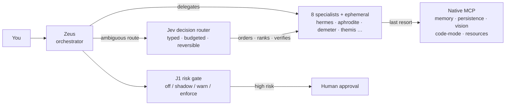
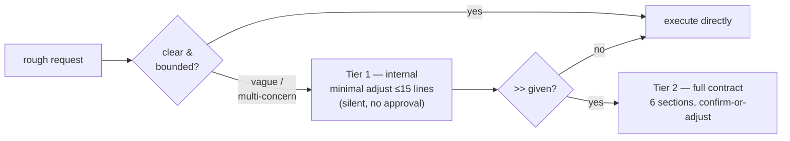

# Overview: how Pantheon routes work

> Originally published in the root README. Setup lives in [Installation](INSTALLATION.md);
> internals in [Architecture](ARCHITECTURE.md).

Pantheon is a companion for [OpenCode](https://opencode.ai/) that helps you move
from an idea to a reviewed, verified change. Eight canonical agents (plus
`spawn_ephemeral` slice archetypes) share one streamlined workflow: plan,
implement, check, review, and record what mattered.
You stay in charge of every decision and every merge.

**The escalation ladder every agent follows**: session context first → free local
selector → one typed Jev decision when genuinely ambiguous → native MCP call only as
the last resort for state the session cannot reconstruct.

**Skill discovery runs a trust cascade** — canonical first, popularity never
compensates for provenance:

---

## Why use it

- **Fast-Track execution:** Bounded micro-edits (<= 2 files, <= 50 lines) bypass all heavy ceremony and verify in < 10 seconds.
- **Mandatory test slicing:** Sub-second targeted test execution instead of running sluggish repository-wide test suites during dev loops.
- **Execution proof receipts:** Cryptographic SHA-256 fingerprinting on modified files and test slice exit codes prevents false-positive task reports.
- **KV-cache prefix optimization:** Strict invariant-first prompt layering maximizes LLM cache hits (up to 90% cost and latency savings).
- **Reactive event bus & zero polling:** Process-wide in-memory event bus delivers instant updates across jobs and agents without disk polling.
- **Themis local reflex loops:** Specialist self-healing resolves isolated lint and test slice discrepancies before escalating to Zeus.
- **Assertive council (`/pantheon`):** Parallel specialist consultations resolved decisively via domain authority and JEV multi-criteria decisions without endless debate turns.
- **You stay in charge:** Pantheon supports your judgment; it never silently alters permissions or runs unapproved destructive actions.
- **Non-destructive upgrades:** Updating Pantheon (`pantheon-opencode update`) refreshes skills, MCPs, and instructions while strictly preserving all user models, presets, permissions, and custom configs.

---

## Next

- [Execution modes](guides/execution-modes.md) — Fast-Track, Council and Deepwork in detail
- [Settings & TUI window](SETTINGS.md) — gates, presets, updates, personalization
- [Agent Capability Matrix](AGENT-CAPABILITY-MATRIX.md) — what each of the 14 agents can and cannot do
