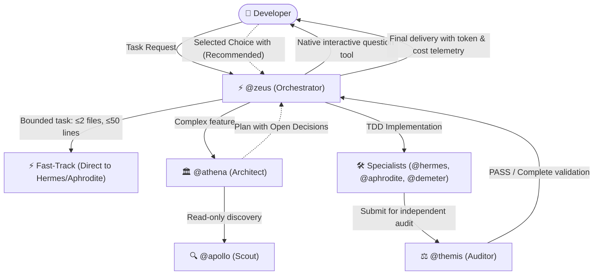

# Quick Start

> 🇧🇷 **Versão em Português disponível:** [Leia em Português](pt-BR/QUICKSTART.md)

This guide takes you from zero to your first working result with **Pantheon** in less than ten minutes.

---

## Before You Start (Prerequisites)

Ensure your environment satisfies the following requirements:

1. **OpenCode:** Version 2.x installed (native OpenCode 2.x host support).
2. **Node.js:** Version `>=26.4.0` (required for Pantheon's tooling and TUI).
3. **Python (Optional / Legacy):** Version `3.11+` only if you opt into legacy Python MCP servers (all 26 core Pantheon tools run natively in TypeScript/Node).

---

## 1. Installation

### Native OpenCode Plugin Install (Only Supported Flow in v2.2.2+)

One command registers the 14 agents, 26 skills, 9 slash commands, 31 native TypeScript tools, and TUI in-process with zero copied files on disk (and automatically cleans legacy Python MCPs and old TUI/CLI copies):

```bash
opencode plugin add pantheon-opencode
```

Why this is the cleanest approach:
- Works in **any directory** immediately (existing repos, git worktrees, or new folders) with no `init` step or `npx` cache clutter.
- Updates cleanly via `opencode plugin update pantheon-opencode` (or `/pantheon-updates`) without leaving stale copied `.opencode/agents/` or `plugins/pantheon-tui/` files behind.

---

## 2. Validate Health & Clean Stale Caches

Inside OpenCode, run `/pantheon-settings` (or `/pantheon-updates`) to inspect **Doctor** health checks and **Legacy & Drift Cleanup** (which scans/removes stale caches, legacy Python MCPs, and obsolete `.pantheon/` stores on demand).

From a repo checkout during local development, you can also run `npm run doctor`.

---

## 3. Launch OpenCode

Start OpenCode in your terminal or launch the desktop application:

```bash
opencode
```

> **Tip for Background Subagents:** If your OpenCode runtime documents support for background subagents, you can enable experimental background delegation:
> ```bash
> OPENCODE_EXPERIMENTAL_BACKGROUND_SUBAGENTS=true opencode
> ```

### What you will see:
- **Rich Sidebar (TUI):** Displays the active Pantheon version (`v2.2.0`), active model preset, Git repository state, **Context** with native-tool domain counters (`mem`, `ctx`, `code`, `edit`, `shell`), **Todo**, and **Dispatch** with live child activity verbs and `?`/`!` attention badges.
- **Interactive Update & What's New Dialogs:** Upgrading opens a dismissable **What's New** dialog (`/pantheon-whats-new` to reopen anytime), and clickable `↑ vX.Y.Z` badges jump straight to `/pantheon-updates`.
- **Native Multimodal Vision (Pantheon Vision):** Paste a screenshot (`Ctrl+V` / `Cmd+V`) or call `vision_describe` when exposed by the host model catalog.

---

## 4. Dispatching Tasks in Chat

Pantheon gives you multiple distinct interaction patterns depending on the scope of your work:

### A. General Feature Development via `@zeus`
For new features, enhancements, and structured workflows:
```text
@zeus Implement an authentication middleware with JWT verification, rate limiting, and unit tests.
```
**How Zeus coordinates:**
- **Fast-Track Bypass:** Bounded tasks (≤2 files, ≤50 lines) bypass planning and go straight to `@hermes` or `@aphrodite`.
- **Architectural Planning:** Complex multi-part tasks are routed to `@athena` for phased blueprinting.
- **Interactive Question Gate:** Any open design decisions (`decisions_needed`) trigger OpenCode's native interactive `question` tool with marked `(Recommended)` defaults.
- **TDD Implementation:** After approval, Zeus dispatches `@hermes` in TDD mode (RED -> GREEN -> REFACTOR) and `@themis` for read-only compliance audit.

### B. Heavy Multi-Phase Projects via `/pantheon-deepwork`
For 10+ turns, multi-session tasks, or complex refactorings requiring persistent checkpoints:
```text
/pantheon-deepwork Migrate the data access layer from Prisma to Kysely with zero-downtime migration scripts.
```
- Persists progress to `.pantheon/deepwork/<task-slug>/` (with `plan.json`, `PLAN.md`, append-only checkpoints).
- Spawns parallel specialists in dedicated Git worktrees (`.pantheon-worktrees/`).
- Enforces `@themis` audit gates at each phase boundary before merging.

### C. Architectural Council Arbitration via `/pantheon`
For high-impact architectural trade-offs, technology evaluations, or security arbitrations:
```text
/pantheon Should we use Server-Sent Events (SSE) or WebSockets for the live notifications feed?
```
- Dispatches 2-3 specialists (e.g. `@athena`, `@hermes`, `@themis`) in parallel in a single turn.
- Resolves divergences using domain authority precedence (Themis for Security, Demeter for DB, Hermes for API, Athena for Modularity).
- Returns a single, assertive synthesis with clear recommendations.

### D. Direct Specialist Invocations with `@`
- **`@talos` (Fast Lane / Single-Turn Hotfixer):** For quick surgical edits, bug fixes, and typos without planning ceremony:
  ```text
  @talos Fix the import path error in src/server.ts and update the port binding.
  ```
- **`@apollo` (Read-Only Codebase Scout):** For deep codebase exploration, tracing references, and finding code locations without edit risk:
  ```text
  @apollo Find where incoming WebSocket connections are authenticated and summarize the flow with line numbers.
  ```
- **`@hermes` (Backend Specialist):** Direct backend implementation in TDD (RED -> GREEN -> REFACTOR).
- **`@aphrodite` (Frontend Specialist):** UI components, Tailwind CSS styling, and WCAG accessibility.
- **`@themis` (Independent Auditor):** Manual quality, security, and test verification gate.

---

## 5. Execution Architecture (The Pantheon Lifecycle)

The following diagram illustrates how Zeus, Athena, implementation specialists, and Themis collaborate during a planned task:



1. **Intelligent Routing:** `@zeus` evaluates scope and complexity. Bounded changes go straight to a specialist; complex tasks receive architectural planning.
2. **Planning with `@athena`:** The plan is scaffolded in structured Deepwork format (`.pantheon/deepwork/<slug>/plan.json` and `PLAN.md`).
3. **Interactive Decision Gate:** Design trade-offs (`decisions_needed`) are **never** dumped as static text bullets in chat. `@zeus` invokes OpenCode's native `question` tool with structured choices and marked `(Recommended)` defaults.
4. **TDD Implementation:** Specialists write tests first (RED) and implement code until tests pass (GREEN).
5. **Rigorous Audit with `@themis`:** No code is completed without independent, read-only compliance verification (linters, regression tests, and security checks).
6. **Real-Time Telemetry:** The TUI sidebar and status commands track subagent activity, active model presets, and token usage in real time.

---

## Next Steps

Now that your first dispatch is complete, explore advanced guides:

- **[Agent Capability Matrix](AGENT-CAPABILITY-MATRIX.md):** Detailed guide to what each agent can and cannot do, permissions, and tool grants.
- **[First Project Guide (End-to-End)](guides/first-project.md):** Complete practical tutorial building a production full-stack application.
- **[Deepwork Blueprint](guides/deepwork.md):** Understand canonical JSON plans, append-only logs, and Mermaid DAG visualization.
- **[Pantheon Vision](guides/vision.md):** Inspect screenshots and debug visual interfaces without prompt clutter.
- **[Cookbook](guides/cookbook.md):** Practical everyday recipes ready to copy and paste for common coding workflows.
- **[Installation Guide](INSTALLATION.md):** Advanced CLI flags, backups, `restore`, and uninstallation procedures.
