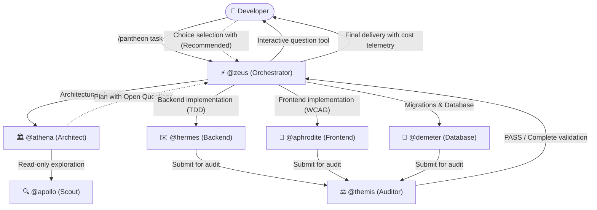

# Quick Start

> 🇧🇷 **Versão em Português disponível:** [Leia em Português](pt-BR/QUICKSTART.md)

This guide takes you from zero to your first working result with **Pantheon** in less than ten minutes.

---

## Before You Start (Prerequisites)

Ensure your environment satisfies the following requirements:

1. **OpenCode:** Version 2.x installed (native OpenCode 2.x host support).
2. **Node.js:** Version `>=26.4.0` (required for Pantheon's CLI, packager, and TUI interface).
3. **Python (Optional):** Version `3.11+` (only needed if using Python-based MCP servers).

---

## 1. Installation

You can install Pantheon in two ways, depending on your preferred workflow:

### Option A — Full Installation via CLI (Recommended)

Installs all 14 specialized agents, 25 skills, context instructions (TDD, YAGNI), slash commands, and the modern TUI:

```bash
# Global Installation (recommended — available across all your repositories)
npx pantheon-opencode init

# Or Project-Scoped Installation (restricted to the current directory)
npx pantheon-opencode init --project
```

> **Automation / CI Tip:** Run `npx pantheon-opencode init -y` to apply default settings non-interactively without prompting.

### Option B — Host-Native Plugin Installation via OpenCode

If you prefer to load only the plugin using OpenCode 2.x's built-in plugin manager:

```bash
opencode plugin add pantheon-opencode
```

---

## 2. Validate Installation with `doctor`

Before starting work, run Pantheon's health diagnostic:

```bash
npx pantheon-opencode doctor
```

The `doctor` command verifies:
- Connection and registration of all **5 native MCP servers** (`resources`, `memory_store`, `memory_search`, `persistence`, `vision` / `cost`).
- Proper plugin registration in `opencode.json`.
- Synchronization of agents, skills, and instruction files.

A healthy installation outputs a **PASS** verdict with zero errors and zero warnings.

---

## 3. Launch OpenCode

Start OpenCode in your terminal or launch the desktop application:

```bash
opencode
```

### What you will see:
- **Rich Sidebar (TUI):** Displays the active Pantheon version (v2.1.1), the active model preset, Git repository state, and a live **Context** block with token counts, estimated cost, and cache speed.
- **Native Multimodal Vision (Pantheon Vision):** If you capture a screenshot and paste it directly into chat (`Ctrl+V` / `Cmd+V`), Pantheon analyzes the image silently via system context without cluttering the chat with comments or HTML markup.

---

## 4. Dispatching Your First Task in Chat

With OpenCode open, you have three canonical ways to interact with the Pantheon ecosystem:

### 1. Full Orchestration via `/pantheon`
Best for implementing new features, major refactorings, or tasks spanning multiple files:

```text
/pantheon Add a GET /metrics endpoint with TDD unit tests and asynchronous CSV streaming export.
```

### 2. Architectural Planning via `/pantheon-deepwork`
Best for complex features requiring an auditable plan and a dependency DAG:

```text
/pantheon-deepwork Refactor the authentication layer to stateless JWT tokens with key rotation.
```

### 3. Calling Specialist Agents Directly with `@`
- **`@zeus` (Central Orchestrator):** Analyzes intent, delegates to specialists, and audits the delivery.
  ```text
  @zeus Analyze API route resilience and suggest structured error-handling improvements.
  ```
- **`@talos` (Fast Lane / 1-Turn Hotfixer):** For quick bug fixes, typos, and surgical edits without planning ceremony.
  ```text
  @talos Fix the import path error in src/server.ts and update the function invocation.
  ```
- **`@apollo` (Read-Only Investigator):** For codebase exploration and architecture discovery without edit risk.
  ```text
  @apollo Find where incoming WebSocket connections are authenticated and summarize the flow with line numbers.
  ```

---

## 5. How Execution Works (The Pantheon Lifecycle)

During task execution, Pantheon enforces strict separation of responsibilities:



1. **Intelligent Routing:** `@zeus` evaluates scope and complexity. Bounded changes go straight to a specialist; complex tasks receive architectural planning.
2. **Planning with `@athena`:** The plan is scaffolded in structured Deepwork format (`.pantheon/deepwork/<slug>/plan.json` and `PLAN.md`).
3. **Interactive Decision Gate:** Design trade-offs (`decisions_needed`) are **never** dumped as static text bullets in chat. `@zeus` invokes OpenCode's native `question` tool with structured choices and marked `(Recommended)` defaults.
4. **TDD Implementation:** Specialists write tests first (RED) and implement code until tests pass (GREEN).
5. **Rigorous Audit with `@themis`:** No code is completed without independent, read-only compliance verification (linters, regression tests, and security checks).
6. **Live Tracking with `/dispatch`:** Type `/dispatch` in chat to open the visual delegation tree and monitor subagent progress in real time.

---

## Next Steps

Now that your first dispatch is complete, explore advanced guides:

- **[Agent Capability Matrix](AGENT-CAPABILITY-MATRIX.md):** Detailed guide to what each agent can and cannot do, permissions, and tool grants.
- **[First Project Guide (End-to-End)](guides/first-project.md):** Complete practical tutorial building a production full-stack application.
- **[Deepwork Blueprint](guides/deepwork.md):** Understand canonical JSON plans, append-only logs, and Mermaid DAG visualization.
- **[Pantheon Vision](guides/vision.md):** Inspect screenshots and debug visual interfaces without prompt clutter.
- **[Cookbook](guides/cookbook.md):** 8 everyday recipes ready to copy and paste for common coding workflows.
- **[Installation Guide](INSTALLATION.md):** Advanced CLI flags, backups, `restore`, and uninstallation procedures.
