# Settings, Command Palette & TUI Surfaces (`/pantheon-settings`)

> 🇧🇷 **Versão em Português disponível:** [Leia em Português](pt-BR/SETTINGS.md)
> Design background: [Pantheon 2.0 — Modern Install, Settings UI, and Update Flow](design/2.0-settings-and-install.md).

Pantheon exposes an interactive, non-destructive TUI inside OpenCode 2.x across
the **Home screen**, **Composer autocomplete**, **Session Sidebar**, **`/dispatch`
panel**, **`/pantheon-settings`**, **`/pantheon-artifacts`**, and **`What's New`**.

---

## 1. Entry Points & Command Palette

- **Home screen:** displays the active `Pantheon v2.2.0` status badge and opens
  `/pantheon-settings` directly in a centered large floating dialog.

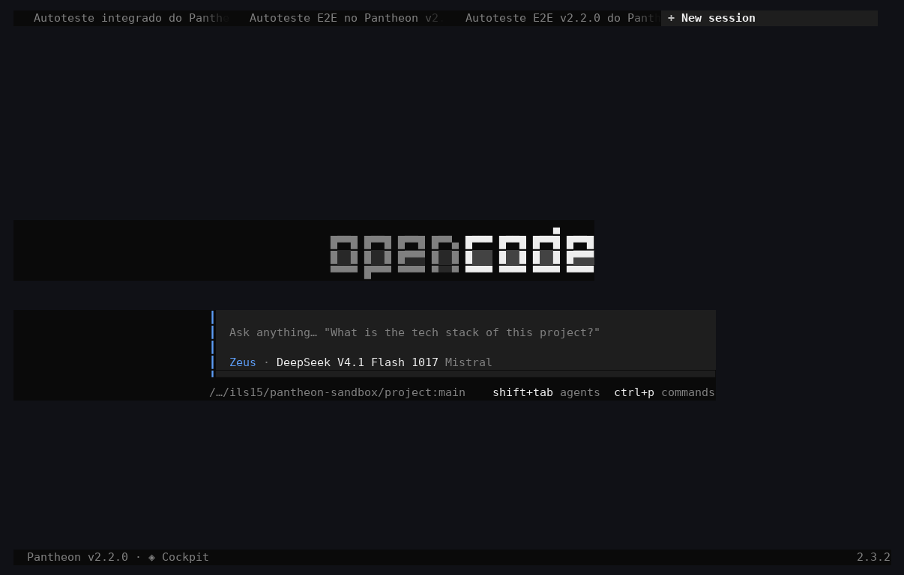

- **Slash commands (`/pantheon*`) & `Ctrl+P`:** typing `/pantheon` shows the
  native command popup; clicking the `↑ vX.Y.Z` update badge in the Home footer
  or Sidebar header also opens **Updates** directly.

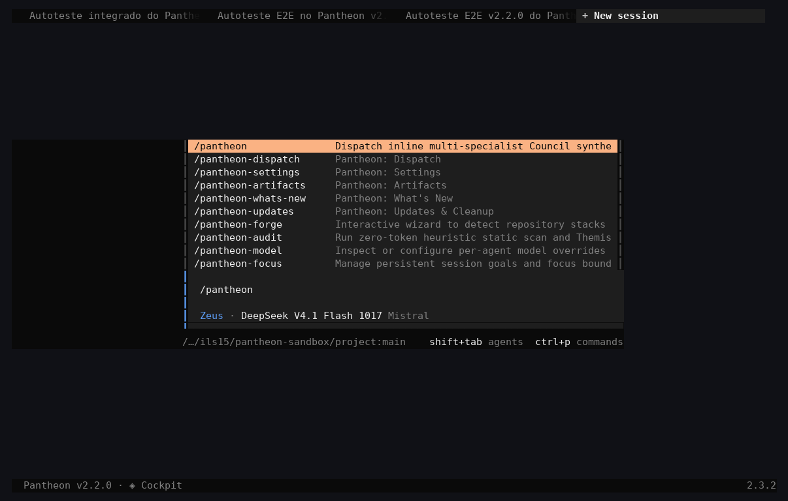

| Command | Alias / Palette | What it opens |
|---|---|---|
| `/pantheon-settings` | `Pantheon: Settings` | 10-tab interactive settings window (`docked` / `dialog` / `fullscreen`) |
| `/pantheon-cockpit` | `/cockpit` · `Pantheon: Mission Control Cockpit` | 3-page Mission Control Cockpit (`Overview`, `Swarm`, `Flightdeck`) |
| `/pantheon-updates` | `Pantheon: Updates & Cleanup` | Jumps directly to the **Updates & Legacy Cleanup** tab |
| `/pantheon-whats-new` | `/whats-new` · `Pantheon: What's New` | Reopens the paginated release highlights card dialog |
| `/pantheon-artifacts` | `/artifacts` · `Pantheon: Artifacts` | Lists and paginates `PLAN`, `REPORT`, and `ADR` files |
| `/pantheon-dispatch` | `/dispatch` · `Pantheon: Dispatch` | Full-width delegation & subagent telemetry panel |

All interactive dialogs support both **keyboard navigation** (`Tab`, `↑`/`↓`,
`←`/`→`, `Enter`, `Ctrl+S`, `Ctrl+R`, `Esc`) and **mouse clicks** (tabs, rows,
value cyclers, action buttons, and sidebar badges).

---

## 2. Tabs Inside `/pantheon-settings`

### `Gates` — Scoped Behavior & Guardrails
Toggle edit scope (`global` vs `project`), installed governance skills
(`Auto-continue`, `TDD with agents`, `Code review checklist`, `Prompt refinery`),
and execution gates (`Idle todo enforcer`, `Context pruner`, `J1 risk gate`),
persisting atomically to `pantheon-overrides.json`.

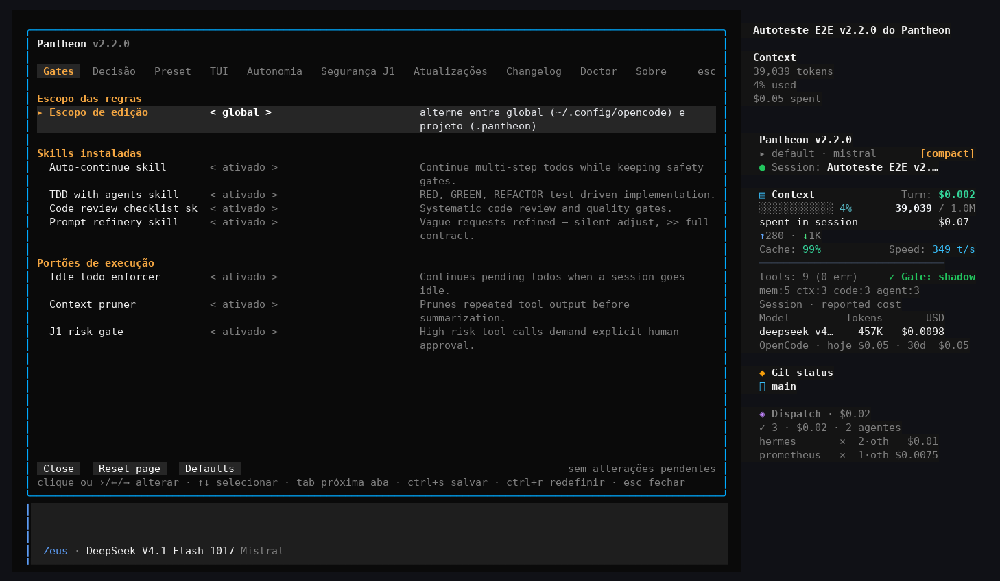

### `Decisão` / `Decision` — Jev Arbitrage & Routing Credentials
Enable or switch the advisory decision mode (`local`, `auto`, `explicit`), cycle
across configured decision models, inspect cloud access gating, and audit
read-only credential status without ever persisting secrets.

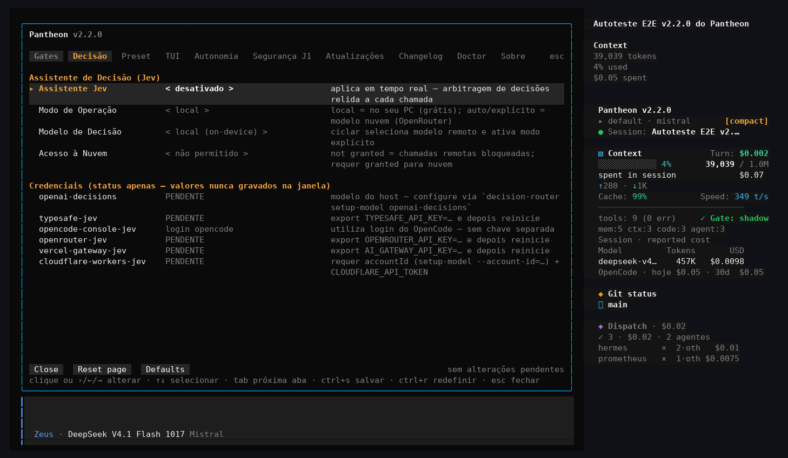

### `Preset` — Global Tier & Vision Model
Switch the active global model tier (`none`, `free`, `eco`, `standard`, `teampro`,
`max`, etc.) and configure the default `vision_describe` model (`opencode-vision.json`).

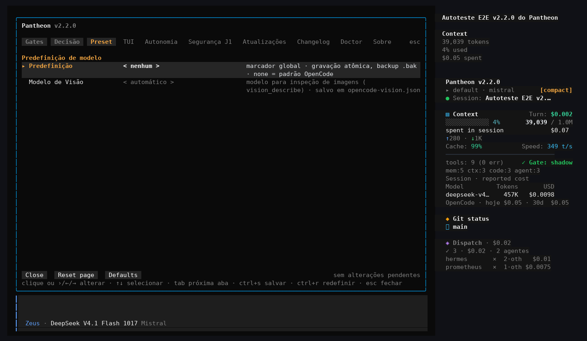

### `TUI` — Bilingual UI, Theme, Gauges & Layout
Switch language (`auto` / `pt-BR` / `en`), layout density (`comfortable` vs
`compact`), surface mode (`docked` / `fullscreen` / `dialog`), status separators,
gauge style (`line`, `block`, `smooth`, `ascii`, `dots`, `braille`), and sidebar rows.

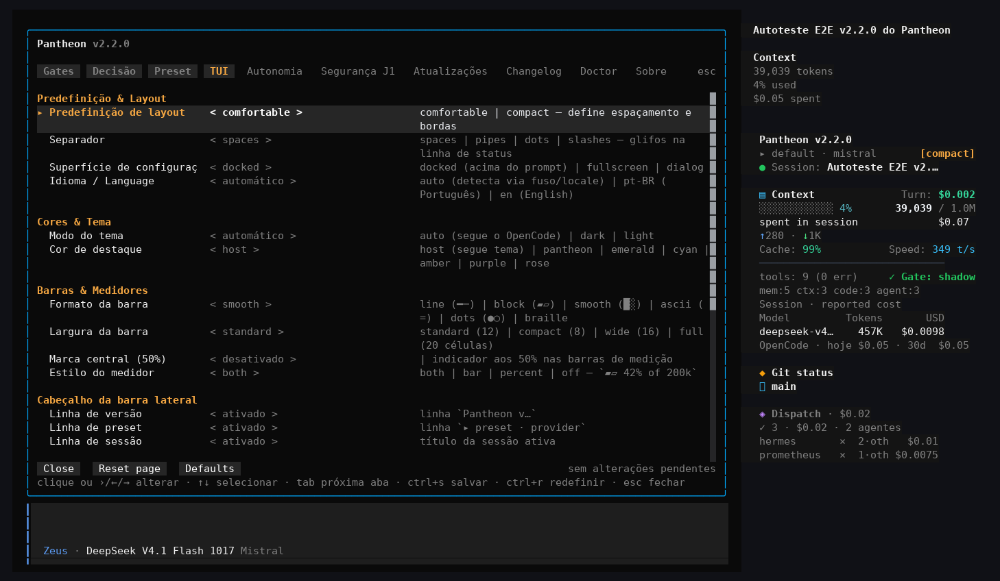

### `Autonomia` / `Autonomy` — Continuation Loop & Decision Budgets
Configure multi-turn continuation limits (`maxContinuations`, cooldown) and Jev
monthly / per-decision USD caps alongside the read-only decision gradient reference.

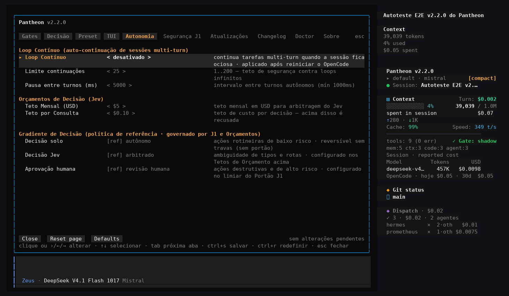

### `Segurança J1`, `Atualizações` & `Changelog`
- **Segurança J1:** configure risk gate thresholds (`shadow`, `enforce`, or scoped overrides).
- **Atualizações (`Updates`):** check the active npm dist-tag (`latest` / `beta`),
  trigger updates, and run **Legacy & Drift Cleanup** to prune obsolete V1 artifacts
  and stale coexisting OpenCode npm caches (`~/.cache/opencode/npm/pantheon-opencode*`).

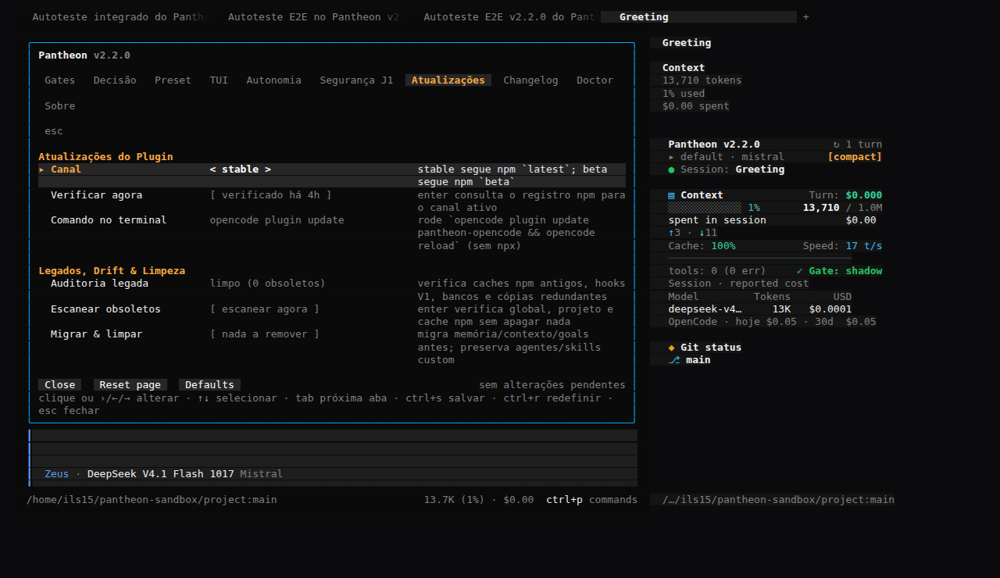

- **Changelog:** browse recent release notes right inside the settings window.

### `Doctor` & `Sobre` / `About`
- **Doctor:** inline file-derived health check (install state version, Node.js
  runtime floor, overrides validity, and decision config presence) complementing
  `npx pantheon-opencode doctor`.

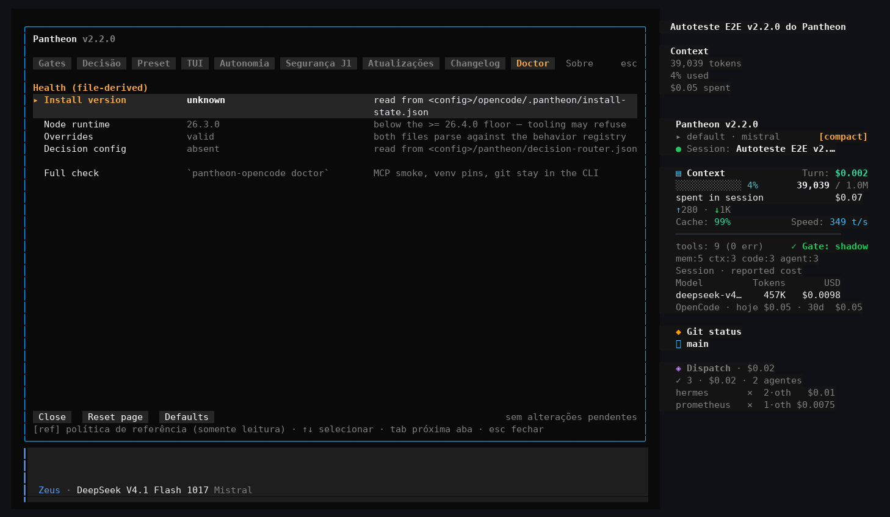

- **Sobre / About:** live summary of runtime, active preset/Jev/J1 state, and
  the grouped inventory of all **29 Native TypeScript Tools**.

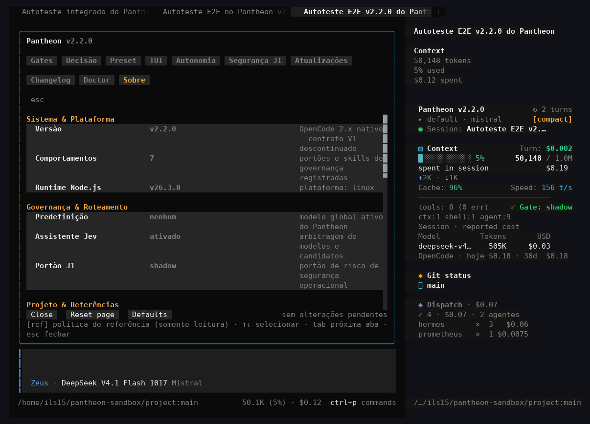

---

## 3. Related Interactive Dialogs & Panels

- **TUI Mission Control Cockpit (`/pantheon-cockpit`):** unified 3-page operational
  cockpit (`Overview`, `Swarm` Gantt & activity stream, `Flightdeck` Gate Matrix),
  navigable via `1–3` or `Tab` and from the Home `◈ Cockpit` badge.

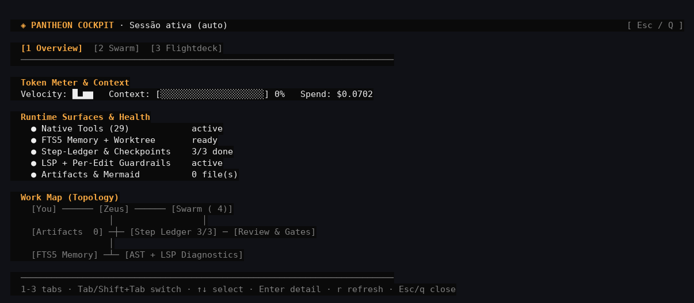

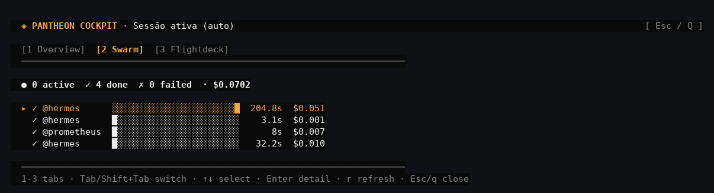

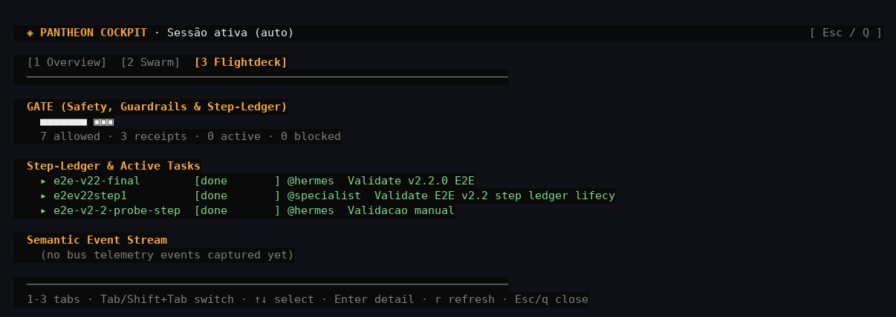

- **What's New (`What's-New`):** rounded card layout with pagination (`‹ Anterior`
  / `Próxima ›`) and dedicated close button (`OK, Entendido` / `OK, Got it`). See
  [The What's-new TUI window](reference/whats-new.md).

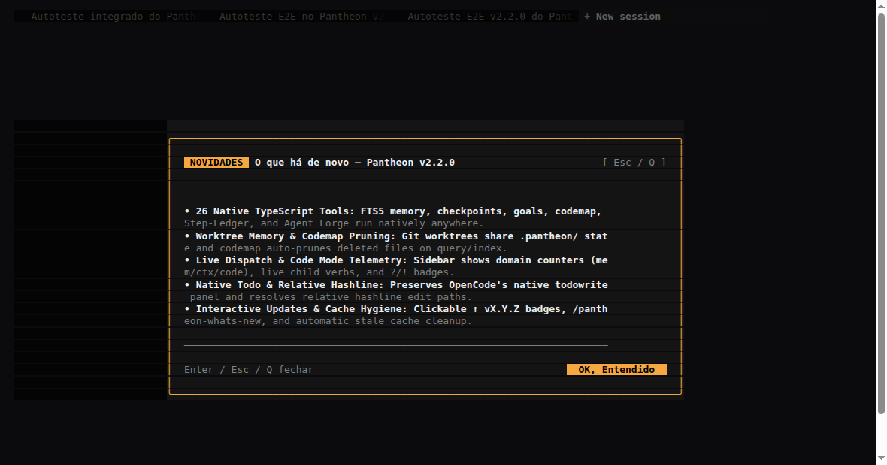

- **Built-in Artifacts Viewer (`/pantheon-artifacts`):** inspect Deepwork `PLAN.md`,
  reports, and ADRs in the terminal without leaving your session — see
  [Artifacts & `/pantheon-artifacts`](ARTIFACTS.md).
- **Live Sidebar & `/dispatch` Panel:** track token/cache telemetry and subagent
  costs in real time — see [OpenCode 2.x](opencode.md#dispatch-sidebar-block).
