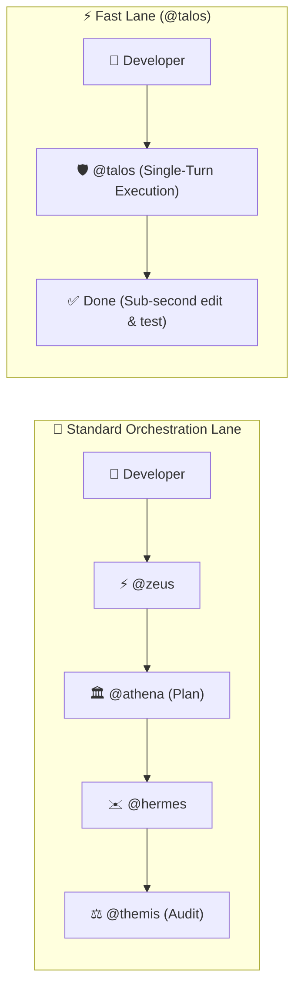

# Tutorial: Fast-Path CLI Utility with @talos

> 🇧🇷 **Versão em Português disponível:** [Leia em Português](../pt-BR/guides/cli-tool.md)

In this practical hands-on tutorial, you will learn how to use Pantheon's **Fast Lane** (`@talos`) to build a standalone, zero-dependency command-line utility with automated unit testing.

---

## Why Use the Fast Lane?

While complex features with database schemas and frontend interfaces benefit from `@zeus` and `@athena`'s multi-phase Deepwork planning, everyday command-line tools, scripts, and bug fixes require **speed and minimal ceremony**.



`@talos` is Pantheon's specialized rapid responder:
- **No subagent overhead:** Operates directly in the primary session.
- **Single-turn execution:** Formulates code and runs tests immediately.
- **Fail-safe edits:** Enforces strict syntax and test verification.

---

## 1. Project Goal: Repository Health Checker

We will build a CLI utility named `repo-health` that analyzes any Git repository and outputs a score from 0 to 100 based on:
1. **Git status:** Clean working tree vs modified/untracked files.
2. **Package manifest:** Presence of `package.json`, valid JSON syntax, and `test` script.
3. **Documentation:** Presence of `README.md`.

---

## 2. Dispatching the Request to @talos

Start OpenCode and send this prompt:

```text
@talos Create a zero-dependency CLI tool in Node.js at bin/repo-health.mjs that inspects the repository health:
1. Checks for uncommitted git changes.
2. Validates package.json syntax and checks for a "test" script.
3. Checks for README.md.
4. Outputs human-readable formatting by default and formatted JSON with --json flag.
5. Create comprehensive unit tests in tests/cli.test.mjs using node:test and node:assert.
```

---

## 3. Implementation Walkthrough

`@talos` immediately writes the test suite and the implementation file.

### Step 3.1: Unit Test Suite (`tests/cli.test.mjs`)

Using Node.js native test runner (`node:test`):

```javascript
import { describe, it } from 'node:test'
import assert from 'node:assert/strict'
import { checkRepoHealth } from '../bin/repo-health.mjs'

describe('checkRepoHealth', () => {
  it('returns a diagnostic result object with score and status', () => {
    const result = checkRepoHealth(process.cwd())

    assert.ok(typeof result.score === 'number', 'score should be a number')
    assert.ok(result.score >= 0 && result.score <= 100, 'score should be between 0 and 100')
    assert.ok(['EXCELENTE', 'REGULAR', 'CRÍTICO'].includes(result.status), 'status should be a valid tier')
    assert.ok(Array.isArray(result.issues), 'issues should be an array')
    assert.ok(typeof result.timestamp === 'string', 'timestamp should be ISO string')
  })

  it('correctly reports issues when package.json is missing in an empty directory', () => {
    const tempDir = process.env.TEMP || '/tmp'
    const result = checkRepoHealth(tempDir)

    assert.ok(result.issues.length > 0, 'should detect missing package.json or git repo')
    assert.ok(result.score < 100, 'score should be penalized')
  })
})
```

### Step 3.2: CLI Implementation (`bin/repo-health.mjs`)

```javascript
#!/usr/bin/env node
import { execSync } from 'node:child_process'
import { existsSync, readFileSync } from 'node:fs'
import { join } from 'node:path'

export function checkRepoHealth(targetDir = process.cwd()) {
  const issues = []
  let score = 100

  // 1. Git status check
  try {
    const gitStatus = execSync('git status --porcelain', {
      cwd: targetDir,
      encoding: 'utf8',
    }).trim()
    if (gitStatus.length > 0) {
      const changedFiles = gitStatus.split('\n').length
      issues.push(`Warning: ${changedFiles} file(s) modified or untracked in Git`)
      score -= Math.min(20, changedFiles * 5)
    }
  } catch {
    issues.push('Alert: Directory is not a valid Git repository')
    score -= 40
  }

  // 2. Package manifest check
  const pkgPath = join(targetDir, 'package.json')
  if (existsSync(pkgPath)) {
    try {
      const pkg = JSON.parse(readFileSync(pkgPath, 'utf8'))
      if (!pkg.scripts?.test) {
        issues.push('Warning: package.json missing "test" script')
        score -= 15
      }
      if (!pkg.description || pkg.description.trim() === '') {
        issues.push('Warning: package.json has no description')
        score -= 5
      }
    } catch {
      issues.push('Error: package.json has invalid JSON syntax')
      score -= 30
    }
  } else {
    issues.push('Warning: package.json not found in root')
    score -= 20
  }

  // 3. Documentation check
  if (!existsSync(join(targetDir, 'README.md'))) {
    issues.push('Warning: README.md not found')
    score -= 15
  }

  const finalScore = Math.max(0, score)
  const status = finalScore >= 80 ? 'EXCELENTE' : finalScore >= 50 ? 'REGULAR' : 'CRÍTICO'

  return {
    score: finalScore,
    status,
    issues,
    timestamp: new Date().toISOString(),
  }
}

if (process.argv[1]?.endsWith('repo-health.mjs')) {
  const result = checkRepoHealth()
  const isJson = process.argv.includes('--json')

  if (isJson) {
    console.log(JSON.stringify(result, null, 2))
  } else {
    console.log('\n🏥 Pantheon Repo Health Diagnostic')
    console.log('──────────────────────────────────────')
    console.log(`Overall Score: ${result.score}/100 [${result.status}]`)
    if (result.issues.length === 0) {
      console.log('✅ No inconsistencies found. Clean repository!')
    } else {
      console.log('\nFindings:')
      for (const issue of result.issues) {
        console.log(`  • ${issue}`)
      }
    }
    console.log('')
  }
}
```

---

## 4. Running the Tests & Tool

### Run the automated tests:
```bash
node --test tests/cli.test.mjs
```
Output:
```text
✔ checkRepoHealth > returns a diagnostic result object with score and status (12ms)
✔ checkRepoHealth > correctly reports issues when package.json is missing in an empty directory (4ms)
ℹ tests 2
ℹ suites 1
ℹ pass 2
ℹ fail 0
```

### Run the CLI:
```bash
node bin/repo-health.mjs
```
Output:
```text
🏥 Pantheon Repo Health Diagnostic
──────────────────────────────────────
Overall Score: 100/100 [EXCELENTE]
✅ No inconsistencies found. Clean repository!
```

Or structured JSON for automation and CI pipelines:
```bash
node bin/repo-health.mjs --json
```

---

## Complete Source Code

The complete runnable source code of this example is located in the Pantheon repository:
- Inspect [`examples/cli-tool/`](https://github.com/ils15/pantheon-opencode/tree/main/examples/cli-tool).
