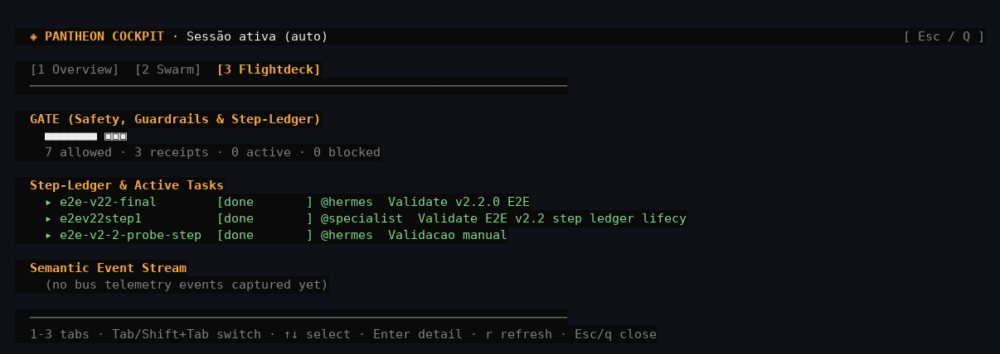

<!-- pantheon:cookbook-version v2.4 -->
# Pantheon Cookbook: Everyday Practical Recipes

> 🇧🇷 **Versão em Português disponível:** [Leia em Português](../pt-BR/guides/cookbook.md)

This practical cookbook gathers copy-paste recipes for everyday development in **Pantheon `v2.4.0` (`OpenCode 2.x` native)** — covering zero-init setup, the **8 canonical agents** (+ `spawn_ephemeral` slice workers), **31 native in-process tools**, **9 server commands**, and **5 interactive TUI surfaces**.

---

## Recipe 0: Zero-Init Setup & Safe Updates (`OpenCode 2.x`)

**Scenario:** Enable Pantheon across any project or git worktree without committing extra framework files to git.

**Command:**
```bash
opencode plugin add pantheon-opencode@2.2.0
# or update later:
opencode plugin update pantheon-opencode
```

**Why this works:**
- All **8 canonical agents**, **9 server commands**, global instructions, and **31 native TypeScript tools** load directly in memory.
- Inside the TUI, run `/pantheon-updates` to check registry updates or clean stale npm plugin caches cleanly.

---

## Recipe 1: Full-Stack Feature with TDD & Quality Gates

**Scenario:** Implement a complete feature (e.g., CSV export endpoint with schema validation and tests).

**Prompt:**
```text
@zeus Add CSV export support to /reports with unit tests and schema validation.
```

**Workflow:**
1. `@zeus` analyzes scope, optionally runs `detect_stack`, and delegates planning to `@athena`.
2. `@athena` defines phases and acceptance criteria; ambiguities use OpenCode's native `question` dialog.
3. `@hermes` executes steps tracked in `pantheon_step_ledger` (including isolated `execute_step` sub-sessions when appropriate) — RED tests first, then GREEN implementation with post-edit LSP diagnostics (`tsc` / `pyright` / stdio / pooled TCP).
4. `@themis` runs linters, security scans, and emits a structured verdict via `pantheon_review_verdict`.

---

## Recipe 2: Express 1-Turn Fix (`@hermes` / `spawn_ephemeral` `hotfix`)

**Scenario:** Fix a CSS styling bug, a typo, or a missing import without planning ceremony.

**Prompt:**
```text
@hermes Update the login submit button background from blue to emerald green in login.css using hashline_edit
```

**Why use `@hermes` or `spawn_ephemeral`?**
Bounded edits go straight to `@hermes` (or `@zeus` via `pantheon_step_ledger(action="spawn_ephemeral", role="hotfix")` for isolated worktree execution) using `hashline_edit` and immediate verification.

---

## Recipe 3: Bugfix TDD with Mechanical `RED` Gate & Auto-Rollback

**Scenario:** Fix a verified production regression without letting agents skip failure reproduction or leave a broken tree behind.

**Prompt:**
```text
@zeus Fix the off-by-one tax rounding bug in src/billing/calc.ts. Enforce a failing reproduction test first before editing production code.
```

**Workflow (`pantheon_step_ledger`):**
1. `@zeus` initializes a `bugfix` step (`init_step`) capturing a non-invasive `GIT_INDEX_FILE` `baselineTree` snapshot without touching `.git/index`.
2. `tool.execute.before` blocks edits (`edit`, `write`, `hashline_edit`, `ast_rewrite`) on production files by `@hermes` while allowing edits to test files.
3. Once a failing test is recorded via `record_reproduction` (`exitCode !== 0`), production edits unlock automatically.
4. If verification fails repeatedly and `ThemisReflexController` escalates, `pantheon_step_ledger` rolls back cleanly to `baselineTree` (`rollback_step` is also available manually).

---

## Recipe 4: Structural AST Search & Refactoring (`ast_search` / `ast_rewrite`)

**Scenario:** Rename or migrate a function call pattern safely across dozens of TypeScript/JavaScript files without matching string literals or comments.

**Prompt:**
```text
@hermes Use ast_search to find all calls to legacyFetch($URL, $$$ARGS) across src/ and preview an ast_rewrite with dryRun=true before applying.
```

**Why use `ast_search` / `ast_rewrite`?**
- Ignores comments and strings automatically, supporting `$VAR` single-node and `$$$ARGS` variadic captures.
- Enforces strict workspace symlink confinement and post-write LSP + diff-scoped lint diagnostics (`[LSP-Diagnostics]`) in the exact same turn.

---

## Recipe 5: Database Migrations & Query Optimization

**Scenario:** Add a new table or column with proper indexing and foreign key constraints without N+1 query pitfalls.

**Prompt:**
```text
@demeter Create an Alembic migration adding the 'user_preferences' table with a foreign key to 'users' and an index on 'created_at'.
```

**Why use @demeter?**
`@demeter` enforces SQLAlchemy, Prisma, Alembic, and PostgreSQL best practices, referential integrity, and index coverage.

---

## Recipe 6: Visual Refactoring & Multimodal Diagnostics (`/pantheon-vision`)

**Scenario:** Rebuild or inspect UI components from a screenshot or verify multimodal vision status.

**Prompt:**
*(Paste screenshot with Ctrl+V / Cmd+V into chat, or run `/pantheon-vision` to check vision configuration)*
```text
@aphrodite Refactor this metrics card component to match the spacing, typography, and contrast in the pasted screenshot.
```

**Workflow:**
1. `/pantheon-vision` shows configured multimodal vision providers and gateway status.
2. Pantheon Vision extracts structured visual tokens once via `vision_describe` / `session.context`, avoiding repeated image bytes in prompts.
3. `@aphrodite` updates the UI components with WCAG AA contrast compliance.

---

## Recipe 7: Safe Read-Only Exploration (`@apollo`)

**Scenario:** Trace authentication, data flows, or symbol callers across files with zero risk of edits.

**Prompt:**
```text
@apollo Map where incoming WebSocket tokens are validated using code_index, code_query, and code_neighbors.
```

**Why use @apollo?**
`@apollo` is strictly read-only (`edit: deny`, `bash: deny`, `ast_rewrite: deny`). Combining `code_index`, `code_query`, and `code_neighbors` avoids broad recursive globs and auto-prunes deleted files.

---

## Recipe 8: Security Audit & Typed Verdict Remediation (`/pantheon-audit` + `@themis`)

**Scenario:** Audit branch changes before merging and auto-trigger fixes on blocker findings.

**Prompts:**
```text
/pantheon-audit
```
or directly:
```text
@themis Audit changes on this branch against OWASP Top 10, verify tests/lint, and record the final pantheon_review_verdict.
```

**Workflow:**
- `/pantheon-audit` runs zero-token static heuristics followed by `@themis`'s 3-layer review.
- `@themis` calls `pantheon_review_verdict` with structured verdicts: `APPROVE`, `APPROVE_WITH_NOTES`, or `BLOCK`.
- When `BLOCK` is emitted, Pantheon automatically dispatches up to 2 remediation turns into the parent orchestration session with actionable findings.

---

## Recipe 9: Ephemeral Archetypes (`ai-pipeline`, `infra-ci`, `observability`)

**Scenarios:** Build vector RAG retrieval pipelines or multi-stage container builds & GitHub Actions workflows via isolated `spawn_ephemeral` workers.

**Prompts:**
```text
@zeus Run spawn_ephemeral(role="ai-pipeline") to implement a vector search pipeline using embeddings and pgvector with batched ingestion.
```
```text
@zeus Run spawn_ephemeral(role="infra-ci") to create a multi-stage Dockerfile for this service and a GitHub Actions PR workflow.
```

---

## Recipe 10: Council Arbitration & Strategic Deepwork (`/pantheon`, `/pantheon-deepwork`, `pantheon_worktree`)

**Scenarios:** Arbitrate high-stakes design trade-offs or execute multi-phase refactors safely in isolated git worktrees.

**Council prompt:**
```text
/pantheon Should we use Server-Sent Events (SSE) or WebSockets for live status updates in our dashboard?
```

**Deepwork + Worktree prompt:**
```text
/pantheon-deepwork Migrate session authentication to rotating refresh tokens using pantheon_worktree isolation and Deepwork checkpoints.
```

**How it runs:**
- Parallel tasks isolate cleanly inside `<project-parent>/.pantheon-worktrees/<repo>/<task>` via `pantheon_worktree` and `ctx.worktree.transform`.
- Linked git worktrees automatically share the primary repository's `.pantheon/` knowledge store (`PANTHEON_ISOLATE_WORKTREE_MEMORY=1` opts out).
- Plan artifacts save to `.pantheon/deepwork/<slug>/PLAN.md` and remain clickable directly from the Home/Sidebar links.

---

## Recipe 11: Persistent Memory, Focus & Cross-Repo Federation (`/pantheon-focus`, `/pantheon-consolidate`)

**Scenario:** Keep goals sharp across compactions and search architectural decisions stored in peer repositories.

**Commands & Tools:**
- **`/pantheon-focus`** — inspect or update durable session goals (`goal_create`, `goal_get`, `goal_update`, `goal_done`).
- **`/pantheon-consolidate`** — compact, deduplicate, and merge local `node:sqlite` FTS5 memory entries.
- **`memory_search` with federation** — set `PANTHEON_FEDERATED_REPOS` or `~/.pantheon/federation.json` so `memory_search(federated=true)` queries peer `.pantheon/memory/memory.db` stores strictly read-only.

---

## Recipe 12: Custom Stack Specialists, Model Overrides & Pruning (`/pantheon-forge`, `/pantheon-model`, `/pantheon-optimize`)

**Scenario:** Tailor project agents to your exact stack (`Node`, `Python`, `Rust`, `Go`), tune per-agent models, or prune stale artifacts.

**Commands:**
- **`/pantheon-forge`** — runs `detect_stack` (`package.json`, `pyproject.toml`, `requirements.txt`, `Cargo.toml`, `go.mod`) and scaffolds specialized agents into `.opencode/agents/` via `pantheon_agent_forge`.
- **`/pantheon-model`** — inspect or configure per-agent model overrides cleanly in `active-preset.json`.
- **`/pantheon-optimize`** — analyze and prune stale Deepwork artifacts, leftover worktrees, and context overhead.

---

## Recipe 13: Real-Time Terminal Mission Control (`/pantheon-cockpit`, `/pantheon-artifacts`, `/pantheon-whats-new`)

**Scenario:** Monitor active subagents, gates, Step-Ledger state, Mermaid plans, and release updates without leaving OpenCode.



- **`/pantheon-cockpit`** (or `/cockpit`) — opens the 3-tab Mission Control dashboard:
  - `1 Overview`: token velocity, context meter, runtime health (`Native Tools (31)`), and topology map.
  - `2 Swarm`: subagent concurrency Gantt timeline, per-agent cost breakdown, **Goal -> Threads -> Workstreams** grouping from `pantheon_board` (`#seq` refs and ephemeral worker badges), and the ranked **Attention Queue** (`decision > failure > review > stuck > quota`).
  - `3 Flightdeck`: `GATE` safety/guardrail matrix, `Step-Ledger` states (`spawn_ephemeral` + `pantheon_board` watchdog alerts), live cross-process event stream, and **`x` Export Replay Trace** to `.pantheon/reports/`.
- **`/pantheon-artifacts`** (or `/artifacts`) — browse project plans/reports and inspect `flowchart`, `sequenceDiagram`, and `stateDiagram` Mermaid diagrams rendered natively as Unicode terminal boxes.
- **`/pantheon-whats-new`** — review curated release highlights cleanly inside OpenCode.

---

## Recipe 14: Configuration, Legacy Cache Cleanup & Health Checks (`/pantheon-settings`, `/pantheon-updates`, `doctor`)

**Scenario:** Inspect active gates/autonomy presets, purge outdated plugin caches, or diagnose host integration issues.

- **`/pantheon-settings`** — opens the interactive 10-tab configuration panel (`Gates`, `Decision`, `Preset`, `TUI`, `Autonomy`, `J1 Safety`, `Updates`, `Changelog`, `Doctor`, `About`).
- **`/pantheon-updates`** — opens directly on **Updates & Cleanup**, checking npm for newer Pantheon releases and removing stale coexisting `~/.cache/opencode/npm/pantheon-opencode*` caches.
- **CLI diagnostics:**
  ```bash
  npx pantheon-opencode doctor
  ```

---

## Recipe 15: Headless Read-Only HTTP Cockpit (`PANTHEON_COCKPIT=1`)

**Scenario:** Watch a headless VPS run from a browser or a `curl` loop without granting anything write access.

**Command:**
```bash
PANTHEON_COCKPIT=1 PANTHEON_COCKPIT_PORT=4747 opencode
curl -s http://127.0.0.1:4747/ | head -c 400
```

**Why this works:**
- Opt-in only: `PANTHEON_COCKPIT=1` is the single enable switch — unset or any other value leaves the surface off.
- Loopback-only, `GET`/`HEAD`-only, and no CORS headers ever. A non-loopback `PANTHEON_COCKPIT_HOST` (including `0.0.0.0`) is a fatal startup error instead of a silent bind.
- Payloads are redacted by default: agent-authored free text is omitted and only its length is exposed. Add `?full=1` for the verbatim text.
- Set `PANTHEON_COCKPIT_TOKEN` to require the `x-pantheon-cockpit-token` header on every request; reach the port through an SSH tunnel rather than rebinding it.

---

## Quick Reference: All Commands

| Surface | Commands |
|---|---|
| **Server Commands** | `/pantheon`, `/pantheon-deepwork`, `/pantheon-audit`, `/pantheon-consolidate`, `/pantheon-focus`, `/pantheon-forge`, `/pantheon-model`, `/pantheon-optimize`, `/pantheon-vision` |
| **TUI Commands** | `/pantheon-cockpit`, `/pantheon-artifacts`, `/pantheon-settings`, `/pantheon-updates`, `/pantheon-whats-new` |
