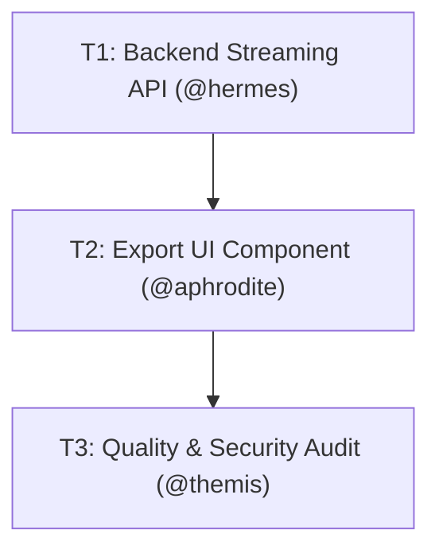

# Deepwork: Disciplined Planning & Canonical Execution

> 🇧🇷 **Versão em Português disponível:** [Leia em Português](../pt-BR/guides/deepwork.md)

Pantheon's **Deepwork** module is the architectural planning and disciplined execution engine for OpenCode. It solves the biggest issue with AI coding agents: *the plan as an ephemeral Markdown document that the model reads, forgets, or prematurely concludes without verifiable proof.*

---

## 1. Non-Negotiable Principles

1. **JSON is Ground Truth, Markdown is a Projection:** The canonical state lives in machine-verifiable, structured JSON (`plan.json`).
2. **Strictly Zero HTML:** No scattered HTML pages or heavy dashboards. All approvals, prompts, and rejections use native OpenCode UI tools (`question`).
3. **Human Decisions First:** Design trade-offs and open questions (`decisions_needed`) are resolved with the developer via interactive choice dialogs before execution.
4. **Dependency DAG, Not a Flat List:** Tasks are connected in a Directed Acyclic Graph (Mermaid DAG), making parallel execution (`parallel_safe`) and blockers explicit.
5. **Fail-First Acceptance Criteria:** Every task defines binary verification checks that currently fail (`fails_now: true`) and must pass upon completion.

---

## 2. Canonical On-Disk Structure

When a Deepwork workflow is initiated via `/pantheon-deepwork` or `@zeus`, Pantheon scaffolds a dedicated plan directory:

```text
.pantheon/deepwork/<slug>/
├── plan.json        # Machine ground truth (strict JSON schema)
├── journal.ndjson   # Append-only audit log of phase and task transitions
└── PLAN.md          # Human-readable Markdown projection with Mermaid DAG
```

### The `plan.json` Format

```json
{
  "plan_id": "PLAN_001_csv-export",
  "created_at": "2026-11-13T10:00:00Z",
  "intent": "Add asynchronous CSV metrics report export to the dashboard",
  "tier": "lite",
  "done_when": [
    "npm test tests/metrics-export.test.ts exits 0",
    "GET /api/reports/csv responds with Content-Type text/csv"
  ],
  "tasks": [
    {
      "task_id": "T1",
      "title": "Backend streaming CSV route",
      "owner": "@hermes",
      "depends_on": [],
      "parallel_safe": true,
      "verification": {
        "command": "node --test tests/metrics-api.test.mjs",
        "fails_now": true
      }
    },
    {
      "task_id": "T2",
      "title": "Export button with loading state",
      "owner": "@aphrodite",
      "depends_on": ["T1"],
      "parallel_safe": false,
      "verification": {
        "command": "npm test",
        "fails_now": true
      }
    }
  ]
}
```

---

## 3. Interactive Approval Gate with the `question` Tool

Open Questions are never dumped as plain text bullets in chat. Instead, `@zeus` extracts each decision into the native `question` tool:

```text
[Interactive Question]
Which buffering approach should be used for CSV generation?
  • (Recommended) Native Node.js stream pipeline to prevent memory spikes
  • In-memory buffer serialization
```

Only after all required decisions are answered and the plan is approved does `@zeus` dispatch execution to specialist agents.

---

## 4. Visualizing Dependencies (Mermaid DAG)

Every `PLAN.md` automatically renders a Mermaid dependency graph:



---

## 5. Reference Implementation

Inspect a live Deepwork plan directory in the repository:
- [`examples/saas-dashboard/.pantheon/deepwork/PLAN_001_metrics-dashboard/`](https://github.com/ils15/pantheon-opencode/tree/main/examples/saas-dashboard/.pantheon/deepwork/PLAN_001_metrics-dashboard)
