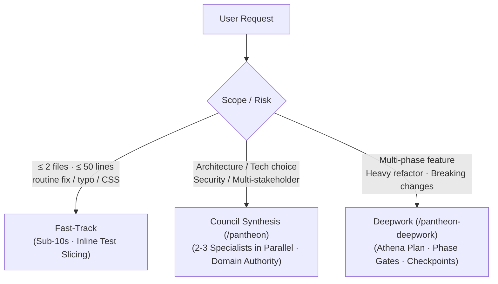

# Execution modes

> Originally published in the root README. Related: [Deepwork Blueprint](deepwork.md),
> [Permissions, Gates & Delegation](../PERMISSIONS-QUALITY-DELEGATION.md).

Pantheon balances speed and rigor through three distinct execution modes:



## 1. Fast-Track & test slicing (micro-edits < 10s)

For routine bug fixes, style adjustments, or localized refactors:

- **No planning ceremony:** directly executes bounded changes.
- **Targeted test slicing:** runs ONLY the test slice relevant to the modified file
  (e.g. `node --test tests/foo.test.mjs` or `pytest -k <func>`). Full repository test
  suites are reserved for CI and release gates.
- **Single-turn delivery:** verifies and completes in under 10 seconds.

## 2. Assertive council synthesis (`/pantheon`)

When confronting architectural crossroads, technology evaluations, or security tradeoffs:

```text
/pantheon Should we use WebSockets or Server-Sent Events for live push notifications?
```

- **Parallel dispatch:** dispatches 2–3 specialist agents simultaneously with independent prompts.
- **Assertive arbitration:** rather than looping in repetitive debate rounds, divergences
  are resolved immediately via **domain authority precedence**:
  - **Security / Auth:** `@themis` has veto power over vulnerable designs.
  - **Database / Schema:** `@demeter` carries authoritative weight on query performance and transaction safety.
  - **Frontend / UX / A11y:** `@aphrodite` governs user interface responsiveness and accessibility.
  - **Infrastructure / CI:** `@prometheus` governs deployment contracts and container isolation.
  - **API / Protocols:** `@hermes` governs contract consistency and transport schemas.
  - **Architecture / Modularity:** `@athena` governs separation of concerns.
- **JEV multi-criteria decision:** if trade-offs balance competing requirements equally,
  Zeus invokes `pantheon_jev_decide` (or the local decision matrix) to rank candidates
  deterministically in one tool call.

## 3. Checkpointed deepwork (`/pantheon-deepwork`)

For multi-phase tasks spanning 10+ turns or multiple sessions:

```text
/pantheon-deepwork "Implement OAuth2 PKCE authentication flow"
```

- **The plan is the artifact:** the canonical ground truth is stored in
  `.pantheon/deepwork/<slug>/plan.json` with an append-only event log
  (`journal.ndjson`) for resilient crash recovery.
- **Native OpenCode gates (strictly no HTML):** approvals (Gate 1) and decision
  resolutions use OpenCode's native interactive `question` tool directly in the chat UI.
- **Dependency DAG:** automatically projects task dependencies into live Mermaid diagrams
  (`flowchart LR`) inside `PLAN.md` and chat status.
- **Fail-first acceptance:** every task defines concrete acceptance criteria
  (`kind: test|command|file|manual`, `fails_now: true`) verified with cryptographic receipts.
- **Tool automation (`pantheon_deepwork`):** structured tool for `init`, `status`,
  `update_task`, `verify_acceptance`, and `resolve_decision`.
- **Resumability:** checkpoints persisted to `.pantheon/deepwork/<slug>/`. Resume anytime
  with `/pantheon-deepwork --resume <slug>`.

Full walkthrough: [Deepwork Blueprint](deepwork.md).
