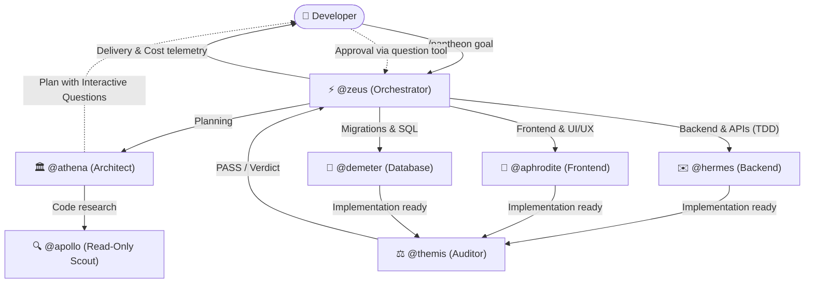

# First Project Guide (End-to-End)

> 🇧🇷 **Versão em Português disponível:** [Leia em Português](../pt-BR/guides/first-project.md)

This practical guide walks you through using **Pantheon** step-by-step, from initializing a project to deploying with automated tests, quality gates, and telemetry.

---

## 1. What is Pantheon?

Pantheon is not a monolithic prompt or a generic chatbot: it is a **multi-agent orchestration framework for OpenCode**.

Rather than overloading a single model with architecture, backend, frontend, SQL, and testing, Pantheon delegates tasks to **14 specialized agents** with clear boundaries and permissions.



---

## 2. Step 1 — Installation and Setup

In any project directory (new or existing):

```bash
# Initialize Pantheon agents, skills, and plugins in the project
npx pantheon-opencode init
```

The interactive installer lets you choose components (`agents`, `skills`, `instructions`, `plugins`). Selecting `plugins` installs the modern **TUI** (terminal dashboard).

Verify installation health with the doctor diagnostic:

```bash
npx pantheon-opencode doctor
```

---

## 3. Step 2 — Dispatching Your First Feature

Start OpenCode (`opencode`) and invoke `@zeus` in chat:

```text
@zeus Build a metrics dashboard service with:
1. Fastify backend with GET /api/metrics and GET /api/metrics/csv
2. React 19 UI with WCAG AA compliance and Tailwind styling
3. Automated unit tests with Node test runner
```

---

## 4. Step 3 — Architectural Planning with @athena

`@zeus` delegates the planning phase to `@athena`.
`@athena` explores the repository using `@apollo` (read-only scout) and creates a canonical Deepwork plan (`.pantheon/deepwork/<slug>/plan.json`):

- **Structured Phases**: Phase 1 (Backend API), Phase 2 (Frontend UI), Phase 3 (Audit & Validation).
- **Mermaid DAG**: Shows parallel and sequential dependencies.
- **Fail-First Verification**: Defines commands that fail now and must pass upon completion.

### Interactive Decision Gate (`question` tool)

When `@athena` identifies design trade-offs, `@zeus` immediately presents them using the native OpenCode `question` tool:

```text
[Question Prompt]
Which CSV export streaming strategy should we adopt?
  1. (Recommended) Native Node.js stream pipeline to prevent memory spikes on large tables
  2. In-memory array serialization with Buffer
```

Once you select your choice and approve the plan, implementation begins.

---

## 5. Step 4 — Implementation via Specialists

`@zeus` dispatches implementation tasks:

### 1. Backend via `@hermes` (TDD)
- Writes unit tests first in `tests/metrics-api.test.mjs` (RED):
```javascript
import { describe, it } from 'node:test'
import assert from 'node:assert/strict'
import { getMetricsSnapshot } from '../src/server/metrics.mjs'

describe('Metrics Service', () => {
  it('returns valid metrics array', () => {
    const metrics = getMetricsSnapshot()
    assert.ok(Array.isArray(metrics), 'should be an array')
    assert.strictEqual(metrics.length, 4, 'should return 4 key metrics')
  })
})
```
- Implements streaming CSV pipeline in `src/server/metrics.mjs` and Fastify routes in `src/server/index.mjs` (GREEN):
```javascript
export function streamMetricsCsv(destination) {
  const items = getMetricsSnapshot()
  const header = 'id,name,category,value,unit,changePercent,updatedAt\n'
  const stream = new Readable({
    read() {
      this.push(header)
      for (const item of items) {
        this.push(`"${item.id}","${item.name}","${item.category}",${item.value},"${item.unit}",${item.changePercent},"${item.updatedAt}"\n`)
      }
      this.push(null)
    },
  })
  stream.pipe(destination)
}
```
- Runs test suite: `node --test tests/metrics-api.test.mjs` passes 5/5.

### 2. Frontend via `@aphrodite`
- Implements accessible React 19 component: `src/client/MetricsDashboard.jsx`.
- Ensures semantic markup, keyboard navigation, and WCAG AA contrast.

---

## 6. Step 5 — Security & Quality Audit with @themis

Before finalizing, `@zeus` dispatches `@themis` to audit the changes:
- Runs test suites and linters (`npm test`, `npm run lint`).
- Verifies that no untrusted libraries or hardcoded secrets were introduced.
- Evaluates test coverage and regression safety.
- Issues a final `PASS` verdict.

---

## 7. Step 6 — Delivery & Cost Telemetry

`@zeus` summarizes the completed work with clickable file links:

- **Files Created**: `src/client/MetricsDashboard.jsx`, `src/server/index.mjs`, `src/server/metrics.mjs`, `tests/metrics-api.test.mjs`.
- **Test Results**: 5 passed, 0 failed.
- **Cost Summary**: Tokens consumed, duration, and model provider efficiency.

---

## Runnable Example

A complete implementation of this exact project is included in the Pantheon repository:
- Check out [`examples/saas-dashboard/`](https://github.com/ils15/pantheon-opencode/tree/main/examples/saas-dashboard) to see the code, tests, and canonical Deepwork plan.
