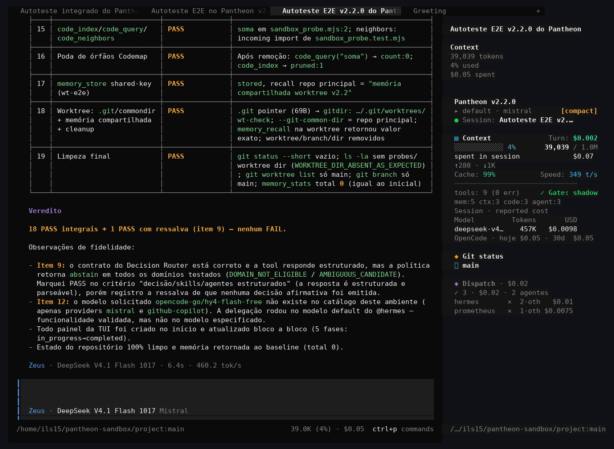
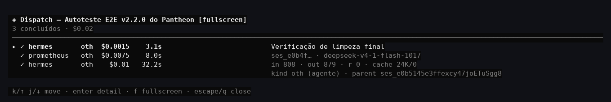

# OpenCode 2.x

OpenCode 2 gets the Pantheon **plugin**: host-native tools, hooks, and a
native TUI surface. This page covers what a user sees. The plugin contract,
tool-by-tool registration, and the delegation matrix are in
[Architecture](ARCHITECTURE.md); supported hosts and evidence are in
[Compatibility](COMPATIBILITY.md).

## The host gate

The installer must confirm the host is OpenCode 2.x before writing. There is
no generation to select and no fallback: `OPENCODE_VERSION=v2` pins the
answer, an `OPENCODE_BIN` basename of `opencode2` is an explicit operator
hint, and otherwise a `--version` probe decides. A confirmed 1.x host, a
failed probe, or an unreadable version is a hard refusal before any write.
The resolution order and the exact refusal behavior live in
[Compatibility](COMPATIBILITY.md#the-host-gate). One plugin is registered; a
host never loads two Pantheon plugins.

## Tools

The plugin registers **30 native TypeScript tools** through `ctx.tool.transform()`
with zero external Python dependency, automatically available in any workspace via
`opencode plugin add pantheon-opencode` (check the live inventory in `/pantheon-settings`
→ **About**):

- **Memory, context, federation & goals:** `memory_store`, `memory_recall`, `memory_search`,
  `memory_forget`, `memory_list`, `memory_stats`, `context_save`, `context_get`, `goal_create`,
  `goal_get`, `goal_update`, and `goal_done` — FTS5-backed persistence under `.pantheon/`
  that automatically shares the main repository root across linked git worktrees
  (override with `PANTHEON_ISOLATE_WORKTREE_MEMORY=1`), plus optional read-only multi-repo
  federation (`PANTHEON_FEDERATED_REPOS` / `~/.pantheon/federation.json`). `goal_update` uses `notes`
  to append progress entries.
- **Structural codemap & AST rewriting:** `code_index`, `code_query`, `code_neighbors`,
  `ast_search`, and `ast_rewrite` — symbol/relation graph with automatic orphan pruning
  plus comment-aware AST matching/rewriting (`$VAR` / `$$$ARGS`) confined to workspace bounds.
- **Mechanical gates, atomic steps & agent forge:** `pantheon_step_ledger` (`init_step`,
  `record_reproduction`, `record_mutation`, `record_verification`, `rollback_step`,
  `complete_step`, `status` with isolated temp-index git checkpoints and bugfix `RED` gates,
  plus `dependsOn` prerequisites — see [Step dependencies](#step-dependencies-and-readiness);
  and `merge_ephemeral` to land a preserved worker branch behind a single-use token — see
  [Ephemeral branch merge](#ephemeral-branch-merge)),
  `pantheon_review_verdict` (typed `@themis` verdict + bounded `ctx.session.synthetic` remediation),
  `pantheon_deepwork`, `pantheon_agent_forge` (including `detect_stack`), and `pantheon_skill_search`.
- **Editing, LSP diagnostics, telemetry & routing:** `hashline_edit` (workspace-confined
  relative paths + post-edit TypeScript/Pyright/stdio + pooled TCP LSP proxy via `PANTHEON_LSP_TCP_ENDPOINTS`),
  `shell`, `todowrite`/`todoread`, `pantheon_cost`, `pantheon_model`, and `pantheon_local_decision` (Zeus-only advisory selector).
- **Native worktree orchestration & commands:** `ctx.worktree.transform` (`create`, `remove`,
  `list`) in `.pantheon-worktrees/<repo>/<task>`, plus **9 slash commands** including
  `/pantheon-forge` and `/pantheon-cockpit`.
- **Host-conditional tools:** `vision_describe` when the host exposes its model catalog,
  and `pantheon_bounded_read` when the host exposes its permission and session APIs
  (root Zeus sessions only).

## Step dependencies and readiness

A step may declare prerequisites with `dependsOn`:

```json
{
  "action": "init_step",
  "stepKey": "b-tests",
  "objective": "Add the ledger dependency tests",
  "agent": "hermes",
  "dependsOn": ["a-schema"]
}
```

- **Validation is mechanical.** Unknown keys (`dependency_not_found`, naming every
  offending key), self-dependencies (`self_dependency`), and cycles
  (`cycle_detected` with the canonical path, e.g. `a -> c -> b -> a`) are refused;
  duplicates are deduped. A dangling dependency is never silently dropped.
- **States.** `init_step` stores `pending` when any dependency is not `done`, and
  `in_progress` otherwise — so steps without `dependsOn` behave exactly as before.
  A `pending` step becomes `in_progress` when `execute_step`/`spawn_ephemeral`
  launches it. Only a **cascade-invalidated** step (`cascadeReason` set) is hard
  blocked; a reflex-escalation `blocked` step stays retryable, and
  `unblock_step` is the explicit recovery (it refuses until every declared
  dependency is `done` again).
- **Readiness.** `ready(k) = state(k) === 'pending' && dependsOn(k).length > 0 &&
  every dependency is done`. Completing the last dependency emits `step:unlocked`
  for each newly-ready dependent, and `status` returns
  `graph: { waves, cycles, ready, unmet, dangling, unplaced }` — `waves` are the
  parallel launch levels (`[[a], [b, c]]` for two independent branches), while
  `unplaced` names the steps that can never launch (cyclic or dangling
  dependency). A dangling dependency is never scheduled into a wave.
- **Refusals.** `execute_step`/`spawn_ephemeral` refuse with `dependencies_unmet`
  (`unmet: [...]`) or `step_blocked` (`blockedBy`) and create no sub-session. The
  gate is re-evaluated inside the same lock acquisition that flips the state, so a
  cascade landing in between cannot be defeated by timing. `complete_step` also
  refuses (`dependencies_unmet`) while a declared dependency is not `done` — a
  passing verification never lifts a cascade block.
- **Rollback cascade.** `rollback_step` refuses (`dependents_done`, with
  `treeUntouched: true`) while a transitive dependent is `done`; the refusal is
  decided under the lock **before** any Git restore, so it is a no-op. A late
  refusal after the restore restores the pre-rollback tree it captured and returns
  it as `restoredTree`. `cascade: true` blocks dependents with `blockedBy` + an
  explicit `cascadeReason`, emits `step:blocked`, and returns the invalidated
  `receiptId`s. The reflex-escalation path applies the same cascade.
- **Verification counters.** `verificationAttempts` counts every
  `record_verification`; `verificationFailures` counts the non-zero exits, so
  `retries = verificationFailures` (a first-try success is `1 / 0`).
- **Recovery from a dangling or self-referential edge.** A ledger that was
  restored, hand-edited, or partially written can leave a step whose `dependsOn`
  points at a deleted key (or at itself). `status.graph.dangling` and
  `status.graph.unplaced` name it, and `execute_step`, `complete_step`, and
  `unblock_step` all refuse with `dependencies_unmet`. Re-running `init_step` for
  that `stepKey` is the working escape hatch, but it **destroys the step's
  runtime state**: `mutatedFiles`, `lastMutationAt`/`lastVerifiedAt`,
  `verificationCommand`/`verificationExitCode`,
  `verificationAttempts`/`verificationFailures`, `receiptId`, `baselineTree`, and
  the `reproduction*` fields are all reset (and the Git baseline is re-captured
  from the current tree), so the step must be re-mutated and re-verified. If the
  entry must be preserved, repair the offending `dependsOn` edge in
  `.pantheon/ledger/step-ledger.json` instead.
- **Checkpoints never carry runtime state.** `captureGitCheckpoint` writes a
  temporary-index tree and drops `.pantheon/` before `write-tree`;
  `restoreGitCheckpoint` drops it from the index before `checkout-index`, so even a
  checkpoint written by an older version cannot roll back the ledger, board,
  memory DB, or deepwork state. Nothing legitimately needs `.pantheon/` inside a
  checkpoint: the ledger drives the rollback itself, and board/memory/deepwork are
  append-only runtime records. Checkpoints from before this exclusion can be
  repaired in place with `pantheon_step_ledger(action="scrub_checkpoints")`
  (`dryRun: true` reports first): each referenced tree is rewritten without
  `.pantheon/`, the ledger's `baselineTree` is updated, and the old tree becomes
  unreachable for Git's normal expiry to reclaim.
- **Every baseline is anchored, so GC cannot eat it.** `init_step` wraps the
  baseline tree in a parentless commit and points
  `refs/pantheon/step-baselines/<key>-<hash>` at it (`baselineRef` on the entry),
  which makes checkpoints reachable and — for the first time — enumerable
  (`git for-each-ref refs/pantheon/step-baselines`). The `<hash>` suffix keeps the
  mapping injective for keys that sanitize alike (`auth:1` vs `auth_1`). A plain
  tree is a dangling object that Git's default two-week expiry silently deletes,
  which would make a later rollback impossible. Do **not** run
  `git gc --prune=now` to clean up after a scrub: it also deletes any baseline that
  has not been anchored yet. Normal `git gc` is safe. Legacy entries (created
  before anchoring) get their ref on the next `scrub_checkpoints`, which is their
  migration path; `rollback_step` reports `baseline_missing` (with the tree SHA and
  the ref, when known) instead of silently restoring nothing. Anchored refs are
  **permanent**: nothing prunes them, there is one per step key, and they are
  retained forever (a future `prune` action could drop refs for removed steps —
  not implemented). `git push --mirror` transfers `refs/pantheon/*` to the
  destination, so a mirror clone/fetch carries the step keys with it; a normal
  `git push`/`push --all` does not.
- **Concurrency.** The ledger is a single JSON file, so every mutation goes through
  `updateStepLedger`: a lock file `.pantheon/ledger/.step-ledger.lock` holding a
  unique `<pid>:<uuid>` owner token, acquired with `open(..., 'wx')`. A stale lock
  (> 2 s) is moved to a quarantine path and only removed when its token matches
  what was observed — a breaker can never delete a live writer's lock, and release
  re-checks the token too. Waits are bounded (4 s) with an actionable error naming
  the lock path and the `rm -f` recovery; a lock owned by the current process fails
  fast as re-entrant misuse. Writes go to `*.tmp.<pid>` + `renameSync`, orphan
  temp files older than 60 s are swept, and a corrupt ledger is quarantined as
  `step-ledger.json.corrupt.<ts>` instead of being overwritten with an empty store.

## Ephemeral branch merge

`spawn_ephemeral` preserves a worker's edits on `pantheon/eph/<stepKey>` and
records `ephemeral.branch` + `ephemeral.baseHead` on the ledger entry (plus
`baseHead` in the tool result). `pantheon_step_ledger(action="merge_ephemeral")`
is the only supported way to land that branch:

```json
{ "action": "merge_ephemeral", "stepKey": "a-schema", "mode": "preview" }
```

- **Two steps, one token.** `mode:"preview"` returns
  `MERGE-<sha256(stepKey|branch|baseHead|branchSha|headNow|diffDigest)[:12]>`,
  valid for 10 minutes. `mode:"apply"`/`"discard"` require it as `confirmToken`.
  It is bound to the exact branch **commit** (`branchSha`), its content and HEAD,
  so a force-push — even one that rewrites the commit without changing the patch —
  or any new commit on either side makes it unusable (`confirm_token_required`,
  with `already_used` / `expired` / `stale` / `missing` in the message). It is a
  **two-phase confirmation, not an authorization**: it proves a preview of this
  exact commit happened, nothing more. Single-use means an *attempted mutation*
  burns it (including one that then fails); pure pre-flight refusals happen before
  the burn, so they leave it usable. Tokens live **in process memory only** — a
  restarted host cannot replay or recover one, and must `preview` again.
- **Preview never touches your checkout.** The trial merge runs through
  `git merge-tree --write-tree --name-only` (git ≥ 2.38); older git merges inside
  a disposable worktree at
  `<project-parent>/.pantheon-worktrees/<repo>/merge-preview-<stepKey>` that is
  removed afterwards. A preview returns `treeUntouched: true` after comparing
  HEAD and `git status` before/after, plus `mergeTree`, `changes`, `conflicts`,
  `blockers`, and `readyToApply`. The token is minted *before* the preview attempt,
  so a branch whose merge cannot even be rehearsed (`preview_failed`) can still be
  `discard`ed instead of becoming undeletable.
- **Preview reports, `apply` refuses.** Preview deliberately keeps working on a
  drifted, dirty, already-conflicting or merge-in-progress tree so the token is
  always obtainable; `readyToApply: false` and `blockers` name exactly what an
  `apply` would refuse with.
- **Refusals, all before the first mutation** (`treeUntouched` / `noOp: true`):
  `not_a_git_repository`, `detached_head`, `step_not_found`, `missing_branch`,
  `branch_missing`, `missing_base_head`, `unknown_base_head`,
  `ambiguous_branch` (the short name resolves to a tag or another ref instead of
  `refs/heads/<branch>` — see below),
  `status_unavailable` / `diff_unavailable` / `drift_unavailable` (git could not
  answer, so the gate refuses rather than reading "unknown" as "clean"),
  `merge_in_progress` (a merge this gate did not start is in progress),
  `dirty_index` (staged changes are never an `allowDirty` case — see below),
  `worktree_dirty` (without `allowDirty: true`), `head_drift` (HEAD moved past
  `ephemeral.baseHead`: the Themis verdict no longer covers that tree),
  `lease_conflict` (`{file, holder, source: 'dirty' | 'lease' | 'branch'}`),
  `nothing_to_merge`, `merge_conflict`, `merge_busy` (another merge holds the
  mutation lock), `lock_lost` (this writer was evicted mid-window),
  `head_changed` / `worktree_changed` (a writer moved the
  checkout while this apply queued for the lock).
  `unsupported_option` is returned for `cascade: true`: `merge_ephemeral` is not a
  rollback, and silently accepting a flag that changes nothing would be a lie.
- **The branch is addressed by full ref *and* by the reviewed sha.**
  `ephemeral.branch` is a plain `pantheon/eph/*` name, but every differential call
  (`diff`, `rev-list`, `merge-tree`) uses `refs/heads/<branch>`, and
  `git merge --squash` is pinned to the **sha that was resolved and reviewed**
  (`branchSha`), not to the ref. `baseHead` is resolved once to a sha too. A
  same-named tag or `refs/pantheon/...` ref cannot be merged in place of the
  reviewed branch (refused up front as `ambiguous_branch`), and a force-push
  inside the merge window cannot change what lands. The landed commit is recorded
  as `ephemeral.mergedSha` for audit.
- **Overlap sources.** `dirty` is a local edit to a file the branch rewrites;
  `branch` is a second live `pantheon/eph/*` branch (no `ephemeral.mergedAt`)
  whose own diff overlaps; `lease` is another session's active
  `ownedFiles`/`forbiddenFiles` claim, read through the real `listActiveLeases()`
  accessor with the caller's own lease excluded. **`lease` cannot fire in
  production today**: nothing in `src/` installs the `globalThis.__pantheonFileLeases`
  hook that `init_step`/`spawn_ephemeral` look for (only tests do, with a
  different signature than `acquireFileLease(sessionID, lease)`), so the live
  sources are `dirty` and `branch`. It stays as defence-in-depth until the launch
  path is wired to `acquireFileLease` — its own task, because it changes
  merge outcomes.
- **Try before you touch.** The merge is validated with `git merge-tree` before
  any git command mutates the checkout, so a conflict is a refusal with an
  untouched tree.
- **Apply leaves changes unstaged** (`commit: true` opts into a commit that honours
  your hooks). After the squash: a pre-merge checkpoint is captured, the squash is
  unstaged with `git reset`, `ephemeral.mergedAt`/`mergeTree`/`mergedSha` are
  written back,
  `step:merge` is emitted, and a `[done]` board slot announces the merge. The
  branch is **kept**; only `mode:"discard"` deletes it (and records
  `ephemeral.discardedAt`). If the ledger write fails *after* the squash, the
  result is still `ok: true` with `metadataRecorded: false` + `metadataError`: the
  merge landed, only the bookkeeping is missing. There is no metadata-only action,
  so the hint spells out the manual repair (`steps[...].ephemeral.*` in
  `.pantheon/ledger/step-ledger.json`) and says explicitly **not** to re-run
  `apply`, which would merge again.
- **One mutation window per checkout, and it is safe to hold for seconds.** The
  checkpoint, the squash (including your `commit: true` pre-commit hooks), the
  recovery and the ledger write run under `.pantheon/.ephemeral-merge.lock`. It is
  **not** the ledger lock: that one breaks a lock older than 2 s, which for a
  multi-second merge would let a peer steal a live window and then erase its
  content. Instead the merge lock (1) breaks on **liveness** — a dead owner pid is
  reclaimed immediately, (2) tolerates 10 minutes before any age-based break and
  applies that age to ownerless locks too (a crash between `open('wx')` and the
  token write leaves zero bytes; without this the checkout would answer
  `merge_busy` forever), (3) refreshes its mtime every second while held, so the
  age rule can only ever fire for a writer that stopped refreshing, and
  (4) re-verifies ownership before the squash and again before the ledger write.
  So: a second apply waits up
  to 1.5 s and then gets `merge_busy` (or `worktree_changed`/`head_changed` if it
  acquires after the first finished), touching nothing either way; a writer whose
  lock was taken mid-window aborts with `lock_lost` and does **not** write the
  ledger, instead of reporting a success it does not own. Cross-process behaviour
  is covered by a two-process test, not just an in-process seam.
- **Never a half-merged tree.** Every failure after the first mutation runs the
  same recovery: `git reset --merge` to drop unmerged index entries and conflict
  markers, then a restore of the pre-merge checkpoint when the tree still differs.
  `treeRestored` is only ever `true` after a verified comparison. A `MERGE_HEAD`
  that this call did not create is **never aborted** — it is reported
  (`foreignMergeDetected`) and left exactly as found; `apply` additionally refuses
  such a checkout up front. A restore covers tracked files plus non-ignored
  untracked files (the checkpoint uses `--exclude-standard`), so a `.gitignore`d
  file the aborted merge created survives: that limitation is stated in
  `recovery.restoreLimitation` rather than hidden.
- **Post-mutation outcomes.** A surviving `MERGE_HEAD`/`MERGE_MSG` after a
  successful squash is reported as `merge_state_left_behind` (`ok: false`,
  `treeUntouched: false`, with `mergeTree`/`mergedAt`/`unstaged` still describing
  what landed); `commit: true` that a user hook rejects is undone the same way
  (`commit_failed` + `recovery`). No post-mutation payload ever claims
  `treeUntouched: true`.
- **Why staged changes are refused outright.** `git merge --squash` will not run
  with a dirty index, and `git reset --merge` discards staged content
  irrecoverably — so an index with staged entries cannot be restored exactly. The
  gate refuses instead of pretending it can compensate.

## Per-agent MCP permissions

The installer reads each agent's `mcp_tools` allowlist and generates native
per-agent permissions. On OpenCode 2.x the host evaluates a
`permissions` rule whose action is `<server>_*` (or `<server>_<tool>`) with
effect `deny`/`allow`. The legacy `permission.mcp.<server>` key is not an
action the host evaluates; the installer translates `allow`/`deny` into the
former. `ask` is not expressible for MCP on that host — it hides the tool
instead of prompting, so the installer emits no rule and warns.

An existing native `permissions` array remains authoritative. The installer
does not append its legacy default grants to that array; it seeds those defaults
only when the config has no native `permissions` array yet.

Deny-by-default, the entrypoints, and custom-server setup are in [MCP](MCP.md).

## Dispatch sidebar block

The native sidebar shows the Pantheon version, active preset/source, git
state, a `Context` block with thousands-separated tokens and `<percent>% used of
<window>` (blue ≤25%, green ≤50%, yellow ≤90%, red above), `$<spent> spent`, and
a muted `cache <n>% · <n.n> tok/s` line.

One aggregated `Dispatch` block covers the whole child set:

- header `◈ Dispatch · <n> rodando · $<cost>`, summing every child, live and
  finished;
- one row per live child (`⠸ <agent>·<kind>[·<verb>][?|!] $<cost> <duration>`,
  newest first, three then `… +N rodando`), surfacing real-time activity verbs
  (`edit`, `code`, `bash`, `ask`, `err`) and attention badges (`?` waiting for
  permission/question, `!` error);
- finished children rolled up per agent: `✓ <total> · $<sum> · <M> agentes`
  (plus `· <F> falhas` when any child failed), up to three
  `<agent> ×<count>·<kind>  $<sum>` rows and `… +K  $<sum>` beyond — never one
  row per session.

The `·<kind>` suffix says why the child exists: `coun`/`plan`/`revw`/`eph`/`swm`/
`disc` from an explicit `[council]`/`[plan]`/`[review]`/`[ephemeral]`/`[swarm]`/`[discovery]`
prefix on the `subagent` description, otherwise from the agent
(`athena`→plan, `themis`→revw, `apollo`→disc, anything else→`oth`).
`council` is never inferred from an agent. A `~` after the kind marks a
background child.

The block stays within eight lines and is omitted entirely when the session has
no child. It is added with `append` claims: the native prompt footer keeps its
own line, and Pantheon only appends `▸<preset> · ✦<n> ativos` while delegations
are running.



*OpenCode 2.3.2 · pantheon-opencode 2.2.0 — live session capture (`Dispatch` roll-up per agent, token telemetry, and git status).*

## `/dispatch` panel

`/dispatch` (also in the palette as *Pantheon: Dispatch*) opens
`pantheon.dispatch` in the host's `session.panel` slot: a full-width view of the
same delegation tree, rendered from the same collector as the sidebar block, so
a child is never listed twice.

The header is `◈ Dispatch — <session>` (+ `[fullscreen]`) with counters for the
whole tree (`2 rodando · 70 concluídos · 1 falha · $3.59`; a zero counter is
omitted) over one row per child — `⠋ hermes     plan   $0.09  14m34s` — running
first, then most recent activity, with `✓`/`✗`/`○`/`?` for
completed/failed/interrupted/unknown. The detail pane shows the selected child's
title or spawning description, short id, model, in/out/reasoning/cache tokens,
kind evidence, and parent id; `—` means the host did not publish it.

Panels at least 72 columns put the detail beside the list; narrower ones stack
it under the list and truncate per column. Keys are namespaced and bound
(`k`/`up`, `j`/`down`, `home`, `end`, `pageup`, `pagedown`, `enter`, `f`,
`escape`/`q`) and live inside the panel claim, so they stay inert while the
panel is not focused. The list is paged at ten rows and selection is held by
session id.

The panel reads only host-cached state — no session sync, no child
`message.list`, no HTTP — and its 80 ms spinner tick exists only while the panel
is open with something running. Opening it requires an open session; otherwise
Pantheon toasts `Open a session to view Dispatch` instead of inventing a
route. Jumping from a row to the child session is a documented TODO: no
`session` router destination is verified for a child id.



*OpenCode 2.3.2 · pantheon-opencode 2.2.0 — live `[fullscreen]` `/dispatch` panel capture.*

## Plan before approval

When you ask for a plan or start `/pantheon-deepwork`, Athena returns the full
plan to Zeus, who displays it in the main conversation before asking for
approval. The approval prompt never points to a plan hidden in a child agent's
conversation.

<!-- media: opencode-v2-plan-approval
     alt: "Plan-approval turn: the full plan rendered in the main conversation above the approval question"
     source: docs/assets/tui/plan-approval.gif (recorded from docs/assets/tui/plan-approval.tape)
     status: pending — no image committed; the fenced sketch below is illustrative
-->

<!-- illustrative, not a screenshot; real capture pending -->

```text
Zeus · teampro

  ## Plan: MCP permission audit

  1. Read every agent allowlist in src/agents/*.md
  2. Compare it with the `permissions` rules pantheon-init emits
  3. Report drift and update docs/MCP.md where a rule is undocumented
  4. Verify with npm run test:node and npm run docs:lint

  Files: docs/MCP.md, src/agents/*.md, scripts/install/*.mjs
  Risks: an `ask` rule cannot be expressed for MCP on this host

  Approve this plan? (yes / no)
```

*Illustrative layout — not a screenshot.* The plan is printed in the main
conversation before the question, so approval never refers to a child's view.

*OpenCode 2.x · pantheon-opencode 2.2.0*

## Context pruning

The `compaction` hook performs dynamic context pruning on the
provider-bound message array immediately before summarization, so old tool
output is not re-summarized into permanent context.

- It rewrites tool parts only.
- An invocation repeated with the same tool name and normalized arguments keeps
  its most recent result verbatim; every earlier successful body becomes a
  `[pantheon-prune:v1 …]` placeholder.
- Error results are never rewritten. A group is pruned only when its newest
  invocation carries a successful result.
- Arguments of failed calls are blanked after two turns while the error text
  stays visible.
- The last four turns and a protected tool list (`subagent`, `task`, `skill`)
  are never touched.
- The marker makes a second pass a no-op, and a pass estimated below 200 tokens
  does nothing.

The hook log records savings for changed passes and the first occurrence of
each fixed no-op reason (`no-candidates` or `below-threshold`) per session and
hook site. These entries contain counts and estimated tokens only; tool content
and arguments are not logged.

The array is mutated in place: no message is deleted or reordered, `system` is
untouched, and an unexpected shape fails open without throwing. The same engine
is available per request only when the plugin entry sets
`options.context_pruner.enabled` to `true` (default `false`), because
per-request pruning invalidates the provider prompt cache. `keepTurns`,
`purgeAfterTurns`, `protectedTools`, `minSavingsTokens`, and `charsPerToken`
tune it.

`init` writes the entry in its object form (`{ "package": …, "options": { … } }`),
so there is a place to put that key without guessing the syntax — a bare-string
entry leaves the host with no options at all. The context-pruner option and
default are listed in the README's *Plugin options* table. Memory retrieval
uses the `pantheon-memory` MCP only when an agent explicitly calls
`memory_search`; see [Memory](MEMORY.md#recall-and-compaction-policy).

## Session goals

Durable manual goals are registered as native plugin tools (`goal_create`, `goal_get`,
`goal_update`, and `goal_done`), backed by the shared `.pantheon/` store across
worktrees. They are granted to Zeus, scoped cleanly, and never continue a session
automatically. See [Memory](MEMORY.md#manual-session-goals).

## Task-result guard

The `execute.after` chain runs `task-result-guard` → `context-sandbox` →
`read-enhancer`. The guard intercepts native child-session dispatch where the
child returns an empty or missing result. Instead of surfacing a silent
`completed` with no payload, it raises an explicit error. This catches the
common free-tier failure mode where a child exceeds the uncached-prefill token
budget and returns nothing.

Background dispatch and status/fan-in facilities are runtime-dependent. When no
status tool is visible, use synchronous `subagent` dispatch or wait for a
host-provided completion notification; do not claim deterministic fan-in or job
recovery without an exposed, verified mechanism.

## Headless cockpit (opt-in, loopback only)

A VPS has no terminal sidebar. Set `PANTHEON_COCKPIT=1` (optionally
`PANTHEON_COCKPIT_PORT`, default `4747`) to start a read-only HTTP surface on
loopback, then reach it through an SSH tunnel:

```bash
ssh -N -L 4747:127.0.0.1:4747 you@vps.example.com
curl -s http://127.0.0.1:4747/healthz
curl -s http://127.0.0.1:4747/
```

**This is not the TUI snapshot.** The response is the versioned
`pantheon.cockpit.v1` envelope (`kind: "headless"`, `parity:
"not-tui-snapshot"`), reduced from on-disk artifacts only — the step ledger with
S1 readiness and the persisted board. Live children, bus events, session
titles, and cost/token counters require a running host and are absent. A
corrupt ledger surfaces as `stepsCorrupt: true` rather than an empty step list,
and a GET never quarantines or rewrites it.

The surface is `GET`/`HEAD` only, sends no CORS headers, rejects a non-loopback
`Host` with `421`, and by default omits all agent-authored free text —
objectives, cascade reasons, board goals/workstreams and message bodies — plus
session ids, file lists, and command lines; only lengths of the free text
remain. `?full=1` returns those fields verbatim. Bind to loopback only; a
non-loopback `PANTHEON_COCKPIT_HOST` is a fatal startup error.
`PANTHEON_COCKPIT_TOKEN` optionally requires the `x-pantheon-cockpit-token`
header (defence-in-depth, not the boundary). `/healthz` exposes a short
`workspaceId` (basename + short hash, never the absolute path) so a tunnel can
be checked. Full enable/tunnel/multi-process/threat-model notes are in
[Platforms](PLATFORMS.md#headless-cockpit-on-a-vps-ssh-tunnel).

## Unsupported features

The plugin reports these gaps through `getUnsupportedFeatures()` (the seed in
`src/pantheon/unsupported.mjs`):

- Adapter scope choices: `legacy-hooks` (the hook surface of the removed V1
  plugin line), `catalog-transform`, `integration-transform`,
  `skill-transform`, `goal-tools` (the goal loop needs infrastructure the
  host's plugin context does not expose).
- Host-domain gaps: `idle-todo-enforcer` (the enforcer is constructed only when
  the host's `session` domain exposes `todo`/`messages`/`children`/`promptAsync`;
  the measured 2.x domain does not), `tool-ceiling` (no
  `message.updated` producer for the host-reported budget, so the
  `<tool_ceiling>` block is not injected), `todo-restore` (no todo API to
  snapshot across compaction), and `board-transitions` (the shared board is
  reachable through the injected board, but the writers — terminal audit,
  idle reports, dispatch mirror — lived in the removed generation's event hook
  and `pantheon-hooks.ts`).

Everything else the removed generation wired is here: the Zeus read guard, the
compaction context, vision history sanitization, the post-write formatter, and
the delegation audit trail (start/stop records joined on `delegation_id`).
Idle dispatch is wired but **conditional** — it reaches an enforcer only where
`idle-todo-enforcer` is not in the seed, which is why that marker is listed
above. `pantheon_bounded_read` applies the same code-root restriction as the
read guard: `src/`, `tests/` and `scripts/` are refused; docs, config, the
memory bank and `.pantheon/` remain readable.
