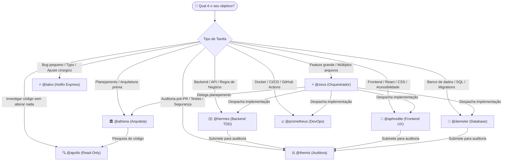

# Matriz de Capacidades dos Agentes do Pantheon

> 🇺🇸 **English version available:** [Read in English](../AGENT-CAPABILITY-MATRIX.md)

Esta matriz consolida a autoridade de domínio, permissões no host, MCPs permitidos e restrições absolutas de cada um dos 14 agentes canônicos do Pantheon no OpenCode.

---

## 1. Fluxograma de Decisão: Quem Acionar?

Use este guia visual para escolher o especialista certo para o seu objetivo:



---

## 2. Visão Geral de Permissões e Ferramentas

| Agente | Domínio | Edit Code? | Bash / Shell? | Subagentes (`task`) | Question Tool? | MCPs Permitidos |
|---|---|:---:|:---:|:---:|:---:|---|
| **@zeus** | Orquestração Central & Roteamento | ❌ `deny` | ❌ `deny` | ✅ `all` | ✅ `allow` | `resources`, `memory_store`, `persistence`, `vision` |
| **@athena** | Arquitetura & Planejamento | ❌ `deny` | ❌ `deny` | ❌ `deny` (filho) | ✅ `allow` | `resources`, `memory_search` |
| **@hermes** | Backend, APIs & Lógica de Negócio | ✅ `allow` | ✅ `allow` | ⚠️ `@apollo` | ❌ `deny` | `resources`, `memory_search`, `code-mode` |
| **@aphrodite** | Frontend, UX, React & CSS | ✅ `allow` | ✅ `allow` | ⚠️ `@apollo` | ✅ `allow` | `resources`, `memory_search`, `vision` |
| **@demeter** | Banco de Dados, SQL & Migrações | ✅ `allow` | ✅ `allow` | ❌ `deny` | ❌ `deny` | `resources`, `memory_search` |
| **@themis** | Auditoria de Segurança & Portão de Qualidade | ❌ `deny` | ✅ `allow` (read-only) | ❌ `deny` | ❌ `deny` | `resources`, `memory_search` |
| **@prometheus**| DevOps, Docker, CI/CD & Deploy | ✅ `allow` | ✅ `allow` | ⚠️ `@apollo` | ❌ `deny` | `resources`, `memory_search` |
| **@talos** | Hotfixes Rápidos & Micro-edits | ✅ `allow` | ✅ `allow` | ❌ `deny` | ❌ `deny` | `resources`, `memory_search` |
| **@apollo** | Investigação & Busca Exploratória | ❌ `deny` | ❌ `deny` | ❌ `deny` | ❌ `deny` | `resources`, `webfetch` |
| **@hephaestus**| Pipelines de IA, RAG & Embeddings | ✅ `allow` | ✅ `allow` | ⚠️ `@apollo` | ❌ `deny` | `resources`, `memory_search`, `code-mode` |
| **@gaia** | Sensoriamento Remoto & Geoespacial | ❌ `deny` | ❌ `deny` | ❌ `deny` | ❌ `deny` | `resources`, `memory_search` |
| **@iris** | Git & Operações de Release | ✅ `allow` | ✅ `allow` (git) | ❌ `deny` | ❌ `deny` | `resources`, `memory_search` |
| **@mnemosyne** | Custódia do Memory Bank & ADRs | ⚠️ `.pantheon/**` | ❌ `deny` | ❌ `deny` | ❌ `deny` | `memory_search`, `memory_store` |
| **@nyx** | Telemetria, Métricas & Custos | ❌ `deny` | ❌ `deny` | ❌ `deny` | ❌ `deny` | `pantheon_cost`, `resources` |

---

## 2. O que Cada Agente PODE e NÃO PODE Fazer

### @zeus (Orquestrador)
- **PODE:** Decidir fluxos, despachar especialistas, arbitrar dúvidas via Jev (`pantheon_jev_decide`), buscar skills (`pantheon_skill_search`), abrir perguntas interativas (`question`), ler até 50 linhas para roteamento rápido.
- **NÃO PODE:** Editar código diretamente (`edit: deny`), executar comandos no terminal (`bash: deny`), pedir ao usuário para rodar comandos de terminal, ou ler arquivos em `.pantheon/deepwork/**` e `.git/**`.

### @athena (Arquiteta)
- **PODE:** Criar especificações arquiteturais, analisar trade-offs, definir blueprints de implementação e planos técnicos detalhados (`PLAN.md`).
- **NÃO PODE:** Implementar ou editar código (`edit: deny`), rodar testes/shell (`bash: deny`), ou abrir diálogos de aprovação dentro da sessão filha (retorna o plano ao Zeus).

### @hermes (Backend)
- **PODE:** Escrever endpoints FastAPI/Node, regras de negócio, testes unitários backend, executar comandos de teste e linting via bash.
- **NÃO PODE:** Alterar schemas de banco de dados (delegar a `@demeter`), criar interfaces visuais (delegar a `@aphrodite`), ou configurar pipelines Docker/CI (delegar a `@prometheus`).

### @aphrodite (Frontend)
- **PODE:** Criar componentes React/Next, estilizar com Tailwind/CSS, validar acessibilidade WCAG, rodar dev server e testes de interface (Vitest/Playwright).
- **NÃO PODE:** Implementar rotas ou lógica interna de backend, alterar schemas de persistência, ou ignorar contrastes e padrões a11y.

### @demeter (Banco de Dados)
- **PODE:** Criar e alterar migrações (Alembic/Prisma), otimizar queries SQL, prevenir problemas N+1, validar integridade referencial.
- **NÃO PODE:** Fazer alterações em componentes frontend ou implementar regras de negócio fora da camada de persistência.

### @themis (Revisora & Auditora)
- **PODE:** Executar suites de teste e linters em modo de leitura para avaliar conformidade (Biome, ruff, pytest), emitir veredictos (`PASS`, `PASS_WITH_NOTES`, `BLOCK`, `BLOCK_INTENT`).
- **NÃO PODE:** Modificar arquivos ou corrigir código encontrado (`edit: deny` absoluto — separação estrita de poderes).

### @prometheus (DevOps)
- **PODE:** Configurar Dockerfile, docker-compose, GitHub Actions, scripts de build/deploy, infraestrutura de monitoramento.
- **NÃO PODE:** Implementar features de produto ou alterar lógica interna de regras de negócio.

### @talos (Hotfixer)
- **PODE:** Corrigir bugs pontuais, erros de digitação, imports ausentes e micro-edits de forma rápida e direta em 1 turno.
- **NÃO PODE:** Executar refatorações estruturais ou tarefas de alta incerteza/risco.

### @apollo (Investigador)
- **PODE:** Varrer o código com `grep`, `glob` e `read`, pesquisar referências na web com `webfetch`, sintetizar descobertas estruturadas.
- **NÃO PODE:** Modificar nenhum arquivo (`edit: deny`), executar scripts/comandos de terminal (`bash: deny`).

### @mnemosyne (Memory Bank)
- **PODE:** Ler e atualizar documentos estritamente dentro de `.pantheon/memory-bank/` e registrar ADRs acordados.
- **NÃO PODE:** Modificar qualquer arquivo fora de `.pantheon/` (ex.: `README.md` é editado por `@hermes` ou `@talos`).

---

## 3. Subagentes e Arbitragem Jev

Por padrão, apenas o orquestrador `@zeus` invoca `pantheon_jev_decide`. Subagentes podem ser autorizados explicitamente definindo a variável de ambiente:

```bash
export PANTHEON_JEV_SPECIALIST_CALLERS="athena,hermes,aphrodite,apollo"
```
