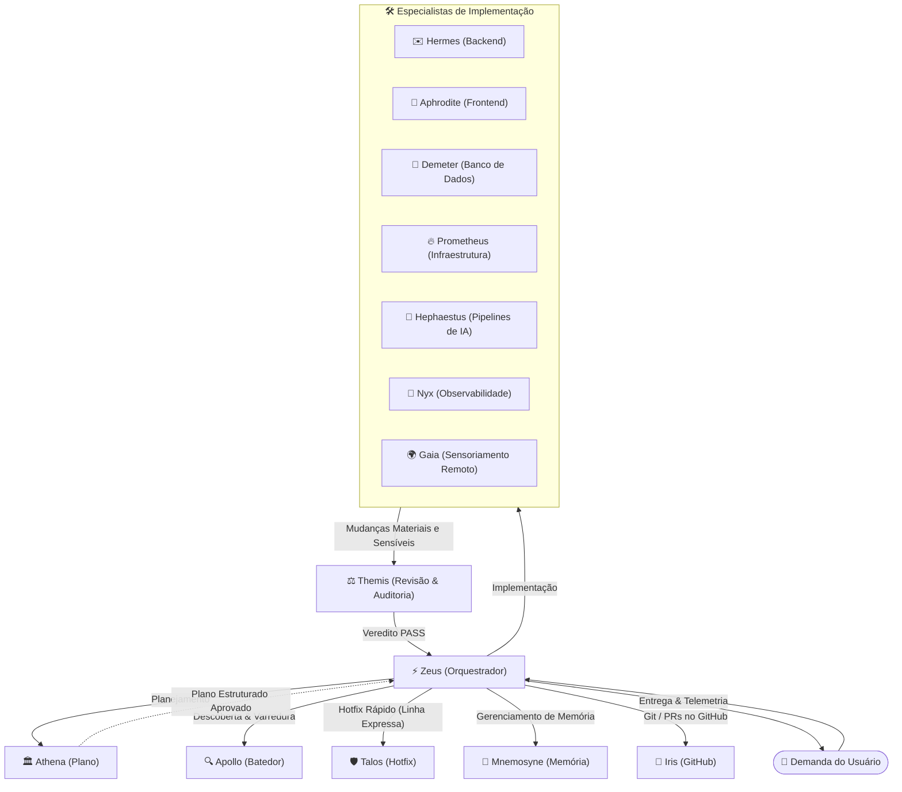
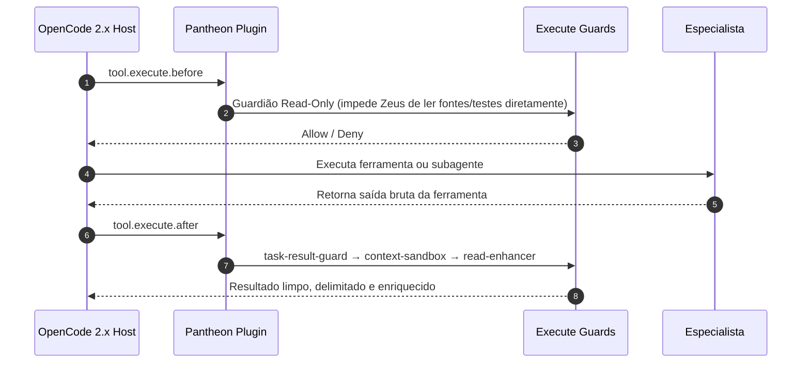

# Arquitetura do Pantheon

> 🇺🇸 **English version available:** [Read in English](../ARCHITECTURE.md)

**Público-alvo:** Desenvolvedores estendendo o Pantheon e qualquer pessoa que queira entender como as peças se encaixam. O guia de instalação está em [Instalação](INSTALLATION.md); os comportamentos do usuário no OpenCode 2.x estão documentados em [OpenCode 2.x](../opencode.md).

---

## Fluxo de Agentes

O Pantheon substitui o loop tradicional de agente único por uma arquitetura com um **condutor (orquestrador)** e **especialistas**.

O `@zeus` orquestra, mas **nunca implementa diretamente**. Ele encaminha trabalhos delimitados para um especialista e aciona planejamento, descoberta, trabalho paralelo e auditoria conforme o escopo e o risco demandam. O comando `/pantheon-deepwork` é o fluxo de trabalho com checkpoints para demandas pesadas em múltiplas fases. Os arquivos canônicos dos agentes residem em `src/agents/*.md`; a [Matriz de Agentes](AGENT-CAPABILITY-MATRIX.md) indexa cada um deles.

Os portões de qualidade são qualitativos, não limiares cegos de linhas/arquivos: trabalho autocontido permanece inline; uma tarefa delimitada vai para um especialista; frentes independentes podem utilizar despachos raiz separados. A `@themis` audita mudanças materiais e sensíveis — autenticação, segurança, esquemas/banco de dados e qualquer coisa que altere comportamentos de forma ampla. Veja [Permissões, Portões & Delegação](../PERMISSIONS-QUALITY-DELEGATION.md).

---

## Mecânica de Delegação

O Pantheon delega através do motor nativo de sessões filhas do host. A ferramenta chamável é `subagent` no runtime raiz reportado; a documentação do host/API chama esse mesmo mecanismo de `task()`. A disponibilidade de ferramentas, opções de execução em segundo plano e observabilidade de conclusão são propriedades do runtime ativo, não do Pantheon. A antiga ferramenta `pantheon_delegate` e seu motor legado foram removidos na versão 2.0.

Todo despacho raiz carrega um **briefing de handoff conciso**: objetivo/resultado esperado, escopo delimitado, critérios de aceite, apenas as entradas relevantes, restrições e portões de segurança, formato do entregável e verificação. Nunca copie conversas inteiras ou histórico não relacionado.

Os contratos de retorno são específicos por papel:

| Chamador | Formato de Retorno |
|---|---|
| Agente de Implementação | `## subtask_summary` com arquivos modificados, resumo, testes e eventuais impedimentos |
| Investigação (`apollo`) | Achados estruturados: tópicos, caminhos com números de linha, snippets ≤ 3 linhas |
| Planejador (`athena`) | O plano completo em Markdown/JSON, nunca apenas um resumo ou ponteiro |
| Especialista de Conselho | `## specialist_response` |

Trabalhos delegados recebem no máximo **uma** nova tentativa após falha transiente inicial. Quando nenhuma ferramenta de status/conclusão é exposta, prefira despacho síncrono ou aguarde a notificação do host; não presuma polling, cancelamento ou recuperação baseada em quadro.

No OpenCode 2.x, o plugin impõe adicionalmente uma matriz chamador/alvo para requisições `subagent` gerenciadas pelo Pantheon quando o host expõe `ctx.permission.hook`. Ele valida os identificadores de sessão, mensagem e chamada de ferramenta de um registro de curta duração de `tool.execute.before`, exigindo que a sessão do host não tenha `parentID`. Origens ausentes, expiradas ou incompatíveis falham fechadas (*fail-closed*). Se o hook não estiver disponível, as permissões do host mantêm o controle. A matriz está documentada em [Permissões, Portões & Delegação](../PERMISSIONS-QUALITY-DELEGATION.md).

---

## O que o Plugin Registra

Existe uma geração única: a linha de plugins V1 foi removida no 2.0, e a superfície abaixo é a única ativa.

O plugin é registrado sob a chave plural `plugins` como o diretório `<installed>/src/plugin`. O arquivo `src/plugin/index.ts` reexporta o ponto de entrada real em `src/plugin.ts`; o registro de hooks de ferramentas em `src/plugin.ts` é alimentado pelas definições em `src/pantheon/tools.ts`.

### Quatro Ferramentas Incondicionais:
- `hashline_edit` — Edição precisa baseada em linhas de hash (`src/pantheon/tools.ts`).
- `pantheon_cost` — Telemetria de tokens consumidos, custos estimados e velocidade de cache (`src/pantheon/tools.ts`).
- `pantheon_model` — Roteamento dinâmico de modelos por especialista (`src/pantheon/tools.ts`).
- `pantheon_local_decision` — Seletor consultivo local; rejeita execução a menos que o contexto do host identifique o chamador como Zeus (`src/pantheon/tools.ts`).

### Até Duas Ferramentas Dependentes do Host:
- `vision_describe` — Adicionada apenas quando `ctx.model.list` é uma função (`src/plugin.ts`; definição em `src/pantheon/native-vision.ts`).
- `pantheon_bounded_read` — Adicionada apenas quando o hook `tool.execute.before` é registrado e o host expõe as APIs de permissão e sessão (`src/plugin.ts`; definição em `src/pantheon/bounded-read.ts`). Apenas para sessões raiz do Zeus.

As ferramentas de metas automáticas são omitidas onde o `PluginContext` do host não as suporta (reportado como `goal-tools`).

O plugin também conecta cinco inscrições de eventos (`session.created`, `session.idle`, `session.deleted`, `session.error`, `session.compacted`), hooks de sessão (`prompt`, `context`, `compaction`), um hook `execute.before` que aplica modo somente-leitura (o mesmo manipulador impede o orquestrador de ler diretamente códigos-fonte, testes e scripts com `read`/`glob`/`grep`), e uma cadeia `execute.after` (`task-result-guard` → `context-sandbox` → `read-enhancer` → formatador + auditoria de delegação).

---

## Modelo do Instalador e Configuração

As fontes canônicas em `src/` são lidas pelo instalador e gravadas na configuração de destino. Não há etapa de geração em runtime.

- O instalador grava `opencode.json`, nunca `opencode.jsonc`. O host pode mesclar um arquivo `.jsonc` irmão; veja [Compatibilidade](../COMPATIBILITY.md#config-registration-and-the-hosts-config-merge).
- Ele remove referências legadas ao Pantheon tanto na chave singular `plugin` quanto na chave plural `plugins` antes de escrever o registro atual, garantindo que dois plugins do Pantheon nunca coexistam. Chaves no formato legado V1 são normalizadas para o formato 2.x antes da gravação.
- Entradas de plugins e MCPs de terceiros são estritamente preservadas e nunca convertidas.
- Um inventário versionado de propriedade por arquivo registra o que o instalador possui, permitindo que o comando `reconcile` identifique arquivos não modificados.

O pacote expõe o plugin como a exportação importável `pantheon-opencode/plugin`; o subcaminho `pantheon-opencode/local-decision-router` é a fonte TypeScript do roteador de decisões. Não há exportação de ponte e não há segundo contrato: o plugin opera de forma independente com degradação graciosa.

---

## Lojas de Memória e Contexto

O Pantheon possui três lojas independentes, documentadas em [Memória](../MEMORY.md):

1. `pantheon-memory` — Banco SQLite persistente com busca léxica por palavras-chave FTS5/BM25.
2. `pantheon-persistence` — Checkpoints de sessão e metas manuais de sessão.
3. `.pantheon/memory-bank/` — Arquivos do projeto revisados por humanos, lidos sob demanda.

Elas não são sincronizadas automaticamente. A disponibilidade das ferramentas MCP depende das permissões do agente ativo; namespaces são filtros organizacionais, não fronteiras de controle de acesso.

---

## Servidores MCP (Pontos de Entrada)

Cinco servidores locais stdio em Python, declarados em `scripts/install-mcp.mjs` e registrados no OpenCode:

| Servidor | Ponto de Entrada | Ferramentas | Recursos |
|---|---|---|---|
| `pantheon-resources` | `scripts/mcp_resources.py` | — | 4 estáticos + 6 templates |
| `pantheon-code-mode` | `scripts/code_mode.py` | 2 | 1 estático + 1 template |
| `pantheon-memory` | `scripts/memory_mcp.py` | 9 | — |
| `pantheon-persistence` | `scripts/mcp_persistence.py` | 6 | — |
| `pantheon-vision` | `src/mcp/pantheon_vision.py` | 3 | — |

A configuração detalhada e allowlists estão em [Servidores MCP](../MCP.md).

---

## Princípios de Design

- **Uma única casa para cada fato:** A matriz de suporte, a mecânica do instalador, o processo de release e as evidências de benchmark vivem cada um em exatamente uma página.
- **Configuração mais um runtime enxuto:** O comportamento dos agentes vive em Markdown (`src/agents/*.md`, `src/instructions/*.instructions.md`, `src/skills/*/SKILL.md`); o plugin instalado fornece a orquestração, ferramentas e guardiões.
- **Fail-closed em identidade e permissões; fail-open em apresentação:** Uma origem de permissão malformada nega a delegação. Um payload de compactação malformado mantém o array de mensagens inalterado.
