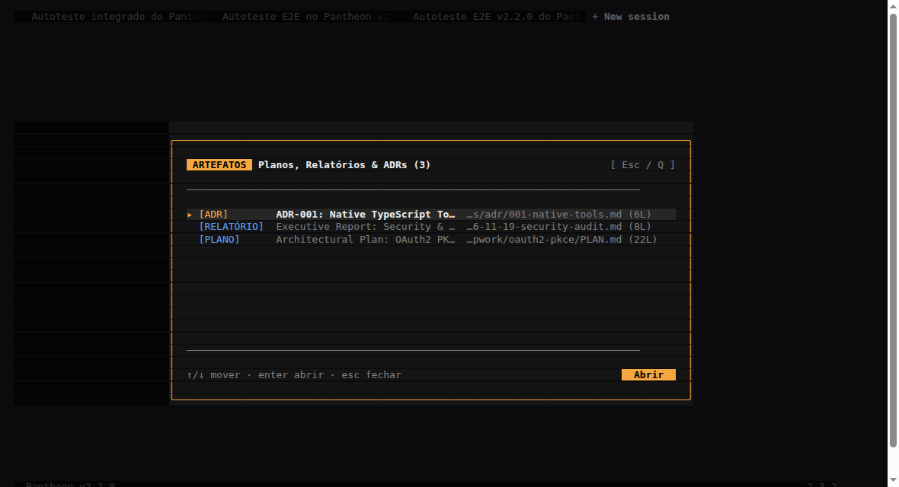
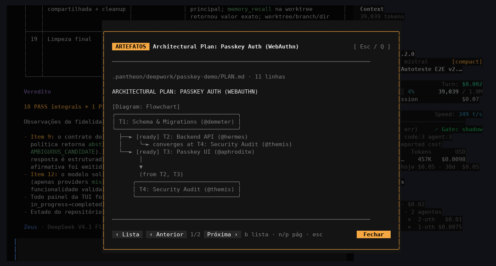

# Artefatos e Visualizador `/pantheon-artifacts`

> 🇺🇸 **English version available:** [Read in English](../ARTIFACTS.md)

O Pantheon armazena planos de engenharia estruturados, relatórios de auditoria/descoberta
e Architecture Decision Records (ADRs) como documentos Markdown densos e organizados dentro
do repositório — mantendo a raiz do projeto limpa e permitindo revisão tanto no
**OpenCode CLI (TUI)** quanto no **OpenCode Desktop**.

---

## 1. Onde os Artefatos Ficam e Quem os Cria

| Tipo | Localização | Produzido por | Ciclo de vida |
|---|---|---|---|
| **Planos (`PLAN`)** | `.pantheon/deepwork/<slug>/PLAN.md` | `@athena` / `/pantheon-deepwork` | Durável por tarefa/sprint (ignorado no git) |
| **Relatórios (`REPORT`)** | `.pantheon/reports/<AAAA-MM-DD>-<tópico>.md` | `@apollo` / `@themis` | Trilha de auditoria e descoberta |
| **ADRs (`ADR`)** | `docs/adr/<NNN>-<slug>.md` (e `.pantheon/memory-bank/adr/*.md`) | `@iris` (ou `spawn_ephemeral` `memory-adr`) | Decisões arquiteturais permanentes |

> [!TIP]
> Worktrees vinculados resolvem automaticamente para a raiz do repositório principal,
> portanto rodar `/pantheon-artifacts` dentro de uma worktree continua enxergando todos
> os planos, relatórios e ADRs do projeto.

---

## 2. Lendo Artefatos no OpenCode CLI (`/pantheon-artifacts`)

Dentro de qualquer sessão OpenCode no terminal, execute `/pantheon-artifacts`
(atalho `/artifacts`, ou **Pantheon: Artifacts** na paleta `Ctrl+P`) — ou clique
diretamente nos links **`▸ Plan: ...`** / **`◈ Artefatos (N)`** na **Sidebar**
ou no **rodapé da tela inicial (Home)** sempre que houver artefatos no projeto:

### Seleção e Leitura Paginada

- Use `↑` / `↓` (`k` / `j`) ou clique em uma linha para selecionar o artefato e
  pressione `Enter` (ou clique em **Abrir**) para abri-lo no leitor paginado.
- Se houver apenas um artefato no projeto, `/pantheon-artifacts` já abre o arquivo
  diretamente no modo leitura.

### Controles de Teclado & Mouse

| Contexto | Tecla / Ação | Efeito |
|---|---|---|
| Lista | `↑` / `k`, `↓` / `j`, clique no item | Seleciona artefato |
| Lista | `Enter` / `Espaço` / segundo clique | Abre o artefato selecionado |
| Leitor | `n` / `→` / clique em `Próxima ›` | Próxima página |
| Leitor | `p` / `←` / clique em `‹ Anterior` | Página anterior |
| Leitor | `b` / `Backspace` / clique em `‹ Lista` | Volta para a lista |
| Qualquer | `Esc` / `q` / clique em `[ Esc / Q ]` | Fecha o diálogo |

O leitor formata automaticamente alertas GFM (`[NOTE]`, `[TIP]`, `[IMPORTANT]`,
`[WARNING]`, `[CAUTION]`), renderiza diagramas Mermaid (`flowchart`, `graph`,
`sequenceDiagram`, `stateDiagram`) como grafos com caixas e setas Unicode,
simplifica links `file://` e quebra títulos e listas para nunca estourar a
largura do terminal.

---

## 3. Lendo Artefatos no OpenCode Desktop

O OpenCode Desktop renderiza Markdown GitHub-Flavored nativamente inline:

- **Links clicáveis de arquivo:** links no formato
  `[auth.ts](file:///caminho/absoluto/src/auth.ts#L1-L40)` saltam direto para o
  arquivo e trecho referenciados.
- **Alertas GFM & diagramas Mermaid:** blocos `> [!NOTE]`, `> [!IMPORTANT]`, tabelas
  comparativas e grafos Mermaid renderizam visualmente no app Desktop.
- **Chat limpo:** os agentes persistem a especificação completa no arquivo do
  artefato e enviam no chat apenas um resumo executivo curto junto ao pedido de
  aprovação.
