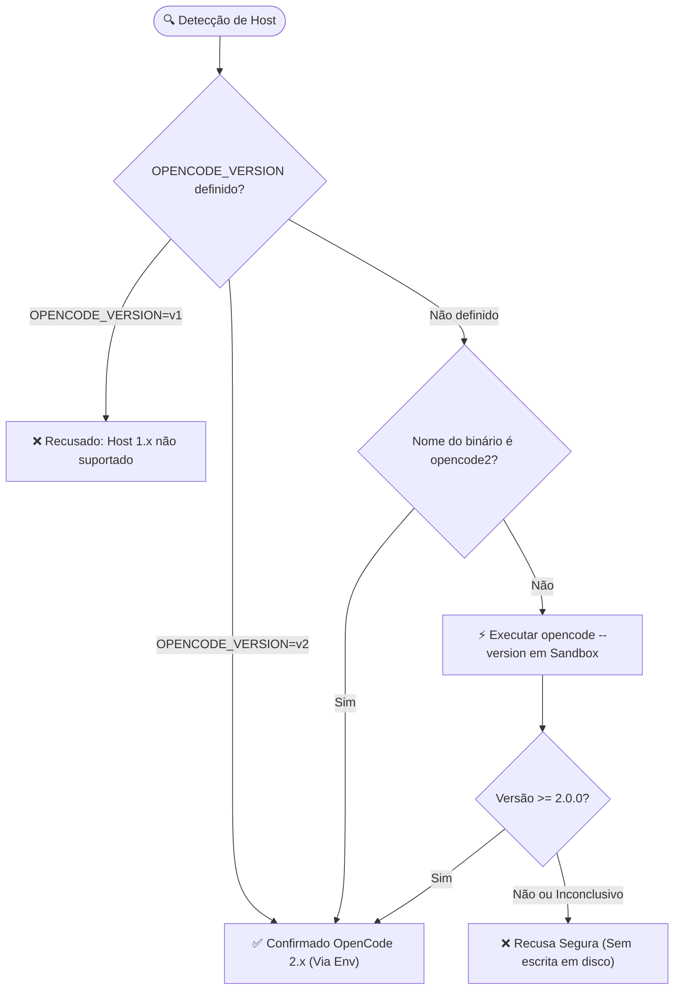

# Política de Suporte e Compatibilidade

> 🇺🇸 **English version available:** [Read in English](../COMPATIBILITY.md)

Esta página é a fonte de verdade para a política de suporte do Pantheon, regras do portão de detecção do host, requisitos de versão do Node.js e lista de comportamentos conhecidos.

---

## Hosts Suportados

O suporte do Pantheon é declarado para a **família** OpenCode, e não para versões menores individuais. Qualquer versão minor pertencente a uma família suportada é compatível por padrão.

- **OpenCode 2.x — Suportado:** Todas as versões da linha 2.x são suportadas, incluindo versões futuras. A partir da versão 2.0, o contrato legado V1 do OpenCode foi totalmente descontinuado. O Pantheon registra exclusivamente a superfície de plugin nativa documentada em [Arquitetura](ARCHITECTURE.md).
- **Incompatibilidade Conhecida: OpenCode 2.0.22:** Essa versão específica não expõe o método `ctx.permission.assert`, o que impede a execução segura das regras de ordenação de permissões e leituras limitadas. Não utilize o Pantheon no OpenCode 2.0.22.
- **Node.js >= 26.4.0:** Requisito de piso do pacote para execução do CLI, empacotador e interface TUI.
- **Python >= 3.11 (Opcional):** Necessário apenas se você for utilizar os servidores MCP locais em Python.

| Linha do Pantheon | OpenCode 1.19.x | OpenCode 2.x | OpenCode 2.0.22 |
|---|---|---|---|
| **1.7.x (Última com suporte a V1)** | Suportado (Plugin V1) | Suportado | Não suportado |
| **2.0 e superiores (Atual)** | Não suportado | Suportado (Nativo 2.x) | Incompatível (Sem `assert`) |

---

## Requisito Mínimo do Runtime Node.js

O Pantheon declara `engines.node` como `>=26.4.0`, em estrito alinhamento com o build oficial de Node do OpenCode fixado na versão 26.4.0. Versões como Node 22, Node 24 e Node 26.0–26.3 não fazem parte do suporte oficial.

O pacote se recusa a aplicar alterações de configuração quando executado sob versões não suportadas do Node, exibindo uma mensagem de versão explícita antes de qualquer escrita em disco.

---

## O Portão de Detecção do Host (Host Gate)

Para evitar configurações corrompidas ou suposições sobre o ambiente, o instalador deve **confirmar** que o host é OpenCode 2.x antes de escrever qualquer arquivo. A resolução segue a seguinte ordem:

1. **Variável de Ambiente Explícita:** Definir `OPENCODE_VERSION=v2` pula a sondagem externa, permitindo execução determinística em pipelines de CI, contêineres e testes.
2. **Nome do Binário:** Caso o executável seja nomeado explicitamente como `opencode2`, o instalador assume a versão 2.x.
3. **Sondagem do Executável (`--version`):** O instalador executa o binário do host dentro de uma sandbox descartável com orçamento estrito de tempo (5s para aplicação, 2s para dry-run), analisando a resposta com âncoras no token do OpenCode.

---

## Mesclagem de Configurações (`opencode.json` vs `opencode.jsonc`)

O instalador do Pantheon grava exclusivamente em `opencode.json`. No entanto, quando um arquivo `opencode.jsonc` existe no mesmo diretório:

- O OpenCode 2.x mescla ambos os arquivos em tempo de execução.
- Valores escalares do arquivo `.jsonc` têm precedência.
- Servidores MCP são mesclados por nome (o objeto mais recente substitui o anterior).
- O comando `npx pantheon-opencode doctor` analisa a configuração consolidada para alertar sobre conflitos ou sobreposições perigosas.

---

## Resumo de Comportamento dos Subagentes

Quando subagentes são disparados em segundo plano (`OPENCODE_EXPERIMENTAL_BACKGROUND_SUBAGENTS=true`), o OpenCode gerencia as tarefas concorrentes enquanto a interface TUI do Pantheon e o painel de contexto rastreiam tokens, custos e status de execução em tempo real.
