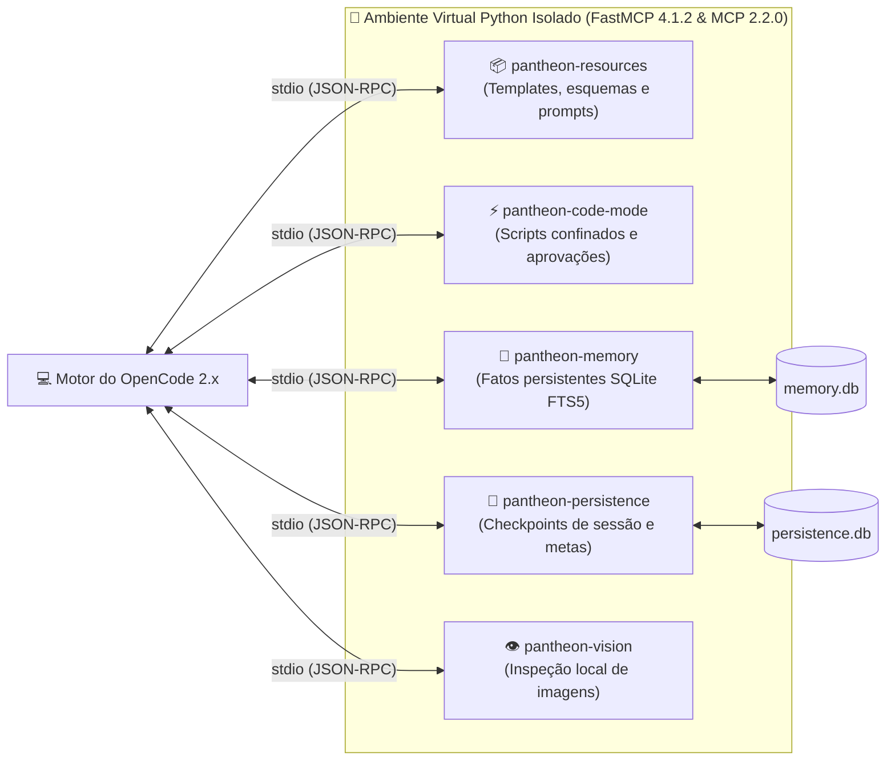

# Servidores MCP (Model Context Protocol)

> 🇺🇸 **English version available:** [Read in English](../MCP.md)

O Pantheon inclui **cinco servidores locais MCP em Python via stdio**. Eles iniciam automaticamente com o OpenCode e cobrem memória de projeto, persistência de checkpoints, recursos do framework, execução confinada de scripts e visão multimodal.

Esta página detalha a configuração dos servidores MCP, pontos de entrada, allowlists por agente e pinos de versão. As assinaturas completas das ferramentas estão em [Ferramentas MCP](../mcp-tools.md); a política de gerenciamento de memória está documentada em [Memória](../MEMORY.md).



---

## Pinos de Versão do Runtime

O runtime empacotado fixa o SDK Python do MCP em `mcp==2.2.0` e o framework FastMCP em `fastmcp==4.1.2`. O código dos servidores importa `FastMCP` diretamente de `fastmcp` (o SDK v2 removeu a reexportação legada `mcp.server.fastmcp`). A instalação cria um ambiente virtual Python isolado a partir do manifesto em `src/mcp/`.

---

## Pontos de Entrada (Entrypoints)

O instalador declara os cinco servidores em `scripts/install-mcp.mjs` e os registra na configuração do host. Cada servidor é um script real e independente:

| Servidor | Ponto de Entrada | Ferramentas | Recursos |
|---|---|---|---|
| `pantheon-resources` | `scripts/mcp_resources.py` | — | 4 estáticos + 6 templates |
| `pantheon-code-mode` | `scripts/code_mode.py` | 2 | 1 estático + 1 template |
| `pantheon-memory` | `scripts/memory_mcp.py` | 9 | — |
| `pantheon-persistence` | `scripts/mcp_persistence.py` | 6 | — |
| `pantheon-vision` | `src/mcp/pantheon_vision.py` | 3 | — |

A instalação grava caminhos absolutos para o interpretador do venv e o script do servidor. O `pantheon-memory` usa `src/mcp/memory_mcp.py` como sua fonte de runtime canônica. O `pantheon-vision` é implementado a partir do código canônico em `scripts/pantheon_vision.py`.

---

## Configuração no OpenCode

O instalador grava o seguinte formato no `opencode.json`:

```json
{
  "mcp": {
    "pantheon-resources": {
      "type": "local",
      "command": ["<venv-python>", "<installed>/scripts/mcp_resources.py"],
      "enabled": true
    },
    "pantheon-code-mode": {
      "type": "local",
      "command": ["<venv-python>", "<installed>/scripts/code_mode.py"],
      "cwd": ".",
      "enabled": true
    }
  }
}
```

Reinicie o OpenCode após alterar qualquer configuração MCP. Os servidores são processos de sistema operacional separados iniciados pelo host via canais stdio.

---

## Allowlists de Permissões por Agente

O instalador lê a lista `mcp_tools` de cada arquivo canônico em `src/agents/*.md` e gera permissões nativas por agente. Para cada servidor do Pantheon, ele bloqueia o coringa (`deny`) primeiro e, em seguida, libera apenas as ferramentas declaradas. Servidores MCP externos do usuário não são alterados.

| Agente | Recursos | Code-mode | Memory | Persistence | Vision |
|---|---|---|---|---|---|
| **zeus** | all | — | search | context_save, context_get, goal_create, goal_get, goal_update, goal_done | — |
| **athena** | all | — | search, code_query, code_neighbors | — | — |
| **apollo** | all | — | search, code_query, code_neighbors | — | — |
| **hermes** | all | execute script | search | — | — |
| **aphrodite** | all | execute script | search | — | describe/OCR/analyze |
| **demeter** | all | execute script | search | — | — |
| **themis** | all | execute script | search | — | — |
| **prometheus** | all | execute script | search | — | — |
| **hephaestus** | all | execute script | search | — | — |
| **nyx** | all | execute script | search | — | — |
| **gaia** | all | — | recall | — | describe/OCR/analyze |
| **iris** | all | — | recall | — | — |
| **mnemosyne** | all | execute script | ferramentas explícitas de escrita | — | — |
| **talos** | all | execute script | recall | — | — |

**Regras:**
- `all` permite todas as ferramentas daquele servidor específico.
- Uma lista permite apenas as ferramentas declaradas; lista vazia nega o acesso.
- Um servidor omitido nos metadados do agente é negado por padrão.
- No OpenCode 2.x, o host avalia regras na lista `permissions` cuja ação é `<servidor>_*` com efeito `deny`/`allow`.

---

## Detalhamento dos 5 Servidores

### 1. `pantheon-resources`
Servidor somente-leitura que expõe metadados e esquemas do Pantheon via URIs `pantheon://`:
- `pantheon://framework/capabilities` — Capacidades e papéis dos 14 agentes.
- `pantheon://templates/athena-plan` — Template do plano Deepwork.
- `pantheon://templates/themis-report` — Formato do veredito de auditoria.
- `pantheon://memory-bank/{file}` — Leitura sob demanda dos arquivos em `.pantheon/memory-bank/`.

### 2. `pantheon-code-mode`
Ambiente para execução segura e confinada de scripts de alto volume (reduz consumo de tokens ao processar grandes massas de dados via scripts isolados).
- `execute_script` — Executa código Python ou Node.js em processo filho com timeout configurável.
- `approve_manifest` — Registra hashes de scripts aprovados.

### 3. `pantheon-memory`
Banco SQLite local (`memory.db`) com indexação FTS5 e busca BM25 por palavras-chave:
- `memory_store` — Armazena fatos, decisões ou regras do projeto (com limite de 64 KiB por entrada).
- `memory_search` — Busca léxica por termos-chave.
- `code_query` e `code_neighbors` — Consultas estruturadas de código para `@athena` e `@apollo`.

### 4. `pantheon-persistence`
Lida com dados efêmeros da sessão atual:
- `context_save` e `context_get` — Checkpoints de estado entre fases do Deepwork.
- `goal_create`, `goal_update` e `goal_done` — Rastreamento estruturado de metas.

### 5. `pantheon-vision`
Servidor de visão local que realiza análise e extração de informações de imagens e capturas de tela:
- `describe_image` — Descrição estruturada de interfaces e gráficos.
- `ocr_image` — Extração de texto de telas e diagramas.
- `analyze_ui` — Mapeamento de componentes e hierarquia visual para o `@aphrodite`.
