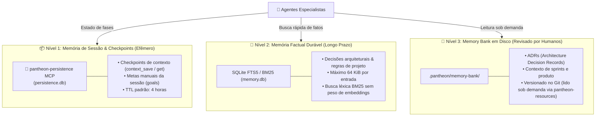

# Gerenciamento de Memória do Pantheon

> 🇺🇸 **English version available:** [Read in English](../MEMORY.md)

O Pantheon opera com **três armazenamentos de contexto independentes**. A regra fundamental é: utilize sempre o menor armazenamento que atenda à necessidade:



---

## Comparativo das 3 Lojas de Memória

| Loja | Tempo de Vida | Caso de Uso |
|---|---|---|
| **`pantheon-memory` MCP** | Banco SQLite `memory.db`; entradas com teto de 64 KiB serializados; expiram apenas se gravadas com `ttl_seconds` | Fatos, decisões de design e convenções reutilizáveis do projeto |
| **`pantheon-persistence` MCP** | Banco SQLite isolado; checkpoints qualificados por ID de sessão com expiração padrão de 4 horas | Checkpoints temporários entre fases e dados transitórios chave/valor |
| **`.pantheon/memory-bank/`** | Arquivos Markdown reais na árvore de trabalho do projeto; versionados no Git | Contexto de arquitetura, ADRs e especificações de produto revisadas por humanos |

> [!NOTE]
> Provedores externos de MCP (como `flashmemory`) utilizam armazenamentos separados do banco SQLite do Pantheon. Usar o mesmo nome de namespace não compartilha nem sincroniza entradas entre provedores distintos.

Esses três armazenamentos **não são sincronizados automaticamente**. Em particular, a preservação de TODOs durante a compactação de contexto do OpenCode é um processo local em memória e não grava no `pantheon-persistence`. As ferramentas `context_*` são checkpoints explícitos de MCP, não ganchos automáticos.

---

## 1. Memória Durável (`pantheon-memory`)

O servidor armazena entradas em SQLite e as indexa com FTS5/BM25. A recuperação é estritamente léxica: a busca encontra correspondências a partir de palavras compartilhadas com o conteúdo gravado, eliminando a dependência e o consumo de tokens de modelos de embeddings vetoriais.

O namespace padrão é `default`. Use namespaces nomeados quando as entradas tiverem um dono ou propósito específico (ex: `architecture`, `conventions`, `testing`).

### Limites e Governança
- **Teto por Entrada:** Gravações que excedam 65.536 bytes (64 KiB) serializados em UTF-8 são terminantemente recusadas (para evitar perda silenciosa de dados). O erro reporta o tamanho real, o teto e a variável de ambiente que permite ajustá-lo (`PANTHEON_MEMORY_MAX_ENTRY_BYTES`).
- **Expiração (TTL):** Entradas podem ter tempo de vida determinado em segundos. Entradas expiradas são automaticamente ocultadas de buscas e expurgadas.

---

## 2. Persistência de Sessão (`pantheon-persistence`)

Gerencia o estado efêmero durante a execução de tarefas complexas e fluxos do Deepwork:
- **`context_save` / `context_get`**: Salva o estado intermediário de uma tarefa antes que uma operação pesada ou uma compactação de contexto ocorra.
- **`goal_create`, `goal_update`, `goal_done`**: Rastreia metas explícitas da sessão atual, permitindo que o usuário ou o `@zeus` consultem o progresso a qualquer momento.

---

## 3. Memory Bank do Projeto (`.pantheon/memory-bank/`)

Diferente de bancos de dados binários, o **Memory Bank** vive como arquivos Markdown comuns na raiz do seu repositório:

```text
.pantheon/memory-bank/
├── activeContext.md       # Foco atual e próximas etapas imediatas
├── productContext.md      # Por que este projeto existe e quais problemas resolve
├── systemPatterns.md      # Arquitetura, padrões de código e convenções
├── decisionLog.md         # Registro de decisões arquiteturais (ADRs)
└── progress.md            # O que está concluído e pendente
```

Esses arquivos podem ser lidos pelos agentes sob demanda através do recurso `pantheon://memory-bank/{arquivo}` do servidor `pantheon-resources`, garantindo total transparência: o desenvolvedor pode inspecionar, editar e versionar no Git todo o conhecimento acumulado pelos agentes.
