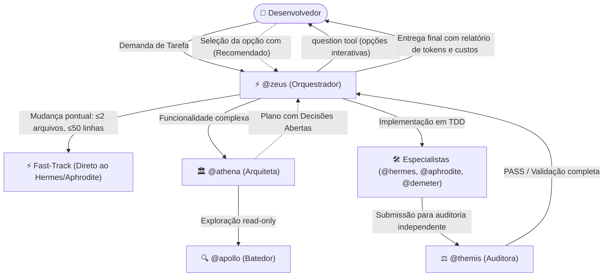

# Início Rápido (Quick Start)

> 🇺🇸 **English version available:** [Read in English](../QUICKSTART.md)

Este guia foi elaborado para levar você do zero ao seu primeiro resultado funcional com o **Pantheon** em menos de dez minutos.

---

## Antes de Começar (Pré-requisitos)

Certifique-se de que seu ambiente atende aos seguintes requisitos:

1. **OpenCode:** Versão 2.x instalada (suporte nativo ao host 2.x).
2. **Node.js:** Versão `>=26.4.0` (necessária para as ferramentas nativas e interface TUI do Pantheon).
3. **Python (Opcional / Legado):** Versão `3.11+` apenas se você optar pelos servidores MCP legados em Python (todas as 26 ferramentas nativas rodam em TypeScript/Node).

---

## 1. Instalação

### Instalação Nativa como Plugin do OpenCode (Fluxo Único na v2.2.2+)

Um único comando registra em memória os 8 agentes canônicos, 26 skills, 9 comandos, 31 tools nativas em TypeScript e a interface TUI, sem copiar arquivos redundantes para o disco (e limpando automaticamente MCPs Python legados e cópias antigas da TUI/CLI):

```bash
opencode plugin add pantheon-opencode
```

Por que esse é o fluxo ideal:
- Funciona imediatamente em **qualquer diretório** (repositórios existentes, worktrees Git ou pastas vazias) sem `init` nem lixo no cache `_npx/`.
- Atualiza de forma limpa com `opencode plugin update pantheon-opencode` (ou `/pantheon-updates`) sem deixar cópias antigas em `.opencode/agents/` ou `plugins/pantheon-tui/` coexistindo.

---

## 2. Validar Saúde e Limpar Caches Antigos

Dentro do OpenCode, use `/pantheon-settings` (ou `/pantheon-updates`) para rodar o **Doctor** e a seção **Legados, Drift & Limpeza** (que detecta/remove caches antigos, MCPs Python legados e também permite resetar os stores `.pantheon/` com segurança).

Em desenvolvimento local no repositório, você também pode rodar `npm run doctor`.

---

## 3. Iniciar o OpenCode

Inicie o OpenCode no seu terminal ou abra o aplicativo desktop:

```bash
opencode
```

> **Dica para Subagentes em Segundo Plano:** Caso o seu runtime do OpenCode documente suporte para subagentes assíncronos, você pode ativar a delegação em segundo plano:
> ```bash
> OPENCODE_EXPERIMENTAL_BACKGROUND_SUBAGENTS=true opencode
> ```

### O que você verá na interface:
- **Barra Lateral Rica (TUI):** Exibe a versão ativa do Pantheon (`v2.2.0`), o preset em uso, o estado do Git, o painel de **Contexto** com contadores por domínio (`mem`, `ctx`, `code`, `edit`, `shell`), **Todo** nativo e **Dispatch** com verbos ao vivo e badges `?`/`!`.
- **Anúncios Interativos de Atualização e Novidades:** Ao atualizar, abre o diálogo **NOVIDADES** (`/pantheon-whats-new` para reabrir quando quiser) e o badge clicável `↑ vX.Y.Z` abre `/pantheon-updates`.
- **Suporte Multimodal Nativo (Pantheon Vision):** Cole uma captura de tela (`Ctrl+V` / `Cmd+V`) ou use `vision_describe` quando o catálogo de modelos do host estiver exposto.

---

## 4. Despachando Tarefas no Chat

O Pantheon oferece diferentes padrões de interação conforme o escopo e a complexidade do trabalho:

### A. Desenvolvimento Geral de Funcionalidades via `@zeus`
Para novas funcionalidades, aprimoramentos e fluxos estruturados:
```text
@zeus Implemente um middleware de autenticação com verificação de JWT, rate limiting e testes unitários.
```
**Como o Zeus coordena:**
- **Desvio Fast-Track:** Mudanças pontuais (≤2 arquivos, ≤50 linhas) pulam a fase de planejamento e vão direto para o `@hermes` ou `@aphrodite`.
- **Planejamento Arquitetural:** Tarefas complexas são encaminhadas para a `@athena` gerar o blueprint em fases.
- **Portão de Perguntas Interativo:** Qualquer decisão técnica pendente (`decisions_needed`) aciona a ferramenta nativa `question` do OpenCode, exibindo opções estruturadas com a indicação `(Recomendado)`.
- **Implementação em TDD:** Após a aprovação do plano, Zeus despacha o `@hermes` em modo TDD (RED -> GREEN -> REFACTOR) e a `@themis` para auditoria estrita.

### B. Projetos Complexos em Múltiplas Fases via `/pantheon-deepwork`
Para tarefas com mais de 10 turnos, múltiplas sessões ou grandes refatorações que exigem persistência de progresso:
```text
/pantheon-deepwork Migre a camada de acesso a dados de Prisma para Kysely com scripts de migração zero-downtime.
```
- Salva o progresso e checkpoints em `.pantheon/deepwork/<task-slug>/` (`plan.json`, `PLAN.md`, logs incrementais).
- Aloca git worktrees isolados (`.pantheon-worktrees/`) para especialistas trabalhando em paralelo.
- Exige aprovação no portão de auditoria da `@themis` a cada virada de fase antes de mesclar o código.

### C. Arbitragem de Decisões de Arquitetura via `/pantheon`
Para trade-offs arquiteturais, seleção de tecnologias ou revisões de segurança de alto impacto:
```text
/pantheon Devemos adotar Server-Sent Events (SSE) ou WebSockets para o feed de notificações em tempo real?
```
- Despacha a questão em paralelo para 2 ou 3 especialistas (ex: `@athena`, `@hermes`, `@themis`) no mesmo turno.
- Resolve divergências aplicando regras de precedência de domínio (Themis para Segurança, Demeter para Banco de Dados, Hermes para API, Athena para Modularidade).
- Retorna uma síntese assertiva com recomendações claras.

### D. Chamada Direta de Agentes Especialistas com `@`
- **`@hermes` (Backend, Infra & Execução Rápida):** Correções cirúrgicas e implementação backend/infra em TDD (ou `spawn_ephemeral` com `role="hotfix"` para slices isolados):
  ```text
  @hermes Corrija o erro de importação no arquivo src/server.ts e atualize a porta do servidor.
  ```
- **`@apollo` (Batedor Read-Only):** Para explorar e entender o código, mapear dependências e encontrar trechos sem qualquer risco de edições:
  ```text
  @apollo Localize onde as conexões WebSocket são autenticadas e resuma o fluxo com números de linha.
  ```
- **`@hermes` (Especialista Backend):** Implementação backend com testes em TDD (RED -> GREEN -> REFACTOR).
- **`@aphrodite` (Especialista Frontend):** Criação de componentes visuais, Tailwind CSS e acessibilidade WCAG.
- **`@themis` (Auditora Independente):** Verificação independente de qualidade, testes, linters e segurança.

---

## 5. Como Funciona a Execução (O Ciclo de Vida do Pantheon)

O diagrama a seguir ilustra a colaboração entre Zeus, Athena, especialistas de código e Themis durante uma tarefa estruturada:



1. **Roteamento Inteligente:** O `@zeus` avalia a complexidade. Tarefas simples vão direto ao especialista; demandas amplas passam por planejamento estruturado.
2. **Planejamento com `@athena`:** O plano é gerado em formato estruturado Deepwork (`.pantheon/deepwork/<slug>/plan.json` e `PLAN.md`).
3. **Portão de Perguntas Interativo:** Dúvidas de arquitetura (`decisions_needed`) **nunca** são deixadas como texto solto no chat. O `@zeus` invoca a ferramenta nativa `question` do OpenCode, exibindo opções estruturadas com a indicação `(Recomendado)`.
4. **Implementação em TDD:** Os especialistas escrevem testes primeiro (RED) e implementam o código até que todos passem (GREEN).
5. **Auditoria Rigorosa com `@themis`:** Nenhum código é concluído sem auditoria independente em modo somente leitura (linters, testes de regressão e segurança).
6. **Telemetria em Tempo Real:** A barra lateral da TUI e os comandos de status exibem subagentes ativos, preset de modelos e consumo de tokens em tempo real.

---

## Próximos Passos

Agora que seu primeiro despacho foi concluído, explore os tópicos avançados:

- **[Matriz de Capacidades dos Agentes](AGENT-CAPABILITY-MATRIX.md):** Saiba exatamente o que cada agente pode e não pode fazer, limites de bash e edição de código.
- **[Guia do Primeiro Projeto (Passo a Passo)](guides/first-project.md):** Um tutorial prático de ponta a ponta criando uma aplicação full-stack real.
- **[Blueprint do Deepwork](guides/deepwork.md):** Aprenda como funciona o motor de planos em JSON canônico, logs append-only e grafos Mermaid.
- **[Visão Multimodal](guides/vision.md):** Veja como colar capturas de tela para depurar layouts sem poluir seu contexto de prompt.
- **[Livro de Receitas (Cookbook)](guides/cookbook.md):** Receitas práticas prontas para copiar e colar em suas demandas diárias.
- **[Guia Completo de Instalação](INSTALLATION.md):** Flags avançadas do instalador, restauração de backups (`restore`) e procedimentos de desinstalação.
