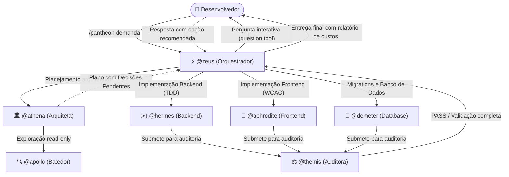

# Início Rápido (Quick Start)

> 🇺🇸 **English version available:** [Read in English](../QUICKSTART.md)

Este guia foi elaborado para levar você do zero ao seu primeiro resultado funcional com o **Pantheon** em menos de dez minutos.

---

## Antes de Começar (Pré-requisitos)

Certifique-se de que seu ambiente atende aos seguintes requisitos:

1. **OpenCode:** Versão 2.x instalada (suporte nativo ao host 2.x).
2. **Node.js:** Versão `>=26.4.0` (necessária para executar o CLI, empacotador e interface TUI do Pantheon).
3. **Python (Opcional):** Versão `3.11+` (necessária apenas se você utilizar servidores MCP avançados em Python).

---

## 1. Instalação

Você pode instalar o Pantheon de duas maneiras, dependendo da sua preferência:

### Opção A — Instalação Completa com CLI (Recomendada)

Instala os 14 agentes especialistas, 25 skills, regras de contexto (TDD, YAGNI), comandos de atalho e a interface visual TUI:

```bash
# Instalação Global (recomendada — disponível para todos os seus projetos)
npx pantheon-opencode init

# Ou Instalação Restrita ao Projeto Atual (apenas na pasta do projeto)
npx pantheon-opencode init --project
```

> **Dica para automação ou CI:** Execute `npx pantheon-opencode init -y` para aplicar as configurações padrão imediatamente sem prompts interativos.

### Opção B — Carregamento do Plugin pelo OpenCode Nativo

Se preferir carregar apenas o plugin através do gerenciador de pacotes nativo do OpenCode 2.x:

```bash
opencode plugin add pantheon-opencode
```

---

## 2. Validar a Instalação com o `doctor`

Antes de iniciar seu trabalho, execute o diagnóstico de saúde do Pantheon:

```bash
npx pantheon-opencode doctor
```

O comando `doctor` valida:
- A conexão e o registro dos **5 servidores MCP nativos** (`resources`, `memory_store`, `memory_search`, `persistence`, `vision` / `cost`).
- A integridade da configuração em `opencode.json`.
- A sincronização dos arquivos de agentes, skills e instruções.

Uma instalação saudável exibirá veredicto **PASS** com zero erros e zero advertências.

---

## 3. Iniciar o OpenCode

Inicie o OpenCode no seu terminal ou abra o aplicativo desktop:

```bash
opencode
```

### O que você verá na interface:
- **Barra Lateral Rica (TUI):** Exibe a versão ativa do Pantheon (v2.1.1), o preset de modelos em uso, o estado do repositório Git e um painel de **Contexto** em tempo real com contagem de tokens, custo estimado e velocidade de cache.
- **Suporte Multimodal Nativo (Pantheon Vision):** Se você capturar uma tela e colar diretamente no chat (`Ctrl+V` / `Cmd+V`), o Pantheon analisa a imagem de forma silenciosa via contexto de sistema, sem poluir a conversa com comentários ou blocos HTML.

---

## 4. Seu Primeiro Despacho no Chat

Com o OpenCode aberto, você tem três formas canônicas de interagir com o ecossistema do Pantheon:

### 1. Orquestração Completa via Comando `/pantheon`
Ideal para implementar funcionalidades, refatorações ou tarefas que envolvem múltiplos arquivos:

```text
/pantheon Adicione um endpoint GET /metrics com testes em TDD e exportação assíncrona para CSV.
```

### 2. Planejamento Arquitetural via `/pantheon-deepwork`
Ideal para tarefas de alta complexidade que exigem plano auditável e grafo de dependências:

```text
/pantheon-deepwork Refatore a camada de autenticação para tokens JWT com rotação de chaves.
```

### 3. Chamada Direta de Agentes Especialistas com `@`
- **`@zeus` (Orquestrador Central):** Analisa a intenção, delega para especialistas e audita o resultado.
  ```text
  @zeus Analise as rotas da API e proponha melhorias de resiliência e tratamento de erros.
  ```
- **`@talos` (Faixa Expressa / Hotfixes em 1 Turno):** Para correções pontuais, erros de digitação e pequenos bugs sem cerimônia de planejamento.
  ```text
  @talos Corrija o erro de importação no arquivo src/server.ts e atualize a chamada de função.
  ```
- **`@apollo` (Investigador Read-Only):** Para explorar e entender o código sem risco de edições indesejadas.
  ```text
  @apollo Localize onde as conexões WebSocket são autenticadas e resuma o fluxo com números de linha.
  ```

---

## 5. Como Funciona a Execução (O Ciclo de Vida do Pantheon)

Durante a execução de uma tarefa, o Pantheon opera sob regras estritas de separação de responsabilidades:



1. **Roteamento Inteligente:** O `@zeus` avalia a complexidade. Tarefas simples vão direto ao especialista; tarefas amplas passam por planejamento prévio.
2. **Planejamento com `@athena`:** O plano é gerado em formato estruturado Deepwork (`.pantheon/deepwork/<slug>/plan.json` e `PLAN.md`).
3. **Portão de Perguntas Interativas:** Dúvidas ou trade-offs técnicos (`decisions_needed`) **nunca** são deixados como texto solto no chat. O `@zeus` invoca a ferramenta nativa `question` do OpenCode, exibindo opções estruturadas com a indicação `(Recomendado)`.
4. **Implementação em TDD:** Os especialistas escrevem testes primeiro (RED) e implementam até que tudo passe (GREEN).
5. **Auditoria Rigorosa com `@themis`:** Nenhum código é concluído sem auditoria independente em modo somente leitura (linters, testes de regressão e segurança).
6. **Acompanhamento com `/dispatch`:** Digite `/dispatch` no chat para abrir a árvore de subagentes e acompanhar o progresso em tempo real.

---

## Próximos Passos

Agora que você já concluiu seu primeiro despacho, explore os tópicos avançados:

- **[Matriz de Capacidades dos Agentes](AGENT-CAPABILITY-MATRIX.md):** Saiba exatamente o que cada agente pode e não pode fazer, limites de bash e edição de código.
- **[Guia do Primeiro Projeto (Passo a Passo)](guides/first-project.md):** Um tutorial prático de ponta a ponta criando uma aplicação full-stack real.
- **[Blueprint do Deepwork](guides/deepwork.md):** Aprenda como funciona o motor de planos em JSON canônico, logs append-only e grafos Mermaid.
- **[Visão Multimodal](guides/vision.md):** Veja como colar capturas de tela para depurar layouts sem poluir seu contexto de prompt.
- **[Livro de Receitas (Cookbook)](guides/cookbook.md):** 8 receitas práticas prontas para copiar e colar em suas demandas diárias.
- **[Guia Completo de Instalação](INSTALLATION.md):** Flags avançadas do instalador, restauração de backups (`restore`) e procedimentos de desinstalação.
