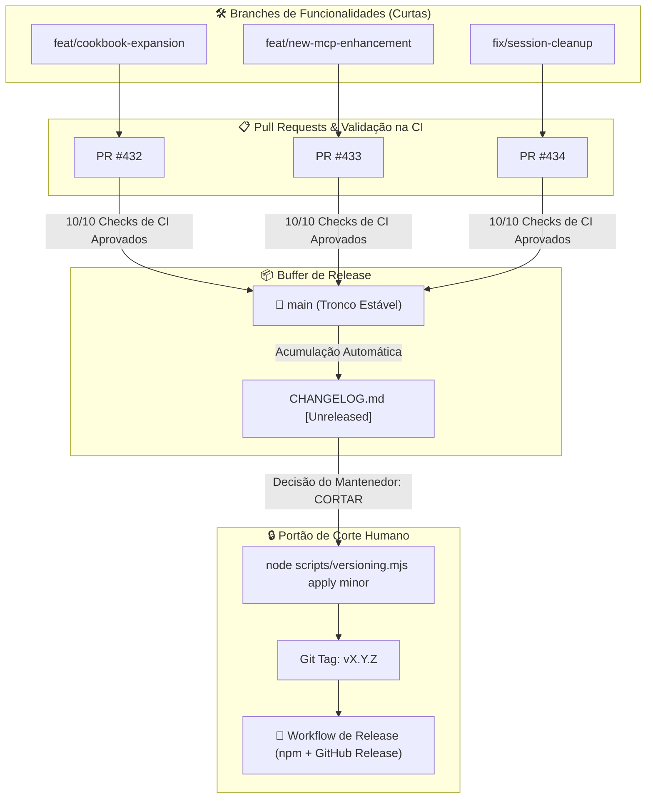

# Processo de Release & Versionamento

> 🇺🇸 **English version available:** [Read in English](../RELEASING.md)

Como funcionam o versionamento, o fluxo de branches, o empacotamento e a publicação de versões no Pantheon.

---

## Estratégia de Branches & Release Buffering (Trunk-Based Delivery)

O Pantheon adota um fluxo de **Trunk-Based Delivery com Buffer de Releases**. Todo o desenvolvimento ocorre em branches curtas de feature, é integrado ao `main` através de Pull Requests revisados, acumula as novas capacidades na seção `[Unreleased]` do changelog, e só publica no npm e GitHub Releases quando o mantenedor decide explicitamente cortar uma versão:



### Princípios Fundamentais:
1. **O `main` Está Sempre Testado e Pronto:** O código na branch `main` nunca está quebrado. Todo merge exige aprovação em todos os 10 checks de CI (`validate`, `test-suite`, `plugin-ts-coverage`, `security-scan`, `commitlint`, `CodeQL`, etc.).
2. **Merges no `main` NÃO Publicam Pacotes:** O merge de um PR no `main` atualiza a documentação ao vivo no GitHub Pages (`latest`), mas **nunca publica no npm** nem cria tags de versão no Git de forma automática.
3. **Buffer de Features em `[Unreleased]`:** As melhorias concluídas se acumulam ordenadamente na seção `## [Unreleased]` do `CHANGELOG.md` até que o mantenedor decida que o lote de features está pronto para virar versão.
4. **Corte Explícito de Release:** O lançamento de uma nova versão oficial só ocorre quando o mantenedor roda o script de release (`node scripts/versioning.mjs apply [patch|minor|major]`), que promove o bloco `[Unreleased]` para a nova versão, sincroniza os manifestos e cria a tag no Git.

---

## Política de Versionamento Semântico

O Pantheon segue estritamente o **Semantic Versioning (SemVer)** baseado nas mensagens de [Conventional Commits](https://www.conventionalcommits.org/):

| Padrão de Commit | Tipo de Incremento | Versão Alvo |
|---|---|---|
| `BREAKING CHANGE` ou escopo `type!:` | **MAJOR** | x.0.0 |
| `feat:` | **MINOR** | x.y.0 |
| `fix:`, `chore:`, `docs:`, `refactor:` | **PATCH** | x.y.z |

---

## Comandos de Versionamento

```bash
# Exibe o status da versão atual, última tag git estável e status de release pendente
node scripts/versioning.mjs status

# Sincroniza todos os manifestos + promove [Unreleased] → [vX.Y.Z]
node scripts/versioning.mjs apply          # tipo automático (calculado dos commits)
node scripts/versioning.mjs apply minor    # tipo explícito: patch | minor | major
node scripts/versioning.mjs apply --notes  # preenche notas de release a partir dos commits

# Simulação da release sem publicar (dry-run com empacotamento npm)
npm run release:dry-run
```

---

## Checklist de Corte de Release

Quando você decidir cortar uma versão nova:

1. **Garantir Árvore Limpa:** Certifique-se de estar na branch `main` com `git pull` atualizado.
2. **Executar Status:** Rode `node scripts/versioning.mjs status` para conferir a recomendação de versão.
3. **Promover Release:** Rode `node scripts/versioning.mjs apply minor` (ou `patch`).
4. **Verificar Build & Lint:** Rode `npm run lint` e `npm test`.
5. **Comitar e Criar Tag:** Comite o changelog e crie a tag git correspondente (`git tag vX.Y.Z`).
6. **Disparar Release:** Faça `git push origin main --tags`. O workflow de release do GitHub Actions (`release.yml`) executará a publicação no npm e gerará as notas no GitHub Releases.
