# Configurações, Paleta de Comandos & TUI (`/pantheon-settings`)

> 🇺🇸 **English version available:** [Read in English](../SETTINGS.md)
> Contexto de design: [Pantheon 2.0 — Modern Install, Settings UI, and Update Flow](../design/2.0-settings-and-install.md).

O Pantheon oferece uma interface TUI interativa e não destrutiva dentro do OpenCode 2.x,
presente na **tela inicial (Home)**, **autocomplete de comandos**, **barra lateral da
sessão**, painel **`/dispatch`**, **`/pantheon-settings`**, **`/pantheon-artifacts`** e
no card **`What's New`**.

---

## 1. Pontos de Entrada & Paleta de Comandos

- **Tela inicial (Home):** exibe o selo de versão ativo (`Pantheon v2.2.0`) e permite
  abrir `/pantheon-settings` direto em diálogo centralizado (`large`), mesmo sem
  sessão aberta.

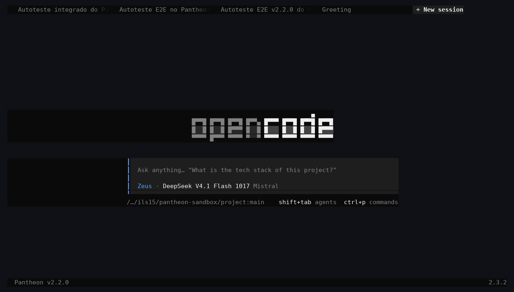

- **Comandos (`/pantheon*`) & `Ctrl+P`:** digitar `/pantheon` lista todos os
  comandos integrados; clicar no selo de atualização `↑ vX.Y.Z` na Home ou na
  barra lateral também abre direto a aba **Atualizações**.

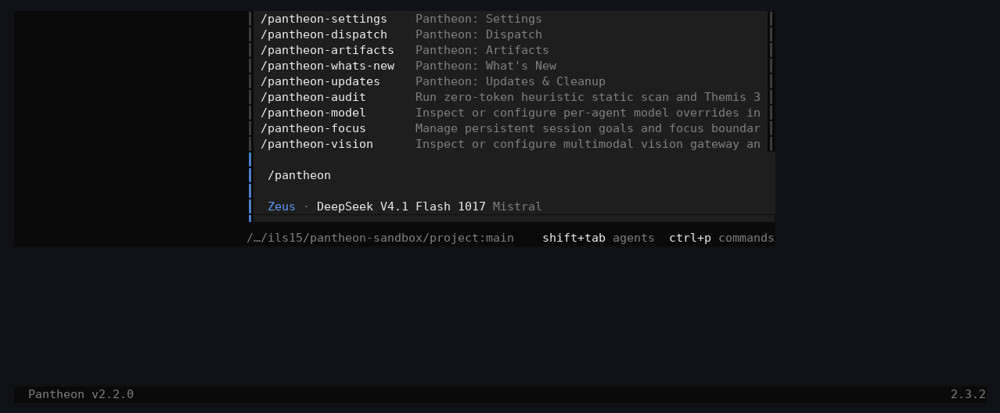

| Comando | Alias / Paleta | O que abre |
|---|---|---|
| `/pantheon-settings` | `Pantheon: Settings` | Janela interativa de 10 abas (`docked` / `dialog` / `fullscreen`) |
| `/pantheon-updates` | `Pantheon: Updates & Cleanup` | Abre direto na aba **Atualizações & Limpeza** |
| `/pantheon-whats-new` | `/whats-new` · `Pantheon: What's New` | Reabre o card paginado com novidades da versão |
| `/pantheon-artifacts` | `/artifacts` · `Pantheon: Artifacts` | Lista e pagina `PLAN.md`, relatórios e ADRs |
| `/pantheon-dispatch` | `/dispatch` · `Pantheon: Dispatch` | Painel amplo de subagentes e custos |

Todos os painéis suportam **teclado** (`Tab`, `↑`/`↓`, `←`/`→`, `Enter`, `Ctrl+S`,
`Ctrl+R`, `Esc`) e **mouse** (clique em abas, linhas, seletores e botões).

---

## 2. As 10 Abas do `/pantheon-settings`

### `Gates` — Regras & Guardrails por Escopo
Alterne entre escopo global e projeto, ative/desative skills instaladas
(`Auto-continue`, `TDD with agents`, `Code review checklist`, `Prompt refinery`) e
portões de execução (`Idle todo enforcer`, `Context pruner`, `J1 risk gate`) com
gravação atômica em `pantheon-overrides.json`.

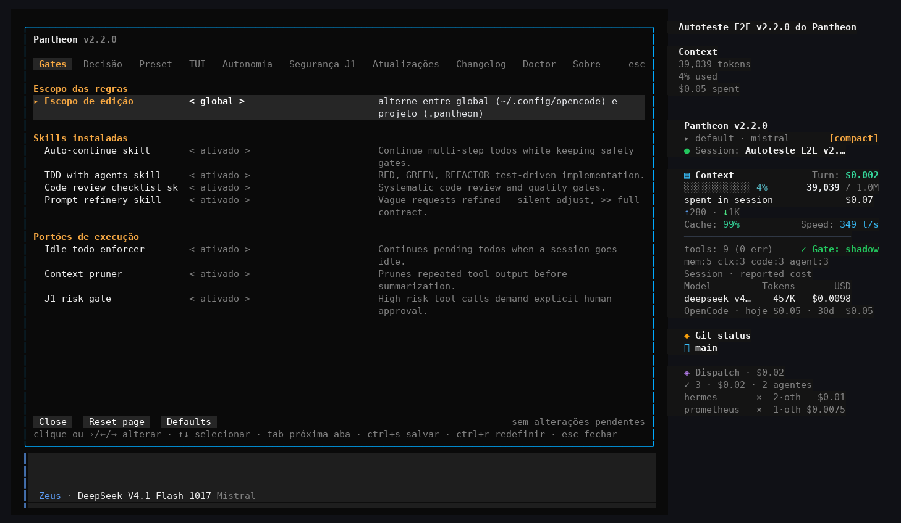

### `Decisão` — Assistente Jev & Credenciais de Roteamento
Configure o modo de arbitragem (`local`, `auto`, `explicit`), alterne entre os
modelos de decisão configurados e acompanhe o status somente-leitura das
credenciais sem nunca gravar chaves na janela.

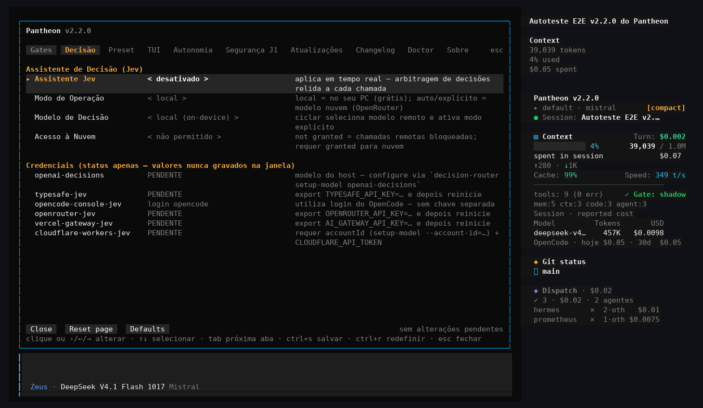

### `Preset` — Tier Global & Modelo de Visão
Selecione o preset global ativo (`none`, `free`, `eco`, `standard`, `teampro`, etc.)
e defina o modelo usado por `vision_describe` em `opencode-vision.json`.

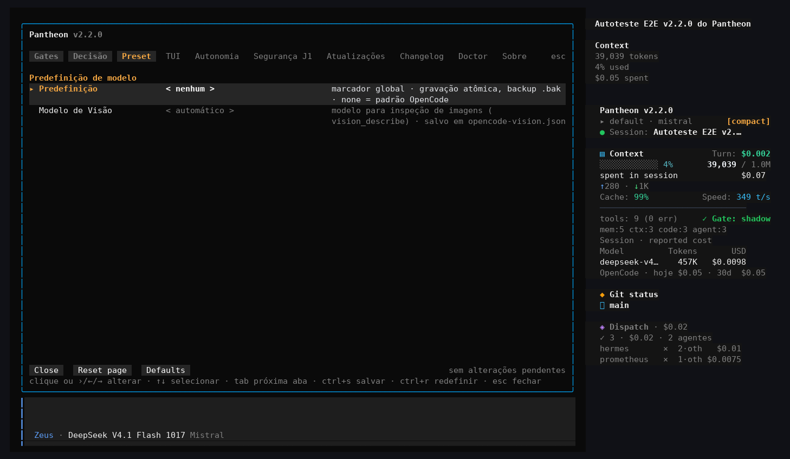

### `TUI` — Idioma PT-BR/EN, Tema, Barras & Layout
Escolha idioma (`auto` / `pt-BR` / `en`), densidade (`comfortable` / `compact`),
superfície (`docked` / `fullscreen` / `dialog`), estilo de barras (`line`, `block`,
`smooth`, `ascii`, `dots`, `braille`) e linhas da barra lateral.

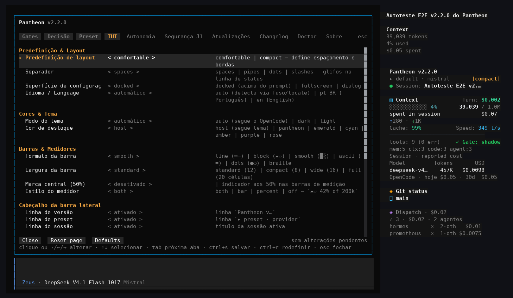

### `Autonomia` — Loop Contínuo & Orçamentos Jev
Defina teto de continuações multi-turn (`1..200`), intervalo mínimo entre turnos e
tetos mensais/por consulta em USD para o roteamento Jev.

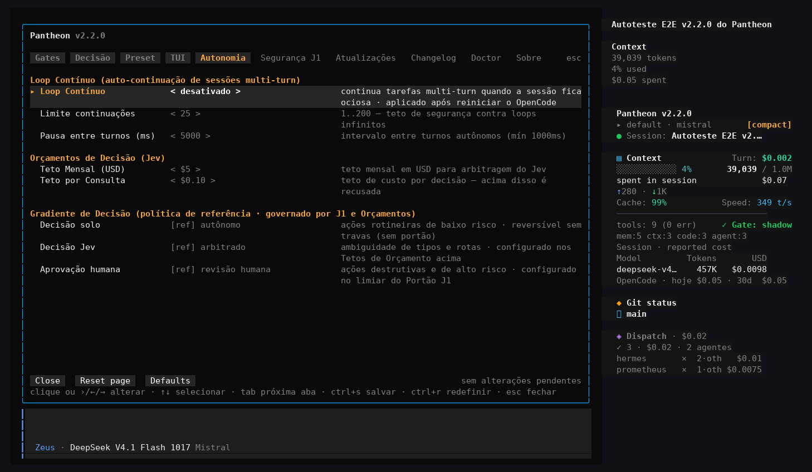

### `Segurança J1`, `Atualizações` & `Changelog`
- **Segurança J1:** define o limiar operacional do portão de risco (`shadow`,
  `enforce` ou overrides por escopo).
- **Atualizações:** checa o canal npm (`latest` / `beta`), dispara atualização e
  executa **Legados, Drift & Limpeza** para remover cópias V1 obsoletas e caches
  antigos do OpenCode (`~/.cache/opencode/npm/pantheon-opencode*`).

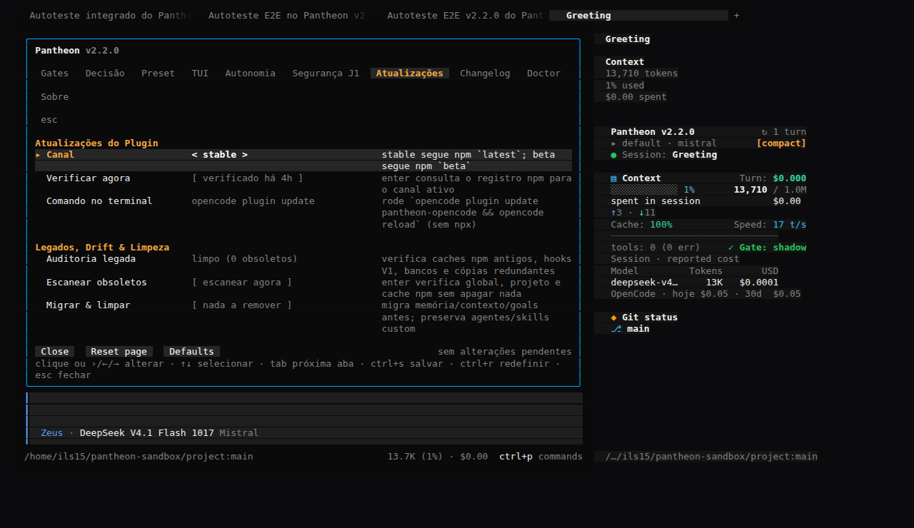

- **Changelog:** navega pelas notas das versões recentes sem sair do terminal.

### `Doctor` & `Sobre`
- **Doctor:** verificação rápida baseada em arquivos locais (versão instalada,
  Node.js ativo, integridade de overrides e presença do `decision-router.json`),
  complementando `npx pantheon-opencode doctor`.

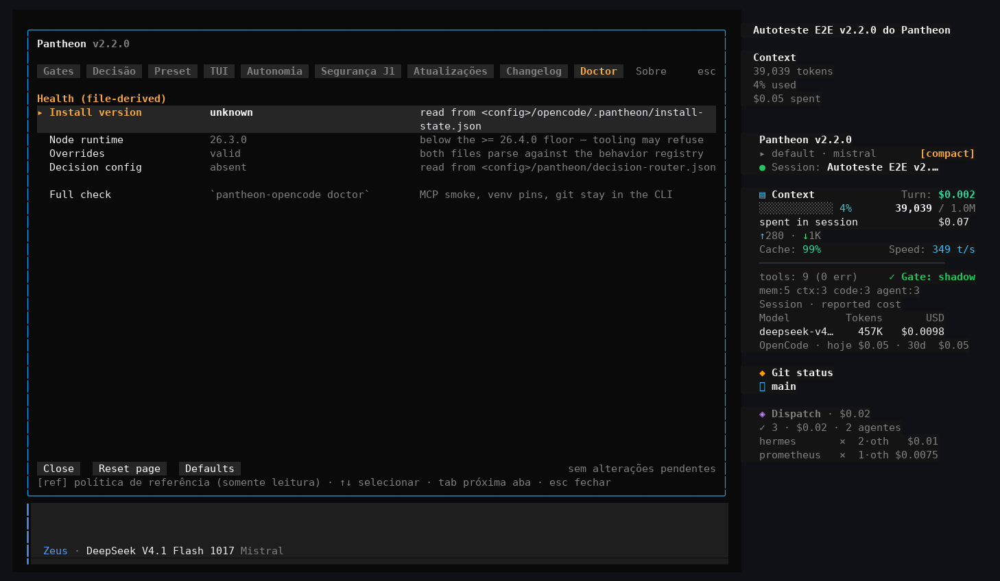

- **Sobre:** resumo de plataforma/governança e inventário agrupado das **26
  Ferramentas Nativas TypeScript** registradas pelo plugin.

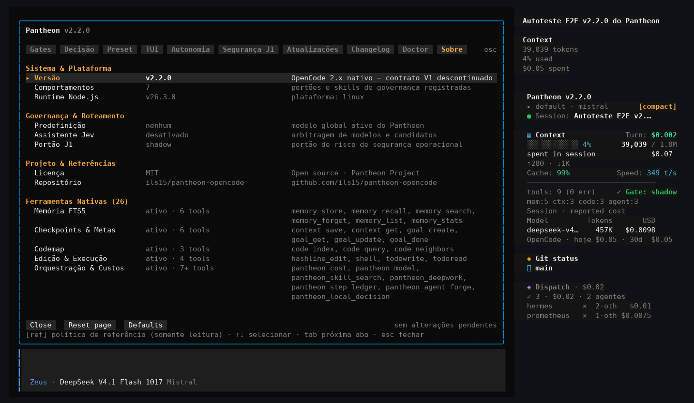

---

## 3. Diálogos e Painéis Relacionados

- **`What's New` (`/whats-new`):** card paginado com navegação (`‹ Anterior` /
  `Próxima ›`) e botão dedicado (`OK, Entendido`). Veja [The What's-new TUI window](../reference/whats-new.md).

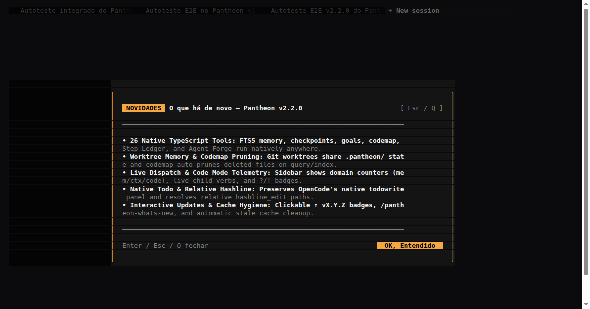

- **Visualizador `/pantheon-artifacts`:** explore planos, relatórios e ADRs no
  terminal — veja [Artefatos & `/pantheon-artifacts`](ARTIFACTS.md).
- **Sidebar ao vivo & `/dispatch`:** acompanhe tokens, cache e custo de cada
  subagente em tempo real — veja [OpenCode 2.x](../opencode.md#dispatch-sidebar-block).
