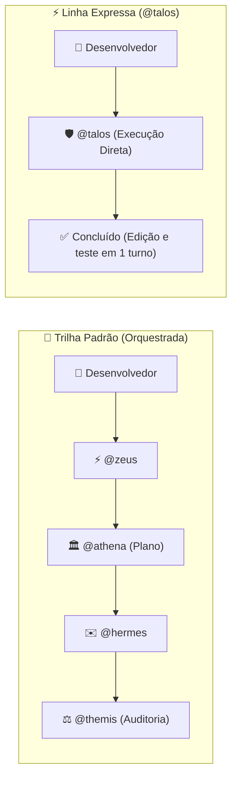

# Tutorial: Utilitário CLI de Alta Performance com o @talos

> 🇺🇸 **English version available:** [Read in English](../../guides/cli-tool.md)

Neste tutorial prático e direto ao ponto, você aprenderá a utilizar a **Linha Expressa (Fast Lane)** do Pantheon com o agente `@talos` para criar uma ferramenta de linha de comando leve, sem dependências externas e com testes unitários automatizados em Node.js.

---

## Por que Usar a Linha Expressa?

Enquanto funcionalidades complexas com banco de dados, APIs e interfaces web se beneficiam do planejamento cerimonial e multi-fase do `@zeus` e da `@athena` via Deepwork, pequenos scripts do dia a dia, ferramentas de linha de comando e hotfixes precisam de **velocidade máxima e zero atrito**.



O `@talos` é o especialista em respostas rápidas do Pantheon:
- **Sem sobrecarga de subagentes:** Opera diretamente na sessão principal.
- **Execução em turno único:** Formula o código e executa a validação de testes imediatamente.
- **Edições seguras:** Valida a sintaxe e a integridade de testes antes de entregar.

---

## 1. Objetivo do Projeto: Verificador de Saúde de Repositórios

Construiremos um utilitário CLI chamado `repo-health` que analisa qualquer repositório Git e gera uma pontuação de 0 a 100 baseada em:
1. **Estado do Git:** Árvore de trabalho limpa vs arquivos modificados/não rastreados.
2. **Manifesto `package.json`:** Existência, sintaxe JSON válida e presença do script `test`.
3. **Documentação:** Presença de arquivo `README.md`.

---

## 2. Enviando o Pedido ao @talos

Inicie o OpenCode e envie o seguinte prompt no chat:

```text
@talos Crie uma ferramenta CLI em Node.js sem dependências externas em bin/repo-health.mjs para inspecionar a saúde do repositório:
1. Verifica se há arquivos modificados ou não comitados no git.
2. Valida a sintaxe do package.json e confere se existe o script "test".
3. Confere se existe um README.md.
4. Exibe saída formatada para humanos por padrão e JSON estruturado com a flag --json.
5. Crie testes unitários completos em tests/cli.test.mjs usando o runner nativo node:test e node:assert.
```

---

## 3. Passo a Passo da Implementação

O `@talos` implementa diretamente a suíte de testes e o arquivo da CLI.

### Passo 3.1: Suíte de Testes Unitários (`tests/cli.test.mjs`)

Usando o test runner nativo do Node.js (`node:test`):

```javascript
import { describe, it } from 'node:test'
import assert from 'node:assert/strict'
import { checkRepoHealth } from '../bin/repo-health.mjs'

describe('checkRepoHealth', () => {
  it('retorna um objeto de diagnóstico com pontuação e status válidos', () => {
    const result = checkRepoHealth(process.cwd())

    assert.ok(typeof result.score === 'number', 'score deve ser um número')
    assert.ok(result.score >= 0 && result.score <= 100, 'score deve estar entre 0 e 100')
    assert.ok(['EXCELENTE', 'REGULAR', 'CRÍTICO'].includes(result.status), 'status deve ser válido')
    assert.ok(Array.isArray(result.issues), 'issues deve ser um array')
    assert.ok(typeof result.timestamp === 'string', 'timestamp deve ser string ISO')
  })

  it('penaliza a pontuação quando o package.json não existe', () => {
    const tempDir = process.env.TEMP || '/tmp'
    const result = checkRepoHealth(tempDir)

    assert.ok(result.issues.length > 0, 'deve detectar ausência do package.json')
    assert.ok(result.score < 100, 'a pontuação deve ser penalizada')
  })
})
```

### Passo 3.2: Implementação da CLI (`bin/repo-health.mjs`)

```javascript
#!/usr/bin/env node
import { execSync } from 'node:child_process'
import { existsSync, readFileSync } from 'node:fs'
import { join } from 'node:path'

export function checkRepoHealth(targetDir = process.cwd()) {
  const issues = []
  let score = 100

  // 1. Checagem do Git
  try {
    const gitStatus = execSync('git status --porcelain', {
      cwd: targetDir,
      encoding: 'utf8',
    }).trim()
    if (gitStatus.length > 0) {
      const changedFiles = gitStatus.split('\n').length
      issues.push(`Aviso: ${changedFiles} arquivo(s) modificados ou não rastreados no Git`)
      score -= Math.min(20, changedFiles * 5)
    }
  } catch {
    issues.push('Alerta: Diretório não é um repositório Git válido')
    score -= 40
  }

  // 2. Checagem do package.json
  const pkgPath = join(targetDir, 'package.json')
  if (existsSync(pkgPath)) {
    try {
      const pkg = JSON.parse(readFileSync(pkgPath, 'utf8'))
      if (!pkg.scripts?.test) {
        issues.push('Aviso: package.json não define o script "test"')
        score -= 15
      }
      if (!pkg.description || pkg.description.trim() === '') {
        issues.push('Aviso: package.json não possui descrição')
        score -= 5
      }
    } catch {
      issues.push('Erro: package.json possui sintaxe JSON inválida')
      score -= 30
    }
  } else {
    issues.push('Aviso: package.json não encontrado na raiz')
    score -= 20
  }

  // 3. Checagem do README
  if (!existsSync(join(targetDir, 'README.md'))) {
    issues.push('Aviso: README.md não encontrado')
    score -= 15
  }

  const finalScore = Math.max(0, score)
  const status = finalScore >= 80 ? 'EXCELENTE' : finalScore >= 50 ? 'REGULAR' : 'CRÍTICO'

  return {
    score: finalScore,
    status,
    issues,
    timestamp: new Date().toISOString(),
  }
}

if (process.argv[1]?.endsWith('repo-health.mjs')) {
  const result = checkRepoHealth()
  const isJson = process.argv.includes('--json')

  if (isJson) {
    console.log(JSON.stringify(result, null, 2))
  } else {
    console.log('\n🏥 Diagnóstico de Saúde do Repositório')
    console.log('──────────────────────────────────────')
    console.log(`Pontuação Geral: ${result.score}/100 [${result.status}]`)
    if (result.issues.length === 0) {
      console.log('✅ Nenhuma inconsistência encontrada. Repositório saudável!')
    } else {
      console.log('\nApontamentos:')
      for (const issue of result.issues) {
        console.log(`  • ${issue}`)
      }
    }
    console.log('')
  }
}
```

---

## 4. Executando os Testes e a Ferramenta

### Executar os testes automatizados:
```bash
node --test tests/cli.test.mjs
```
Saída:
```text
✔ checkRepoHealth > retorna um objeto de diagnóstico com pontuação e status válidos (12ms)
✔ checkRepoHealth > penaliza a pontuação quando o package.json não existe (4ms)
ℹ tests 2
ℹ suites 1
ℹ pass 2
ℹ fail 0
```

### Executar a CLI:
```bash
node bin/repo-health.mjs
```
Saída:
```text
🏥 Diagnóstico de Saúde do Repositório
──────────────────────────────────────
Pontuação Geral: 100/100 [EXCELENTE]
✅ Nenhuma inconsistência encontrada. Repositório saudável!
```

Ou formato estruturado JSON para esteiras de CI/CD:
```bash
node bin/repo-health.mjs --json
```

---

## Código-Fonte Completo

O código-fonte funcional deste tutorial está disponível no repositório do Pantheon:
- Confira [`examples/cli-tool/`](https://github.com/ils15/pantheon-opencode/tree/main/examples/cli-tool).
