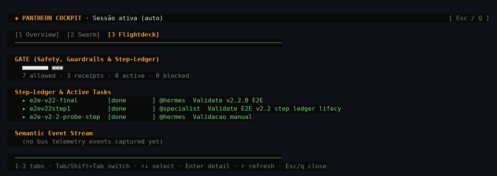

<!-- pantheon:cookbook-version v2.2 -->
# Livro de Receitas do Pantheon: Fluxos Práticos do Dia a Dia

> 🇺🇸 **English version available:** [Read in English](../../guides/cookbook.md)

Este livro de receitas reúne fluxos práticos prontos para copiar e colar no **Pantheon `v2.2.0` (`OpenCode 2.x` nativo)** — cobrindo onboarding Zero-Init, os **14 agentes especialistas**, as **30 ferramentas TypeScript nativas**, os **9 comandos de servidor** e as **5 superfícies interativas de TUI**.

---

## Receita 0: Setup Zero-Init e Atualização Segura (`OpenCode 2.x`)

**Cenário:** Habilitar o Pantheon em qualquer projeto ou worktree Git sem sujar o repositório com arquivos copiados.

**Comando:**
```bash
opencode plugin add pantheon-opencode@2.2.0
# ou para atualizar uma instalação existente:
opencode plugin update pantheon-opencode
```

**Por que funciona melhor:**
- Todos os **14 agentes**, **9 comandos de servidor**, instruções globais e **30 ferramentas nativas** carregam direto em memória.
- Na TUI, use `/pantheon-updates` para verificar atualizações no npm e limpar caches obsoletos automaticamente.

---

## Receita 1: Funcionalidade Full-Stack com TDD e Portão de Qualidade

**Cenário:** Implementar uma funcionalidade completa (ex.: endpoint de exportação CSV com validação de schema e testes).

**Prompt:**
```text
@zeus Adicione suporte a exportação CSV em /reports com testes unitários e validação de schema.
```

**Fluxo de Execução:**
1. `@zeus` analisa o escopo, opcionalmente executa `detect_stack`, e delega o planejamento à `@athena`.
2. `@athena` estrutura fases e critérios de aceite; ambiguidades usam o diálogo nativo `question`.
3. `@hermes` executa as etapas rastreadas no `pantheon_step_ledger` (inclusive com sub-sessões isoladas via `execute_step` quando necessário) — testes RED primeiro, depois código GREEN com diagnósticos LSP pós-edição (`tsc` / `pyright` / stdio / TCP pool).
4. `@themis` executa linters, auditoria de segurança e emite o parecer estruturado via `pantheon_review_verdict`.

---

## Receita 2: Correção Expressa em 1 Turno (`@talos`)

**Cenário:** Corrigir um estilo CSS, typo ou import ausente sem cerimônia de planejamento.

**Prompt:**
```text
@talos Altere a cor de fundo do botão de login para verde esmeralda em login.css usando hashline_edit
```

**Por que usar `@talos`?**
`@talos` é a via rápida do Pantheon: zero sobrecarga de subagentes, edições cirúrgicas via `hashline_edit` (confinado à raiz do projeto) e verificação imediata.

---

## Receita 3: Bugfix TDD com Portão Mecânico `RED` e Rollback Atômico

**Cenário:** Corrigir um bug confirmado em produção impedindo que o agente pule o teste de reprodução ou deixe o working tree sujo em caso de falha.

**Prompt:**
```text
@zeus Corrija o bug de arredondamento de imposto em src/billing/calc.ts exigindo primeiro um teste de reprodução falhando antes de editar o código de produção.
```

**Fluxo (`pantheon_step_ledger`):**
1. `@zeus` inicia um step `bugfix` (`init_step`), gravando um snapshot `baselineTree` isolado via `GIT_INDEX_FILE` sem mexer no `.git/index` do usuário.
2. O hook `tool.execute.before` bloqueia edições (`edit`, `write`, `hashline_edit`, `ast_rewrite`) em arquivos de produção por `@hermes` / `@talos`, mantendo escrita livre em arquivos de teste.
3. Assim que um teste falhando é registrado via `record_reproduction` (`exitCode !== 0`), a edição em produção é liberada automaticamente.
4. Se as tentativas de validação esgotarem e `ThemisReflexController` escalar, o `pantheon_step_ledger` restaura o `baselineTree` automaticamente (`rollback_step` também pode ser chamado sob demanda).

---

## Receita 4: Busca e Refatoração Estrutural via AST (`ast_search` / `ast_rewrite`)

**Cenário:** Migrar chamadas de API em dezenas de arquivos TypeScript/JavaScript sem risco de alterar strings ou comentários.

**Prompt:**
```text
@hermes Use ast_search para localizar todas as chamadas a legacyFetch($URL, $$$ARGS) em src/ e faça uma prévia com ast_rewrite usando dryRun=true antes de aplicar.
```

**Por que usar `ast_search` / `ast_rewrite`?**
- Ignora comentários e strings literais automaticamente, suportando capturas `$VAR` e variádicas `$$$ARGS`.
- Garante confinamento por symlink dentro do workspace e retorna `[LSP-Diagnostics]` + lint por diff no mesmo turno.

---

## Receita 5: Migrações de Banco de Dados e Otimização de Consultas

**Cenário:** Adicionar nova tabela ou coluna com chaves estrangeiras e índices otimizados sem gargalos N+1.

**Prompt:**
```text
@demeter Crie uma migration Alembic adicionando a tabela 'user_preferences' com chave estrangeira para 'users' e índice em 'created_at'.
```

**Por que usar `@demeter`?**
`@demeter` aplica boas práticas de SQLAlchemy, Prisma, Alembic e PostgreSQL, garantindo integridade referencial e índices eficientes.

---

## Receita 6: Refatoração Visual e Diagnóstico Multimodal (`/pantheon-vision`)

**Cenário:** Ajustar componentes frontend com base em um screenshot ou inspecionar o status do gateway de visão.

**Prompt:**
*(Cole o screenshot com Ctrl+V / Cmd+V no chat, ou execute `/pantheon-vision` para conferir a configuração)*
```text
@aphrodite Refatore este card de métricas para corresponder ao espaçamento, tipografia e contraste do screenshot colado.
```

**Fluxo:**
1. `/pantheon-vision` exibe os provedores multimodais configurados e o status do gateway.
2. O Pantheon Vision extrai tokens visuais uma única vez via `vision_describe` / `session.context`, evitando reenviar bytes de imagem no histórico.
3. `@aphrodite` atualiza os componentes com contraste acessível WCAG AA.

---

## Receita 7: Investigação Segura Somente Leitura (`@apollo`)

**Cenário:** Mapear autenticação, fluxos de dados ou quem chama determinado símbolo sem risco de edição acidental.

**Prompt:**
```text
@apollo Rastreie onde os tokens WebSocket são validados usando code_index, code_query e code_neighbors.
```

**Por que usar `@apollo`?**
`@apollo` opera estritamente em modo somente leitura (`edit: deny`, `bash: deny`, `ast_rewrite: deny`). O uso de `code_index`, `code_query` e `code_neighbors` evita globs recursivos pesados e poda automaticamente arquivos removidos.

---

## Receita 8: Auditoria de Segurança e Remediação por Veredito (`/pantheon-audit` + `@themis`)

**Cenário:** Auditar alterações da branch antes de abrir PR e acionar correções automáticas se houver bloqueios.

**Prompts:**
```text
/pantheon-audit
```
ou diretamente:
```text
@themis Audite as alterações desta branch contra o OWASP Top 10, valide testes e lint e registre o veredito final com pantheon_review_verdict.
```

**Fluxo:**
- `/pantheon-audit` executa análise estática zero-token seguida da revisão em 3 camadas da `@themis`.
- `@themis` registra o veredito estruturado via `pantheon_review_verdict`: `APPROVE`, `APPROVE_WITH_NOTES` ou `BLOCK`.
- Ao emitir `BLOCK`, o Pantheon injeta automaticamente até 2 turnos de remediação na sessão pai com os achados estruturados.

---

## Receita 9: Pipelines de IA, Containers e CI/CD

**Cenários:** Construir pipelines vetoriais RAG ou Dockerfiles multi-stage e workflows GitHub Actions.

**Prompts:**
```text
@hephaestus Implemente um pipeline de busca semântica com embeddings e pgvector com ingestão em lotes.
```
```text
@prometheus Crie um Dockerfile multi-stage para este serviço e um workflow do GitHub Actions para rodar testes em PRs.
```

---

## Receita 10: Conselho de Arquitetura e Deepwork em Worktrees (`/pantheon`, `/pantheon-deepwork`, `pantheon_worktree`)

**Cenários:** Arbitrar trade-offs arquiteturais críticos ou executar refatorações multifase em worktrees isolados.

**Prompt de Conselho:**
```text
/pantheon Devemos usar Server-Sent Events (SSE) ou WebSockets para atualizações ao vivo no dashboard?
```

**Prompt de Deepwork + Worktree:**
```text
/pantheon-deepwork Migre a autenticação de sessões para refresh tokens rotativos usando isolamento via pantheon_worktree e checkpoints do Deepwork.
```

**Como funciona:**
- Tarefas paralelas são isoladas em `<project-parent>/.pantheon-worktrees/<repo>/<task>` por meio de `pantheon_worktree` e `ctx.worktree.transform`.
- Worktrees ligados compartilham automaticamente o `.pantheon/` do repositório principal (`PANTHEON_ISOLATE_WORKTREE_MEMORY=1` permite isolar por worktree).
- Planos são salvos em `.pantheon/deepwork/<slug>/PLAN.md` e abrem diretamente pelos links clicáveis da Home e Sidebar.

---

## Receita 11: Memória Persistente, Foco e Federação Cross-Repo (`/pantheon-focus`, `/pantheon-consolidate`)

**Cenário:** Preservar metas entre compactações de contexto e consultar decisões salvas em repositórios pares.

**Comandos e Ferramentas:**
- **`/pantheon-focus`** — consultar ou atualizar metas duráveis da sessão (`goal_create`, `goal_get`, `goal_update`, `goal_done`).
- **`/pantheon-consolidate`** — compactar, deduplicar e consolidar entradas no banco `node:sqlite` FTS5 local.
- **`memory_search` federado** — configure `PANTHEON_FEDERATED_REPOS` ou `~/.pantheon/federation.json` para que `memory_search(federated=true)` pesquise bancos `.pantheon/memory/memory.db` de outros repositórios em modo estritamente somente leitura.

---

## Receita 12: Especialistas Sob Medida, Modelos e Limpeza (`/pantheon-forge`, `/pantheon-model`, `/pantheon-optimize`)

**Cenário:** Adaptar agentes à stack exata do projeto (`Node`, `Python`, `Rust`, `Go`), ajustar modelos por agente ou limpar artefatos antigos.

**Comandos:**
- **`/pantheon-forge`** — executa `detect_stack` (`package.json`, `pyproject.toml`, `requirements.txt`, `Cargo.toml`, `go.mod`) e cria agentes customizados em `.opencode/agents/` via `pantheon_agent_forge`.
- **`/pantheon-model`** — inspeciona ou configura overrides de modelo por agente em `active-preset.json`.
- **`/pantheon-optimize`** — analisa e remove artefatos Deepwork antigos, worktrees órfãos e excessos de contexto.

---

## Receita 13: Observabilidade em Tempo Real no Terminal (`/pantheon-cockpit`, `/pantheon-artifacts`, `/pantheon-whats-new`)

**Cenário:** Acompanhar subagentes, portões, Step-Ledger, diagramas Mermaid e novidades da versão direto na TUI.



- **`/pantheon-cockpit`** (ou `/cockpit`) — abre o Mission Control Cockpit em 3 abas:
  - `1 Overview`: velocidade de tokens, medidor de contexto, saúde das superfícies (`Native Tools (30)`) e mapa de topologia.
  - `2 Swarm`: linha do tempo Gantt concorrente e custo por subagente.
  - `3 Flightdeck`: matriz `GATE`, estados do `Step-Ledger`, stream de eventos cross-process e atalho **`x` (`Export Replay Trace`)** para `.pantheon/reports/`.
- **`/pantheon-artifacts`** (ou `/artifacts`) — navegue por planos/relatórios e visualize diagramas `flowchart`, `sequenceDiagram` e `stateDiagram` renderizados em caixas Unicode no terminal.
- **`/pantheon-whats-new`** — visualize o resumo curado de novidades da versão instalada.

---

## Receita 14: Configurações, Limpeza de Caches Legados e Diagnóstico (`/pantheon-settings`, `/pantheon-updates`, `doctor`)

**Cenário:** Ajustar presets de autonomia/portões, remover caches antigos de npm ou validar a integração com o OpenCode.

- **`/pantheon-settings`** — abre o painel interativo de 10 abas (`Gates`, `Decisão`, `Preset`, `TUI`, `Autonomia`, `Segurança J1`, `Atualizações`, `Changelog`, `Doctor`, `Sobre`).
- **`/pantheon-updates`** — abre direto na aba **Atualizações & Limpeza**, verificando novas versões no npm e limpando caches obsoletos coexistentes em `~/.cache/opencode/npm/pantheon-opencode*`.
- **Diagnóstico via CLI:**
  ```bash
  npx pantheon-opencode doctor
  ```

---

## Referência Rápida: Todos os Comandos

| Superfície | Comandos |
|---|---|
| **Comandos de Servidor** | `/pantheon`, `/pantheon-deepwork`, `/pantheon-audit`, `/pantheon-consolidate`, `/pantheon-focus`, `/pantheon-forge`, `/pantheon-model`, `/pantheon-optimize`, `/pantheon-vision` |
| **Comandos TUI** | `/pantheon-cockpit`, `/pantheon-artifacts`, `/pantheon-settings`, `/pantheon-updates`, `/pantheon-whats-new` |
