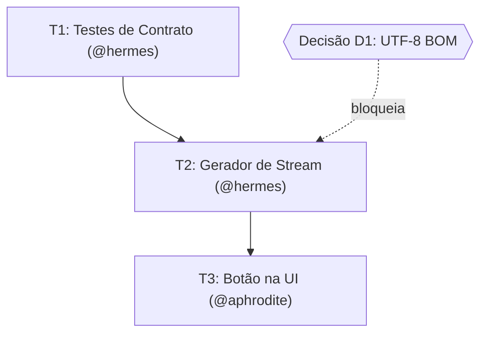

# Deepwork: Planejamento Rigoroso e Execução Canônica

> 🇺🇸 **English version available:** [Read in English](../../guides/deepwork.md)

O módulo **Deepwork** do Pantheon é o motor de planejamento arquitetural e execução disciplinada para o OpenCode. Ele resolve o maior problema de agentes de IA: *o plano como documento estático em Markdown que o modelo lê, esquece ou decide por conta própria que terminou sem provar nada.*

---

## 1. Princípios Não-Negociáveis

1. **JSON é a verdade, Markdown é a projeção:** O estado canônico vive em formato estruturado auditável por máquina.
2. **Zero HTML:** Nada de páginas HTML soltas ou dashboards pesados. Toda aprovação, decisão ou rejeição usa as ferramentas nativas do OpenCode (diálogos interativos no terminal e no desktop).
3. **Decisões Humanas Primeiro:** Questões em aberto e trade-offs (`decisions_needed`) são apresentados ao desenvolvedor via `question` tool antes da implementação.
4. **DAG de Dependências, Não Lista:** As tarefas são conectadas em um Grafo Acíclico Dirigido (Mermaid DAG), explicitando o que pode rodar em paralelo (`parallel_safe`) e o que está bloqueado.
5. **Critérios de Aceite Fail-First:** Toda tarefa possui critério binário com check que falha hoje (`fails_now: true`) e precisa passar ao término.

---

## 2. Estrutura Canônica no Disco

Quando uma tarefa de Deepwork é iniciada pelo comando `/pantheon-deepwork` ou pelo `@zeus`, o Pantheon cria uma pasta dedicada para o plano:

```text
.pantheon/deepwork/<slug>/
├── plan.json        # A verdade canônica do plano (JSON Schema estrito)
├── journal.ndjson   # Log de eventos append-only (auditoria de transições)
└── PLAN.md          # Projeção em Markdown legível com Mermaid e links clicáveis
```

### O `plan.json` (A Verdade Estruturada)

```json
{
  "plan_id": "PLAN_001_csv-export",
  "created_at": "2026-11-13T10:00:00Z",
  "intent": "Adicionar exportação assíncrona de relatórios para CSV no painel",
  "tier": "lite",
  "done_when": [
    "npm test tests/metrics-export.test.ts retorna 0",
    "Endpoint GET /api/reports/csv responde com Content-Type text/csv"
  ],
  "tasks": [
    {
      "id": "T1",
      "title": "Escrever testes de contrato do streaming CSV",
      "specialist": "@hermes",
      "touches": ["tests/metrics-export.test.ts"],
      "depends_on": [],
      "parallel_safe": true,
      "gate": "test",
      "state": "pending",
      "acceptance": [
        { "check": "npm test tests/metrics-export.test.ts", "fails_now": true }
      ]
    },
    {
      "id": "T2",
      "title": "Implementar gerador de stream de CSV",
      "specialist": "@hermes",
      "touches": ["src/api/reports.ts"],
      "depends_on": ["T1"],
      "parallel_safe": false,
      "gate": "typecheck",
      "state": "pending"
    },
    {
      "id": "T3",
      "title": "Adicionar botão de exportação e feedback na UI",
      "specialist": "@aphrodite",
      "touches": ["src/components/ReportView.tsx"],
      "depends_on": ["T2"],
      "parallel_safe": false,
      "gate": "lint",
      "state": "pending"
    }
  ],
  "decisions_needed": [
    {
      "id": "D1",
      "question": "Formato de codificação do arquivo CSV:",
      "options": ["(Recomendado) UTF-8 com BOM (compatível com Excel)", "UTF-8 puro"],
      "blocks": ["T2"]
    }
  ],
  "risks": [
    { "what": "Exaustão de memória em relatórios gigantes", "mitigation": "Streaming por chunks" }
  ]
}
```

---

## 3. A Projeção Visual (`PLAN.md`)

O arquivo `PLAN.md` projeta os dados do `plan.json` em um formato visual de fácil leitura para o desenvolvedor no editor ou terminal:

### Exemplo de Grafo de Execução gerado:



---

## 4. O Portão de Decisões Interativo (`question`)

Toda vez que o plano contiver itens em `decisions_needed` ou `Open Questions`:
* O Zeus e a Athena **são proibidos de prosseguir às cegas**.
* O OpenCode abre a caixa de diálogo interativa na tela (`question` tool).
* Cada decisão é respondida com 1 clique.
* O evento de resposta é registrado no `journal.ndjson` com timestamp, liberando as tarefas dependentes.

---

## 5. Como Iniciar um Plano Deepwork

No chat do OpenCode:

```text
/pantheon-deepwork Refatorar módulo de autenticação para suportar login por Passkey
```

Ou pedindo diretamente para o Zeus:

```text
@zeus elabore um plano de deepwork para a issue #304
```

O plano é sintetizado pela `@athena`, auditado pela `@themis` e apresentado a você para aprovação com links clicáveis `file://` para os arquivos gerados.
