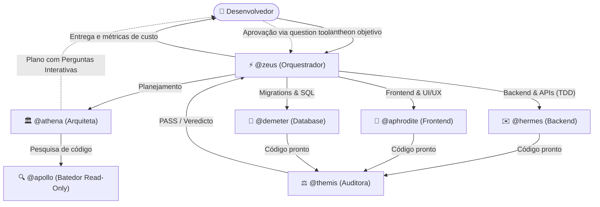

# Guia do Primeiro Projeto (End-to-End)

> 🇺🇸 **English version available:** [Read in English](../../guides/first-project.md)

Este guia ensina a utilizar o **Pantheon** na prática, passo a passo, desde a inicialização de um projeto novo até o deploy final com testes, portões de qualidade e telemetria de custos.

---

## 1. O que é o Pantheon?

O Pantheon não é um prompt gigante nem um assistente genérico: ele é um **framework de orquestração multi-agente para o OpenCode**.

Em vez de sobrecarregar um único modelo com planejamento, código backend, CSS, banco de dados e testes, o Pantheon divide o trabalho entre **14 agentes especialistas** com permissões e papéis rigorosamente demarcados.



---

## 2. Passo 1 — Instalação e Inicialização

Em qualquer pasta de projeto (nova ou existente):

```bash
# Inicializa os agentes, skills e plugins do Pantheon no projeto
npx pantheon-opencode init
```

O instalador interativo permite selecionar componentes (`agents`, `skills`, `instructions`, `plugins`). A opção `plugins` instala a **TUI** (interface de terminal moderna).

Verifique se tudo está íntegro executando o diagnóstico de integridade:

```bash
npx pantheon-opencode doctor
```

Se o `doctor` relatar 0 warnings, seu ambiente está pronto!

---

## 3. Passo 2 — Abrindo o OpenCode e a TUI

Abra sua sessão do OpenCode:

```bash
opencode
```

Se você instalou a TUI, você verá a barra lateral com:
* **Context Gauge:** Consumo de tokens da janela de contexto em tempo real.
* **Spend / Cost:** Custo acumulado da sessão em dólares (\$USD).
* **Git Status:** Branch atual e status do repositório.
* **Active Preset:** Preset de modelos ativo (`balanced`, `quality`, `speed` ou customizado).

---

## 4. Passo 3 — Disparando sua Primeira Tarefa com o Zeus

No chat do OpenCode, fale com o coordenador `@zeus` usando o comando `/pantheon`:

```text
/pantheon Criar um painel de monitoramento de métricas em React com exportação de relatórios em CSV e endpoint backend com testes unitários.
```

### O que o Zeus faz:
1. **Analisa o escopo:** Se a tarefa for complexa ou envolver múltiplos subsistemas, o Zeus aciona a `@athena` para estruturar um plano formal.
2. **Athena pesquisa o projeto:** A Athena consulta o `@apollo` para ler arquivos e dependências sem poluir o contexto da conversa.
3. **Plano Deepwork gerado:** A Athena devolve o plano canônico com DAG de dependências em Mermaid e lista de arquivos afetados.

---

## 5. Passo 4 — O Portão de Perguntas e Aprovação (`question`)

Quando o plano contém incertezas técnicas ou escolhas arquiteturais, o Pantheon **nunca deixa perguntas soltas como texto morto**:

Aparece na sua tela o diálogo nativo interativo do OpenCode (`question` tool):

```text
? Escolha o formato da exportação CSV:
  ▸ (Recomendado) Streaming assíncrono com cabeçalho UTF-8 (menor consumo de RAM)
    Geração síncrona em memória (Buffer)

? Aprovar plano e iniciar execução?
  ▸ (Recomendado) Aprovar e iniciar execução
    Ajustar plano
```

Com as setas do teclado e `Enter`, você responde em 3 segundos. Suas escolhas são registradas no histórico auditável e o Zeus prossegue imediatamente.

---

## 6. Passo 5 — Implementação em TDD pelos Especialistas

O Zeus agora despacha as tarefas em paralelo ou em sequência:

* **Backend com @hermes (TDD):**
  - Escreve os testes unitários primeiro em `tests/metrics-api.test.mjs` (RED):
    ```javascript
    import { describe, it } from 'node:test'
    import assert from 'node:assert/strict'
    import { getMetricsSnapshot } from '../src/server/metrics.mjs'

    describe('Metrics Service', () => {
      it('retorna array de métricas válido', () => {
        const metrics = getMetricsSnapshot()
        assert.ok(Array.isArray(metrics), 'deve ser um array')
        assert.strictEqual(metrics.length, 4, 'deve retornar 4 métricas chave')
      })
    })
    ```
  - Implementa a lógica e streaming em `src/server/metrics.mjs` (GREEN):
    ```javascript
    export function streamMetricsCsv(destination) {
      const items = getMetricsSnapshot()
      const header = 'id,name,category,value,unit,changePercent,updatedAt\n'
      const stream = new Readable({
        read() {
          this.push(header)
          for (const item of items) {
            this.push(`"${item.id}","${item.name}","${item.category}",${item.value},"${item.unit}",${item.changePercent},"${item.updatedAt}"\n`)
          }
          this.push(null)
        },
      })
      stream.pipe(destination)
    }
    ```
  - Roda os testes: `node --test tests/metrics-api.test.mjs` passa 5/5.

* **Frontend com @aphrodite:**
  - Cria o componente visual (`src/client/MetricsDashboard.jsx`).
  - Aplica Tailwind CSS com suporte a dark mode, navegação por teclado e conformidade WCAG AA.
  - Adiciona botão de download com feedback visual de progresso.

---

## 7. Passo 6 — Portão de Qualidade e Segurança com @themis

Antes de concluir a entrega, o Zeus aciona a `@themis`:
* A Themis executa os linters (`npm run lint` / Biome / Ruff).
* Executa a suite de testes automatizados (`npm test`).
* Valida ausência de segredos ou vulnerabilidades OWASP.
* Emite o relatório de veredito: `PASS`.

---

## 8. Passo 7 — Verificando Custos e Métricas

Ao final da execução, verifique a telemetria do trabalho executado:

```text
/pantheon_cost
```

O comando exibe:
* Tokens de entrada e saída consumidos por modelo.
* Cache hit rate (economia de tokens por cache de prompt).
* Duração da sessão e custo total formatado em USD (\$0.04).

---

## 9. Próximos Passos

* [Matriz de Capacidades dos Agentes](../AGENT-CAPABILITY-MATRIX.md) — Saiba detalhadamente o que cada agente pode e não pode fazer.
* [Deepwork Architecture](deepwork.md) — Como funciona o motor de planos em JSON e DAGs.
* [Pantheon Vision](vision.md) — Como colar capturas de tela e depurar interfaces visuais.
* [Cookbook de Receitas](cookbook.md) — Casos práticos prontos para o seu dia a dia.
