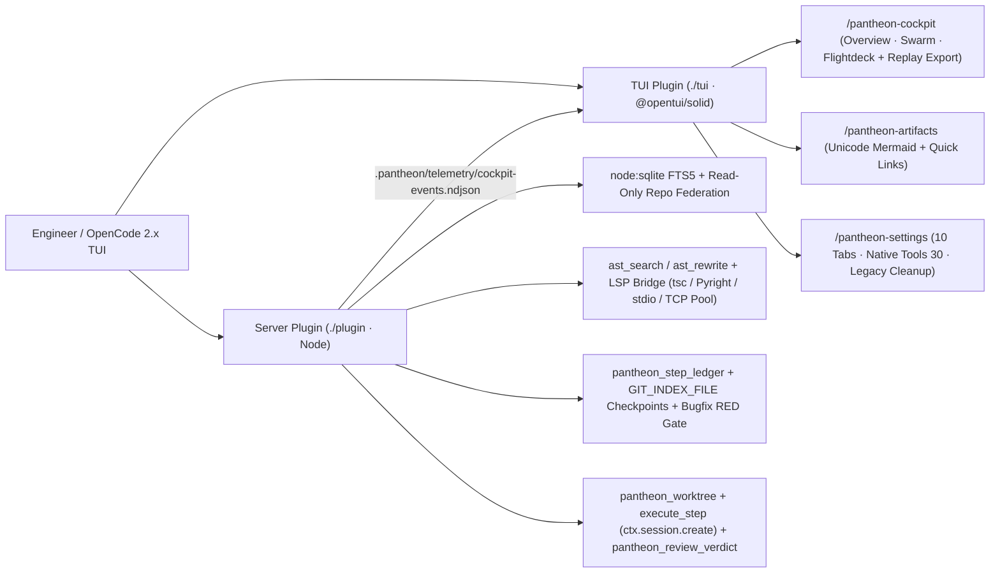
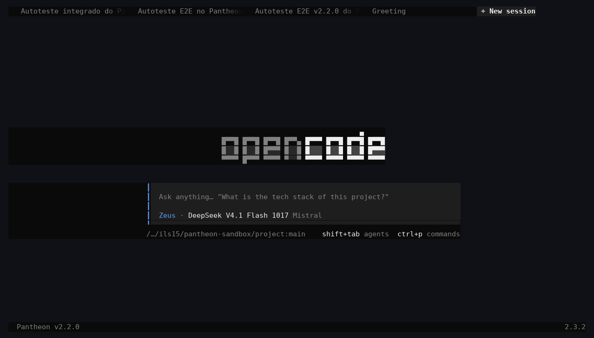
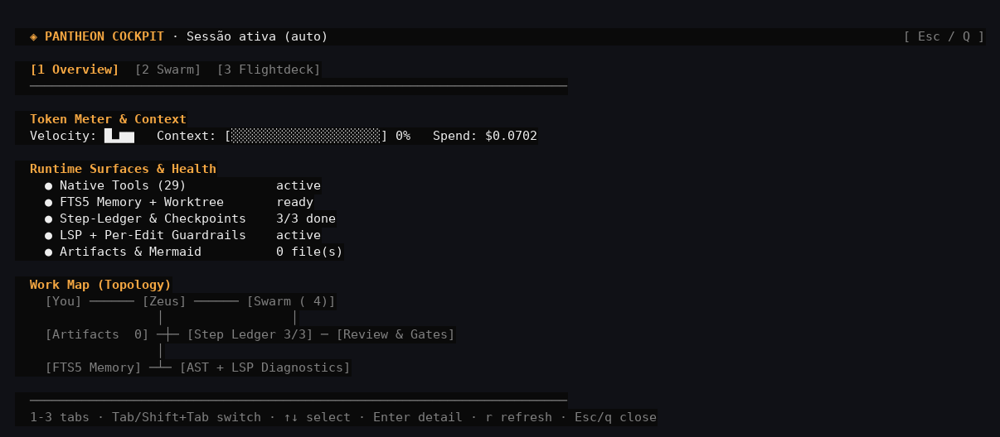
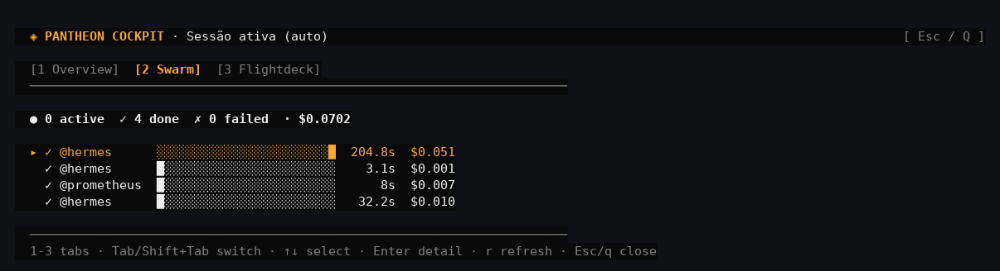
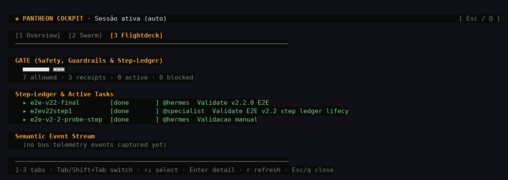
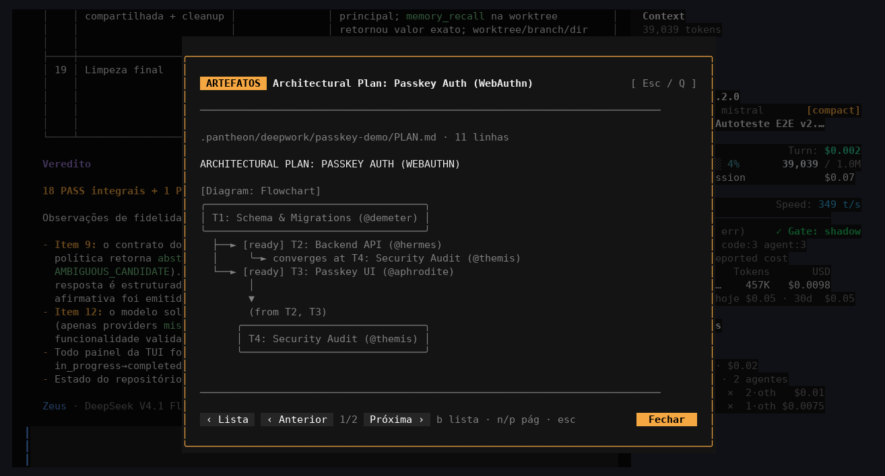
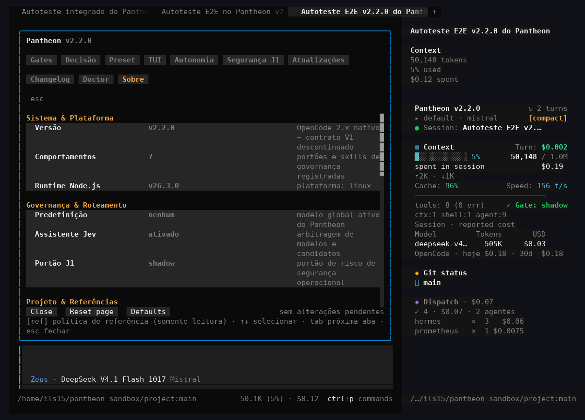

# Pantheon `v2.2.0` — Native OpenCode 2.x Orchestration, All 5 Architectural Pillars & Mission Control Cockpit

> [!NOTE]
> **Pantheon `v2.2.0`** marks the full **2.2 General Availability (GA)** milestone for **OpenCode 2.x** (`2.0.x`–`2.3.x+`). Alongside completing the native in-process plugin runtime, `v2.2.0` pulls forward all five architectural pillars (`Structural Editing & LSP Diagnostics`, `Step-Ledger & Atomic Sub-Sessions`, `Spec-First Worktree & Verdict Orchestration`, `Graph Localization & Bugfix RED Gates`, and `Polyglot Extensibility`) together with the 3-page **TUI Mission Control Cockpit** (`/pantheon-cockpit`).

```bash
# Quick install or upgrade inside OpenCode 2.x
opencode plugin add pantheon-opencode@2.2.0
# or update an existing installation
opencode plugin update pantheon-opencode
```

---

## 1. Architecture Overview

In `v2.2.0`, Pantheon runs natively inside OpenCode 2.x with zero Python runtime required for core orchestration tools and zero project-folder pollution (`AGENTS.md` or scripts copied into git only if you opt into `init`):

- **30 Native In-Process TypeScript Tools** (`node:sqlite` FTS5 memory, checkpoints, goals, structural AST search/rewrite, codemap, Step-Ledger, isolated sub-sessions, git checkpoints, worktrees, typed review verdicts, stack detection, and agent forge)
- **14 Canonical Polyglot Agents** orchestrated via `ctx.agent.transform`
- **9 Server Commands** (`/pantheon`, `/pantheon-deepwork`, `/pantheon-audit`, `/pantheon-consolidate`, `/pantheon-focus`, `/pantheon-forge`, `/pantheon-model`, `/pantheon-optimize`, `/pantheon-vision`)
- **5 Interactive `@opentui/solid` TUI Surfaces** (`/pantheon-cockpit`, `/pantheon-artifacts`, `/pantheon-settings`, `/pantheon-updates`, `/pantheon-whats-new`)





---

## 2. What's New & Improved Across the Release

### 2.1 Zero-Init Native Runtime, Bundle Split & Cache Hygiene
- **Clean Server (`./plugin`) vs. TUI (`./tui`) Bundle Split:** The Node server bundle operates independently without loading `@opentui/solid`, keeping headless runs lightweight while verifying `src/plugins/tui/dist/tui.js` freshness via `prepack`, `version:check`, and `package:validate`.
- **Zero-Polluting Zero-Init:** `opencode plugin add pantheon-opencode` provisions all **14 agents**, **9 server commands**, `AGENTS.global.md`, and KV-cache-friendly session instructions purely in memory.
- **Duplicate Command & Legacy Cache Cleanup:** Eliminated the server-side duplicate `/pantheon-settings` declaration, removed the obsolete `Quotas & Spend` placeholder tab, and added `Legacy & Drift` audit/cleanup (`legacy-audit.ts`) to clean stale coexisting `~/.cache/opencode/npm/pantheon-opencode*` caches automatically.

### 2.2 In-Process FTS5 Persistence, Shared Worktree Memory & Multi-Repo Federation
- **SQLite WAL + FTS5 Core:** `memory_store`, `memory_recall`, `memory_search`, `memory_forget`, `memory_list`, `memory_stats`, `context_save`, `context_get`, `goal_create`, `goal_get`, `goal_update`, and `goal_done` execute directly in-process with TTL support and automatic secret redaction.
- **Worktree-Shared `.pantheon/` Store:** Linked git worktrees automatically share the main repository's `.pantheon/` store (`PANTHEON_ISOLATE_WORKTREE_MEMORY=1` opts out per worktree).
- **Read-Only Multi-Repo Federation:** Configure `PANTHEON_FEDERATED_REPOS` or `~/.pantheon/federation.json` so `memory_search(federated=true)` queries peer `.pantheon/memory/memory.db` files strictly in `{ readOnly: true }` mode, tagging hits with `sourceRepo` and surfacing cross-repo counts in `memory_stats`.
- **Self-Pruning Structural Codemap:** `code_index`, `code_query`, and `code_neighbors` automatically prune deleted files from the symbol graph on query/reindex.

### 2.3 Structural Editing (`ast_search` / `ast_rewrite`), LSP Bridge & Workspace Confinement
- **Dependency-Free Structural AST Tools:** Custom tokenizer ignores strings and comments while matching `$VAR` single-node and `$$$ARGS` variadic captures, supporting `dryRun`, strict workspace symlink confinement, and pre-write edit guardrails (`ast_rewrite` is blocked in read-only sessions).
- **Workspace-Confined `hashline_edit`:** Resolves relative paths against the active project root and blocks traversal or symlink escapes outside the repository.
- **Live Post-Edit LSP & Diff-Scoped Lint Bridge:**
  - `lsp-diagnostics.ts` supports stdio LSP servers (`PANTHEON_LSP_SERVER`), **pooled reusable TCP LSP connections** (`PANTHEON_LSP_TCP_ENDPOINTS` with shared `initialize` + `didOpen` → `didChange`), `tsc --noEmit`, and `pyright --outputjson`.
  - Fixed `execute-after.ts` and `plugin.ts` so `ast_rewrite` (`args.path` / `filesModified`) and relative `hashline_edit` paths resolve cleanly against workspace `cwd`, surfacing `[LSP-Diagnostics]` and diff-scoped lint in the same turn.

### 2.4 Step-Ledger, Atomic `GIT_INDEX_FILE` Checkpoints, Sub-Sessions & Bugfix `RED` Gate
- **Zero-Touch Git Checkpoints:** Every `init_step` captures a `baselineTree` hash using an isolated temporary `GIT_INDEX_FILE` without modifying your real `.git/index` stage.
- **Automatic Rollback on Escalation:** When verification retries exhaust (`maxRetries = 2`), `ThemisReflexController` emits `themis:reflex:escalated` and `pantheon_step_ledger` automatically restores `baselineTree` (`rollback_step` is also callable on demand).
- **Isolated Sub-Session Runner (`execute_step`):** Integrated directly into `pantheon_step_ledger` using verified `@opencode/client` SDK calls (`create`, `prompt`, `wait`, `remove`) so subtasks run cleanly without bloating parent context.
- **Mechanical Bugfix `RED` Reproduction Gate:** Enforced inside `tool.execute.before` for `taskType="bugfix"` steps — blocks edits to production code (`edit`, `write`, `hashline_edit`, `ast_rewrite`, `patch`) for `@hermes` / `@talos` until `record_reproduction` records a failing test (`exitCode !== 0`), while still permitting edits to test files so the failing test can be written first.

### 2.5 Native Worktrees, Typed Review Verdicts & `/pantheon-forge`
- **Native Worktree Orchestration (`pantheon_worktree` + `ctx.worktree.transform`):** Both the host transform hook and the tool confine isolated worktrees to `<project-parent>/.pantheon-worktrees/<repo>/<task>`.
- **Typed Review Verdicts (`pantheon_review_verdict`):** Records structured `APPROVE`, `APPROVE_WITH_NOTES`, and `BLOCK` verdicts. On `BLOCK`, automatically resolves `parentID` via `sessionDomain.get` and dispatches up to **2** remediation turns using valid `SessionSyntheticInput`.
- **`/pantheon-forge` Wizard & Stack Detector:** Inspects `package.json`, `pyproject.toml`, `requirements.txt`, `Cargo.toml`, and `go.mod` during both `/pantheon-forge` / `detect_stack` and `init --project` to tailor project specialist agents via `pantheon_agent_forge`.
- **Modernized 14-Agent Roster:** All canonical agents updated with permissions (`todowrite`/`todoread` preserved) and instructions for the `v2.2.0` toolset.

---

## 3. TUI Experience: Mission Control Cockpit, Unicode Mermaid & Live Telemetry

### Mission Control Cockpit (`/pantheon-cockpit` / `/cockpit`)
Press `1`–`3` or `Tab` to switch views, `Enter` to inspect subagent details, or **`x`** on Flightdeck to export a chronological Markdown replay trace (with a Mermaid `sequenceDiagram`) directly into `.pantheon/reports/`:

1. **Overview (`1`)** — Token velocity sparkline, context meter, session spend, health counters (`Native Tools (30) active`), and ASCII topology map.
2. **Swarm (`2`)** — Active/done/failed subagent counts, per-agent cost summary, and concurrent Gantt timeline.
3. **Flightdeck (`3`)** — Visual `GATE` matrix (`allowed` / `receipts` / `active` / `blocked`), Step-Ledger list, real-time cross-process telemetry bus from `.pantheon/telemetry/cockpit-events.ndjson`, and **`x` Export Replay Trace**.







### Interactive Artifact Reader, Sidebar Counters & Settings
- **Artifact Viewer (`/pantheon-artifacts` / `/artifacts`):** Renders Mermaid `flowchart`, `graph`, `sequenceDiagram`, and `stateDiagram` blocks as crisp Unicode terminal boxes, accessible via clickable Home/Sidebar badges (`▸ Plan:`, `◈ Artefatos (N)`, `◈ Cockpit`).
- **Live Sidebar Telemetry & Update Alerts:** Displays domain counters (`mem`/`ctx`/`code`), active child verbs, `?`/`!` attention badges, and non-intrusive `↑ vX.Y.Z` update notifications.
- **Settings (`/pantheon-settings`):** Shows `Native Tools (30)` in **About**, fixes `Tab` switching when opened from Home, expands **What's New** cards, and automates stale npm cache cleanup.





---

## 4. Practical Workflow Benefits

| Area | Before (`2.1.x` / early `2.2-beta`) | Now (`v2.2.0` GA) | Concrete Impact |
|---|---|---|---|
| **Setup & Cleanliness** | Copied files into project repos and relied on Python MCP setup | Zero-Init via `opencode plugin add pantheon-opencode` | **Zero git noise** and instant startup in any repo or worktree |
| **Refactor Safety** | Text search + manual edits could match comments or leave workspace bounds | `ast_search`/`ast_rewrite` + confined `hashline_edit` + inline LSP/lint | **Fewer silent regressions**: type & lint errors fixed in the same turn |
| **Bugfix Discipline** | Agents could patch production code before proving the bug failed | Mechanical `RED` gate blocks prod code edits until `record_reproduction` fails | **Structural TDD enforcement** without slowing down test authoring |
| **Rollback Guarantees** | Multi-step failures left dirty working trees to untangle by hand | Per-step `GIT_INDEX_FILE` tree snapshots + auto-rollback on escalation | **Deterministic recovery** without touching your staged git index |
| **Context Efficiency** | Subagents ran inline and knowledge stayed siloed per repo | `execute_step` isolated sub-sessions + read-only `memory_search(federated)` | **Lower token burn** and instant recall across peer repositories |
| **Terminal Visibility** | No live concurrency Gantt, gate matrix, or diagram preview in TUI | `/pantheon-cockpit` (`1–3`) + `x` replay export + `/pantheon-artifacts` Mermaid | **Real-time auditability & observability** without leaving the terminal |

---

## 5. Upgrading & Documentation

- **Quickstart & Installation:** [Installation Guide](../INSTALLATION.md) · [Quickstart](../QUICKSTART.md) · [OpenCode 2.x Integration](../opencode.md)
- **Cockpit, Settings & Artifacts:** [Settings Guide](../SETTINGS.md) · [Artifacts Guide](../ARTIFACTS.md) · [Architecture](../ARCHITECTURE.md)
- **Release Highlights Archive:** [v2.x Highlights](./highlights.md)
