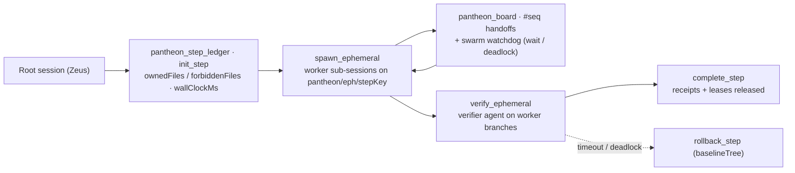
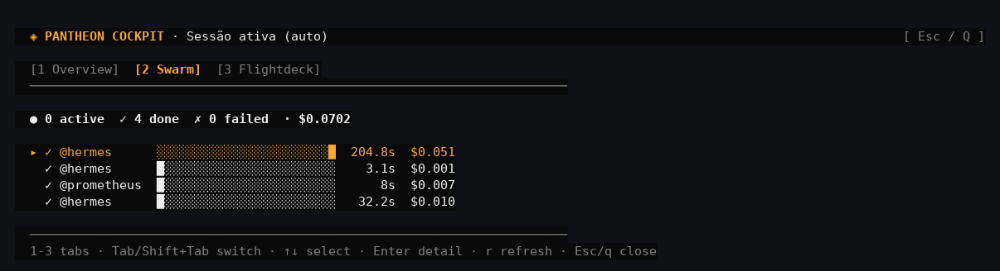
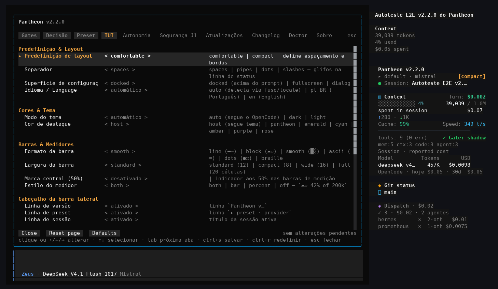

# Pantheon `v2.3.4` — Swarm Mode Phase 1–2, Enforced Wall-Clock Timeouts & Windows Shell Detection

> [!NOTE]
> **Pantheon `v2.3.4`** completes **Swarm Mode Phase 1–2**: ephemeral workers now run under real file leases, `#seq` board handoffs, and enforced `wallClockMs` deadlines that abort a turn mid-flight instead of merely recording the field. It also fixes Windows shell resolution (`resolveShellBin()`) and the Desktop Cockpit composer-pill entry points, so one package works unpatched on Git Bash, `cmd.exe`, and POSIX shells.

```bash
# Install or upgrade inside OpenCode 2.x
opencode plugin add pantheon-opencode@2.3.4
# or update an existing installation
opencode plugin update pantheon-opencode
```

---

## 1. Swarm Mode Phase 1–2

- **Ephemeral worker hierarchy:** `spawn_ephemeral` creates disposable worker sub-sessions scoped to a step, with role archetypes, per-worker budgets, and `pantheon/eph/<stepKey>` branches instead of long-lived agent sessions.
- **`#seq` board handoffs:** `pantheon_board` appends monotonic `#seq`-indexed messages to `.pantheon/board/messages.ndjson`, so peer handoffs, council debates, and `@mention` routing stay causally ordered across concurrently loaded plugin instances.
- **File leases on `init_step`:** `ownedFiles` / `forbiddenFiles` are registered with the step and enforced for the worker session — not advisory metadata.
- **Real `wallClockMs` enforcement:** the step runner checks the deadline before, during, and after each turn, clamps the remaining budget into the prompt timeout, and aborts with a `wall-clock timeout exceeded` halt instead of letting a worker overrun.
- **Deadlock and wait handling:** the swarm watchdog records directed `(waiter -> target)` dependency edges, detects circular waits, and surfaces `deadlock` alerts on the event bus instead of hanging silently.
- **Deterministic replay:** board messages replay in `#seq` order (with a `maxSeqCap`) so Cockpit traces and post-mortems reproduce the exact handoff sequence.
- **`verify_ephemeral`:** a `pantheon_step_ledger` action that runs the verifier agent against ephemeral worker branches before a step can be completed.





---

## 2. Windows & Cross-Platform Hardening

`resolveShellBin()` replaces the previous `src/plugin/index.js` hand-patch. Resolution order on Windows:

1. Git Bash at `C:\Program Files\Git\bin\bash.exe`
2. Git Bash at `C:\Program Files (x86)\Git\bin\bash.exe`
3. `%COMSPEC%`
4. `cmd.exe`

On POSIX it keeps `/bin/bash`, falling back to `/bin/sh`. No manual edit of the bundled plugin is required after upgrade, and shell-write guardrails resolve paths correctly for drive-letter workspaces.

---

## 3. Guardrail Correctness

- **Leases block both write channels:** the lease registry is checked on mutating edit tools *and* on shell write commands — redirections (`>`, `>>`), `tee`, `sed -i`, `cp`/`mv`/`rm`/`touch`, PowerShell `Set-Content`/`Out-File`/`Add-Content`/`Remove-Item`, and nested `bash -c` / `sh -c` / `cmd /c` subshells.
- **`wallClockMs` is enforced, not accepted:** a step that exceeds its deadline halts with an explicit error and emits the normal escalation path instead of silently continuing.
- **G4/G5/G6 validation scenario:** the end-to-end scenario (lease violation on a forbidden file, lease violation via shell redirect, and a step that overruns `wallClockMs`) is covered so the guardrails fail closed rather than degrading to warnings.

---

## 4. GUI & TUI

- **Cockpit and composer pill opening:** `/pantheon-cockpit` and `ComposerPill` open through `ctx.layout.open("${ctx.id}:pantheon-cockpit", session)` with `ctx.dialogs.open` as fallback.
- **Invalid `PanelTab.icon` removed:** the malformed tab descriptor is gone, so the panel mounts without host-side schema warnings.
- **Settings parity and live telemetry:** full TUI Settings parity in the GUI, session-localized strings, reactive `PanelProps.session` reads, and `session_v2` DAG detection for live swarm telemetry.



---

## 5. Upgrading & Documentation

- **Installation & upgrade:** [Installation Guide](../INSTALLATION.md) · [OpenCode 2.x Integration](../opencode.md)
- **Release history:** [v2.x Highlights](./highlights.md)
- **Upgrade path:** `opencode plugin update pantheon-opencode` picks up `2.3.4` from `latest`; the TUI bundle is rebuilt with the embedded version, so `version:check` reports no stale dist.
