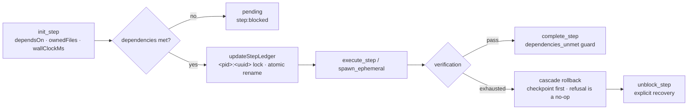

# Pantheon `v2.4.0` — Dependent Steps on a Locked Ledger, Protected Ephemeral Merges & an Opt-In HTTP Cockpit

> [!NOTE]
> **Pantheon `v2.4.0`** makes the step ledger a real scheduler: steps now declare `dependsOn` prerequisites, run on a single cross-process lock, and roll back as an explicit, recoverable cascade rather than a silent reset. Ephemeral-worker branches merge only through gates that re-verify HEAD drift, pin the reviewed SHA, honour file leases and require a two-step confirmation token. Alongside it: an FTS5 strategy store that learns which decompositions work, a fail-closed CI merge gate, and an opt-in, loopback, read-only HTTP cockpit that is redacted by default.

```bash
# Install or upgrade inside OpenCode 2.x
opencode plugin add pantheon-opencode@2.4.0
# or update an existing installation
opencode plugin update pantheon-opencode
```

---

## 1. Dependent Steps on a Locked, Atomic Ledger

The ledger is no longer a flat list of step records written by whoever got there first.

- **`dependsOn` prerequisites:** `init_step` accepts declared dependencies, and `step-dependencies.ts` normalizes, validates, computes execution waves, and detects cycles by reachability. `status.graph` exposes `{ waves, cycles, ready, unmet, dangling, unplaced }`.
- **Unmet dependencies are `pending`, not launched:** `execute_step` and `spawn_ephemeral` both refuse a step whose dependencies are not `done`, emitting `step:blocked` / `step:unlocked` instead of starting a worker against unfinished inputs.
- **One lock for every mutation:** `updateStepLedger(cwd, mutator)` takes a lock file, retries briefly, breaks only genuinely stale holders, and commits by atomic rename. `writeStepLedger` delegates to it, and auto-created steps in the runner route through it too.
- **Propagation-safe stale break:** the lock carries a `<pid>:<uuid>` owner token; breaking a stale lock renames it to quarantine, compares tokens, and links back if it raced a live writer. An orphaned zero-byte lock is reclaimed by age, and orphan `*.tmp.<pid>` files older than 60s are swept.
- **Explicit cascade rollback:** a refused rollback is decided under the lock *before* the tree is restored, captures a pre-rollback checkpoint, and undoes a late refusal — so a refusal is always a no-op (`treeUntouched` / `restoredTree`). Only cascade-invalidated steps carry `cascadeReason` and stay hard-blocked; `unblock_step` is the explicit recovery. A passing verification no longer silently clears a cascade block, and `complete_step` refuses with `dependencies_unmet` while any declared dependency is not done.
- **`.pantheon`-free git checkpoints:** baselines and rollbacks are captured and restored against tracked content only, so the runtime store can never leak into a checkpoint, a rollback diff, or a baseline tree hash.
- **Corrupt-ledger quarantine:** a malformed `step-ledger.json` is quarantined as `step-ledger.json.corrupt.<timestamp>` and the mutation throws; it is never replaced by an empty store.



---

## 2. Protected Ephemeral-Branch Merge

`merge_ephemeral` replaces "fast-forward the worker branch and hope" with a rehearsed, single-use merge.

- **Preview never touches the checkout:** `preview` uses `git merge-tree --write-tree` (temp-worktree fallback for git `<2.38`) and mints `MERGE-<sha256(stepKey|branch|baseHead|headNow|diffDigest)[:12]>` — single-use, 10-minute TTL, self-invalidating on HEAD drift or a moved branch.
- **Pre-mutation refusals:** `head_drift`, dirty worktree/branch/lease overlap, dirty index, empty diff, conflicts and `merge_in_progress` all refuse before the first mutation.
- **SHA-pinned content:** the reviewed commit is resolved once and the *sha* — not the branch name — drives every differential call and the squash, and it is part of the token digest. A force-push (even a same-content rewrite) invalidates the token; a tag or `refs/pantheon` ref shadowing the branch is refused as `ambiguous_branch`.
- **Cross-process merge mutex:** `.pantheon/.ephemeral-merge.lock` is a dedicated primitive, safe to hold for seconds — it breaks on owner liveness (dead pid) rather than age, tolerates ten minutes before any age-based break, refreshes its mtime every second, and re-verifies ownership before the squash and again before the ledger write. An evicted writer returns `lock_lost` and never reports success.
- **Verified recovery:** a `finally`-style path aborts only a merge it owns, resets, and restores the pre-merge checkpoint when the tree still differs, then asserts no `MERGE_HEAD`/`MERGE_MSG`. `treeRestored` is reported only after a verified comparison.
- **Truthful outcomes:** `ephemeral.mergedAt` / `mergeTree` / `mergedSha` / `discardedAt` persist on the ledger entry and a `step:merge` event fires. A ledger write failure after a landed squash reports `ok: true, metadataRecorded: false` with a "re-record, do not re-merge" hint instead of claiming nothing happened. Only `discard` deletes the branch.

---

## 3. Strategy Store — FTS5 Outcomes with Candidate → Proven → Anti-Pattern Decay

`pantheon_strategy` records what actually happened to a step and answers "has this decomposition worked before?"

- **Additive, idempotent schema:** `strategy_runs` (+ indexes), `strategy_stats`, `strategy_docs` with an FTS5 `strategy_docs_fts` mirror driven by `*_ai`/`*_ad`/`*_au` triggers, a `strategy_effective` view, and `strategy_meta` guarded by `schema_version='1'` in one transaction.
- **Ladder at query time:** `proven` at ≥3 samples and ≥0.8 success, `anti_pattern` at ≥3 samples and >0.6 failure, otherwise `candidate`. Ranking is `success_rate * decay DESC`, with `decay = max(0, 1 - age/90)`.
- **Lexical only:** FTS5 BM25 retrieval — no embeddings, no `sqlite-vec`, no Ollama, no network.
- **Wired to real outcomes:** `complete_step` records a success run; the reflex-escalation branch records a failure; a Themis `BLOCK` attaches to the latest run and forces `success=0`. Recording is best-effort and reported in the payload — it can never fail a step.
- **Duplicate-safe and bounded:** a repeat `complete_step` on an already-done step reports `recorded: false` rather than inflating the sample; retention prunes runs at 30 days / 10k every 50th insert, and aggregates are never pruned.
- **Granted narrowly:** `zeus`, `athena` and `themis` only.

---

## 4. Fail-Closed CI Merge Gate

The auto-merge workflow previously ran on `pull_request` with no required checks configured, so GitHub had nothing to wait for and merged two seconds after the suite went red.

- **Merge only on a green `workflow_run`:** conclusion `success`, owner-authored, non-draft, targeting `main`, sitting at the tested SHA, `MERGEABLE`/`CLEAN`, and reporting `SUCCESS` (not `skipped`) for `validate`, `test-suite`, `plugin-ts-coverage`, `commitlint` and `security-scan`. No `--auto`.
- **Refuse an empty check list:** `gh pr checks` must return a non-empty JSON array; `jq` on empty input would otherwise leave the check list empty and pass.
- **Squash pinned to the tested SHA:** `--match-head-commit` closes the TOCTOU between the `headRefOid` guard and the merge.
- **Generated artifacts are gated on the fast lane:** `check:generated` (roster, decision-router bundles, `AGENTS.md`), plus rebuild-and-diff steps for `src/agents` and `src/plugin`, plus `check:plugin` (temp build, byte compare). A pre-commit hook rebuilds and diffs the same generators, backing up unstaged/untracked generated files so one attempt surfaces both drifts and no hand-edit is lost.
- **Protection audit reads reality:** required contexts are cross-checked against `commits/main/check-runs`, with real CodeQL context names, non-destructive remediation, and a bootstrap-window note. Branch protection itself remains external configuration.

---

## 5. Opt-In Loopback Read-Only HTTP Cockpit

A single config value opens a redacted, read-only window on the swarm over a tunnel — and nothing else.

- **Opt-in and loopback:** disabled unless `PANTHEON_COCKPIT` names a port; binds loopback, serves `GET`/`HEAD` only, and answers `405` for unrouted methods (a `CONNECT` is a closed socket, not a `405`).
- **Fatal config is loud:** every rejected spelling logs one line naming the bad value and the expected form, and is also written to stderr. A whitespace-only token is fatal.
- **Bind failures name the remedy:** `EADDRINUSE` rejects with a port-naming `CockpitBindError` and the multi-process VPS recipe. `/healthz` exposes a `basename+short-hash` `workspaceId` — never an absolute path — so a tunnel can be verified.
- **Post-listen errors are logged, not thrown:** a persistent `server.on('error')` handler with a state guard.
- **Redacted by default:** see [§7](#7-behavioural-notes).

---

## 6. Off-Plan Fixes

Seven defects found while shipping the five slices.

| Area | Symptom | Fix |
|---|---|---|
| **auto-merge** | `gh pr view --json` asked for a field no `gh` release supports | Dropped the phantom field from the query |
| **auto-merge** | `gh` ran in a checkout-less job with no repository context | Every call is repo-aware via `GH_REPO` |
| **auto-merge** | An ineligible PR was reported as a workflow failure | Ineligibility is a clean skip with its reason |
| **hooks** | Commit hooks silently skipped in **every** worktree since v1.0 | `.husky` is tracked and reached by a relative `core.hooksPath`; husky dropped |
| **test-slice** | Files pinned by differently-named contracts fell back to the repo suite | Explicit contract slices for workflows, generated-artifact hooks, `check-tui-dist`, `scripts/hooks/`, shipped scripts and feature-named sources |
| **redaction gate** | `tar` probes ENOBUFS'd at Node's 1 MiB default while no secret was present | 64 MiB child buffer on both `tar` calls |
| **validate** | Doctor tests asserted ambient machine state instead of a provisioned checkout | `tests/helpers/provisioned-checkout.mjs` provisions a healthy target; the ambient run survives as a shape-only diagnostic |

Notes on the two that had the longest tails:

- **Worktree hooks:** `core.hooksPath` lives in the *shared* `.git/config`, so every linked worktree inherited husky's generated `.husky/_` directory, which `git worktree add` never materialises. Git skipped the hook silently, so a parallel specialist lane accepted non-conventional commits and bypassed the generated-artifacts guard. Hooks are now tracked, self-sufficient, and **fail loudly** — a worktree without `node_modules` exits non-zero with `npm ci` as the exact fix. `hooks-worktree.test.mjs` drives them inside a throwaway `git worktree add`; `scripts/verify-git-hooks.mjs` verifies the wiring.
- **Ambient doctor state:** `doctor-section-summary` asserted `status === 0` for the ambient checkout, so a legitimate concurrent session turned it red — two worktrees on one branch is precisely what the shared-checkout guardrail must *fail*. The suite now runs against a provisioned checkout with `--profile lite`, and `guardrails-doctor` adds the exit-code pair: a provisioned repo exits 0, and the same repo with a second worktree on its branch exits 2 naming `guardrail_shared_branch`.

---

## 7. Behavioural Notes

Two intentional behaviour changes to know about before upgrading.

### 7.1 Cockpit free text is omitted by default

The default cockpit payload carries **no agent-authored free text** — `step.objective`, `step.cascadeReason`, `board.goal`, `board.workstream` and `board.body` are replaced with their lengths. These fields are unbounded channels that routinely contain absolute paths, command lines and credentials, and no scrubber can be proven complete. `?full=1` returns them verbatim; use it only over a trusted tunnel.

### 7.2 `biome` ignores `.pantheon/deepwork`

`biome.json` now ignores `.pantheon/deepwork`, so local lint stops scanning a gitignored runtime artefact. Tracked `.pantheon/**` files keep their coverage — the ignore is scoped to the deepwork runtime directory, not the whole store.

---

## 8. Upgrading & Compatibility

- **No migration required:** the strategy schema is additive and idempotent, the ledger is read through the new lock path, and an existing `step-ledger.json` loads unchanged.
- **Semantics that can surprise:** a step with unmet `dependsOn` now starts `pending` instead of launching; a cascade-invalidated step needs an explicit `unblock_step`; and `merge_ephemeral` refuses rather than fast-forwarding when the reviewed SHA moved.
- **Hooks get stricter:** a worktree without `node_modules` now fails a commit instead of silently skipping the hook. Run `npm ci` in the worktree (or use the worktree tooling, which refuses to leave a lane whose hooks cannot run).
- **Cockpit is off by default:** nothing listens unless you set `PANTHEON_COCKPIT`.

---

## 9. Upgrading & Documentation

- **Installation & upgrade:** [Installation Guide](../INSTALLATION.md) · [Upgrading](../UPGRADING.md) · [OpenCode 2.x Integration](../opencode.md)
- **Architecture & tools:** [Architecture](../ARCHITECTURE.md) · [MCP Tools](../mcp-tools.md) · [Artifacts](../ARTIFACTS.md)
- **Branch protection & CI:** [Branch Protection](../BRANCH-PROTECTION.md) · [Releasing](../RELEASING.md)
- **Release history:** [v2.x Highlights](./highlights.md)
- **Upgrade path:** `opencode plugin update pantheon-opencode` picks up `2.4.0` from `latest`; the TUI bundle is rebuilt with the embedded version, so `version:check` reports no stale dist.
