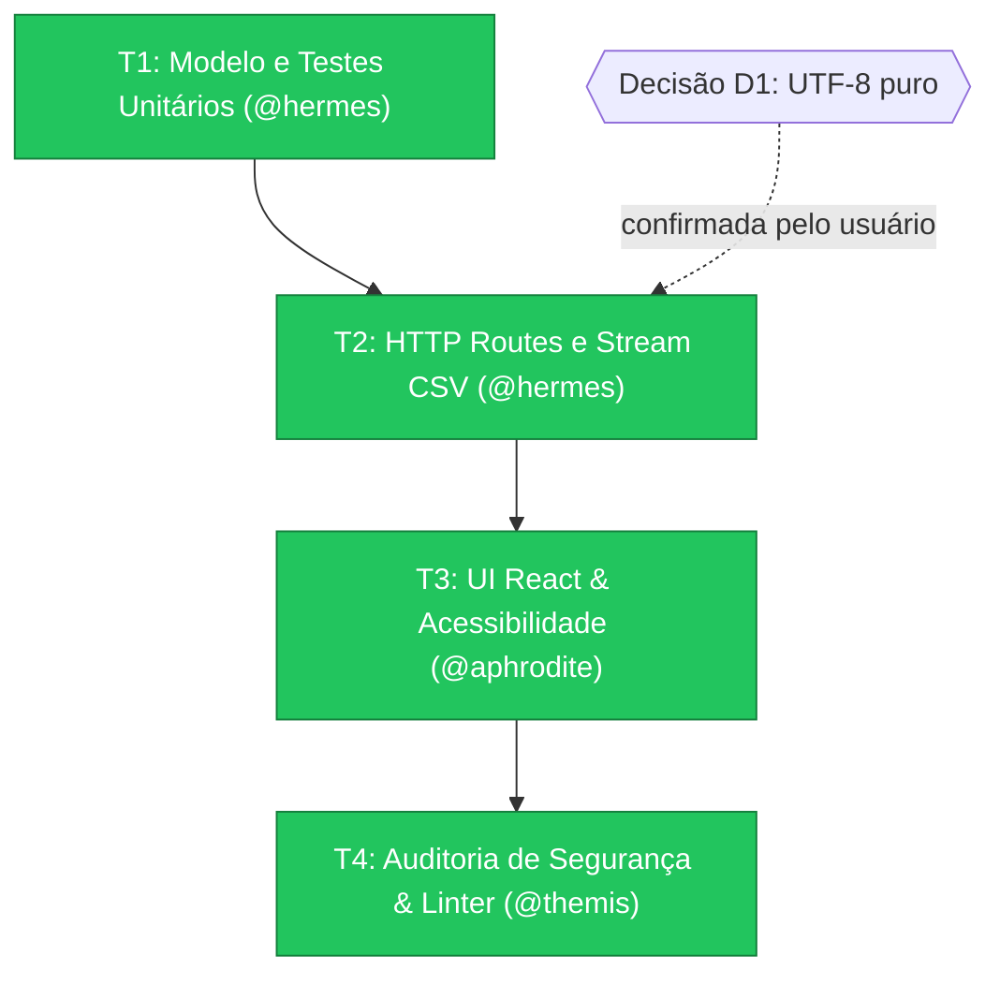

# Plano de Deepwork: SaaS Performance Dashboard (PLAN_001_metrics-dashboard)

- **Status:** CONCLUÍDO (PASS)
- **Criado por:** `@athena` · **Orquestrado por:** `@zeus` · **Auditado por:** `@themis`
- **Origem canônica:** [plan.json](file:///home/ils15/pantheon/examples/saas-dashboard/.pantheon/deepwork/PLAN_001_metrics-dashboard/plan.json)
- **Histórico auditável:** [journal.ndjson](file:///home/ils15/pantheon/examples/saas-dashboard/.pantheon/deepwork/PLAN_001_metrics-dashboard/journal.ndjson)

---

## 1. Grafo de Dependências (DAG)

---

## 2. Fases de Execução & Evidências

| ID | Especialista | Tarefa | Portão | Status | Evidência |
|---|---|---|:---:|:---:|---|
| **T1** | `@hermes` | Especificar modelo de métricas e testes unitários | `test` | ✅ Concluído | `node --test tests/metrics-api.test.mjs` (0 errors) |
| **T2** | `@hermes` | Implementar rotas HTTP e streaming CSV | `test` | ✅ Concluído | Headers `Content-Type: text/csv` validados |
| **T3** | `@aphrodite` | Componente de UI com Tailwind e WCAG AA | `lint` | ✅ Concluído | Sem erros de contraste ou roles ARIA ausentes |
| **T4** | `@themis` | Auditoria de segurança e linting pré-merge | `audit` | ✅ Concluído | Veredicto `PASS` emitido |

---

## 3. Decisões Humanas Registradas

* **D1:** Formato de codificação do arquivo CSV ➔ **Selecionado:** `UTF-8 puro` (Confirmado interativamente via OpenCode `question` tool).
