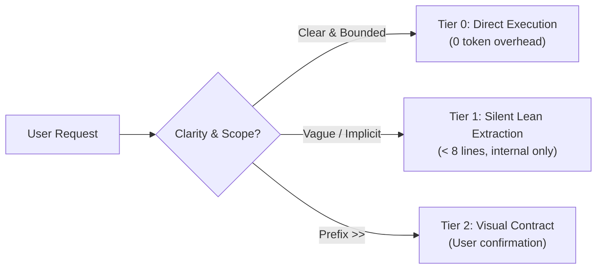

# Prompt Refinery

Turn ambiguous or multi-concern prompts into crisp, verifiable engineering briefs. Emulates Claude Code and ChatGPT Agent prompt architectures: zero-overhead pass-through by default, lean internal structuring for vague requests, and full visual contract only via `>>`.



---

## The Three Tiers

| Tier | Trigger | Behavior | Output Format |
|---|---|---|---|
| **0 — Pass-through** | Clear, bounded task ("fix typo in README", "run tests") | Executes immediately with zero refinement overhead | Direct execution |
| **1 — Silent Lean (Default)** | Unbounded scope, missing units/constraints, multi-concern | Silently extracts intent, slices, and defaults for own execution | Internal brief (< 8 lines) |
| **2 — Visual Contract** | **Prefix `>>` ONLY** | Presents full visual contract to user for explicit approval | Structured Markdown table & gates |

---

## Tier 1: Silent Lean Extraction (Internal Default)

Execute silently in session context. Never show to the user; begin work immediately:
```
Target: [Single sentence: action verb + concrete outcome]
Slices: 1) [Slice A] 2) [Slice B] (2-4 independently testable steps)
Negative Constraints: [What NOT to touch or break; no new external deps]
Verification: [Exact test or lint command]
Defaults: [Assumed parameters, e.g. active branch, default ports]
```

---

## Tier 2: Visual Contract (Prefix `>>` Only)

Presented to user for confirmation before starting:

```markdown
### Proposed Scope & Execution Plan

| Slice | Focus Area | Target Files | Verification Gate |
|---|---|---|---|
| 1. Model / Schema | Data structure | `src/models/...` | Unit tests / migrations |
| 2. Implementation | Core business logic | `src/services/...` | Sliced test command |
| 3. Integration | E2E & lint check | `tests/...` | Full gate / `ruff` / `biome` |

- **In Scope:** [Concrete additions or changes]
- **Out of Scope & Negative Constraints:** [Explicit exclusions; files/systems not to touch]
- **Acceptance Criteria:**
  - [ ] Observable completion condition
  - [ ] Test verification passes cleanly
- **Open Questions (with Recommended Defaults):**
  - [Question]? *(Default: [Recommended choice] — interactively confirmed via question tool)*
```

---

## Operating Rules

1. **Tier 1 is Silent & Fast:** The agent extracts structure internally. The user sees execution start immediately, never an intermediate confirmation dialog.
2. **Tier 2 Requires `>>`:** Only explicit `>>` prefix requests trigger user-visible contract confirmation.
3. **Language Consistency:** Always preserve the user's language (PT-BR requests produce PT-BR briefs).
4. **Fail-Open:** Any error during refinement falls back to the original prompt without blocking.
5. **Interactive Questioning & Ambiguity Resolution (MANDATORY `question` tool):**
   - Whenever prompt refinement or planning surfaces Open Questions (`decisions_needed`), trade-offs, or scope choices, **NEVER leave them as inert text bullets in chat** or assume "proceed if no objections".
   - You **MUST ALWAYS invoke the native `question` tool** with structured choices, placing the recommended choice first and marking it with `(Recomendado)`.
   - The user selects choices with 1 click/Enter, and the selections are recorded as audited decisions.
   - With decision router active, use `pantheon_jev_decide` (mode: `choice`) for internal candidate scoring.
   - Non-blocking minor gaps without meaningful user trade-offs use sensible declared defaults without stalling the flow.
