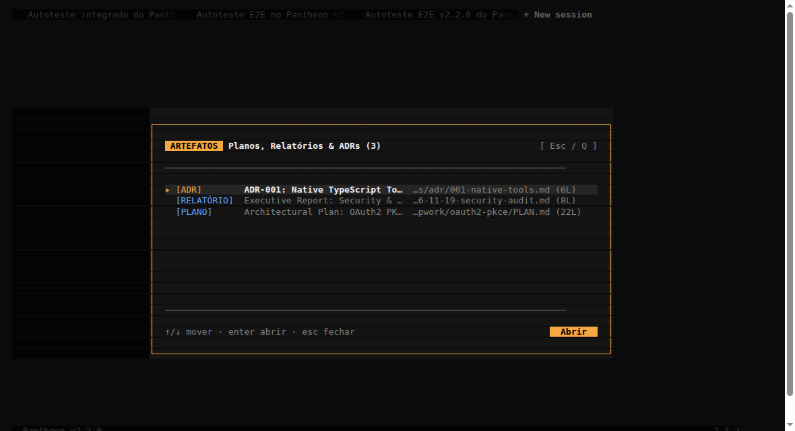
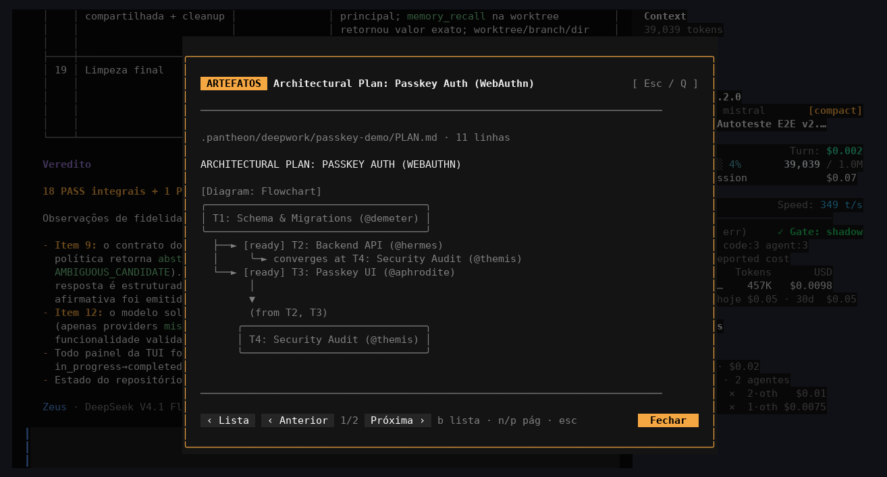

# Guia de Deepwork: Planejamento Rigoroso & Artefatos

O **Deepwork** é o sistema de planejamento canônico e execução auditada do Pantheon.

---

## 1. Princípios

1. **O plano vive em `.pantheon/deepwork/<slug>/`:**
   - `plan.json`: O estado canônico estrito validado por schema.
   - `journal.ndjson`: O histórico append-only auditável de eventos e decisões.
   - `PLAN.md`: A projeção visual em Markdown com grafo Mermaid e links clicáveis `file://`.
2. **Zero HTML:** O Pantheon utiliza diálogos interativos nativos (`question` tool) no próprio OpenCode para decisões e aprovações.
3. **Decisões Humanas Primeiro:** Trade-offs técnicos (`decisions_needed`) são resolvidos antes da execução dos especialistas.
4. **Progresso Verificado (`pantheon_step_ledger`):** Mutações precisam registrar verificação objetiva (testes/lint) antes de concluir cada etapa.

---

## 2. Como Usar

No chat do OpenCode:

```text
/pantheon-deepwork Adicionar suporte a autenticação por Passkey
```

Ou delegando ao Zeus:

```text
@zeus elabore um plano de deepwork para a issue #42
```

---

## 3. Lendo e Revisando Planos (`/pantheon-artifacts`)

Depois que a `@athena` cria `.pantheon/deepwork/<slug>/PLAN.md`, você pode inspecionar no chat do **OpenCode Desktop** ou abrir o leitor interativo paginado direto no terminal via `/pantheon-artifacts` (`/artifacts`):





> Veja todos os atalhos de teclado e mouse em [Artefatos & `/pantheon-artifacts`](../docs/pt-BR/ARTIFACTS.md).
