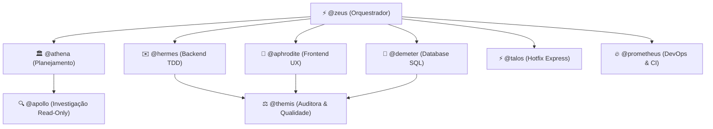

# 🏛️ Bem-vindo à Wiki do Pantheon

> **Pantheon** é um framework de orquestração multi-agente para o **OpenCode**: 14 agentes especializados, 25 skills canônicas e um fluxo guiado do planejamento à mudança revisada e testada.

---

## 🧭 Navegação Rápida

| Página da Wiki | Descrição |
|---|---|
| [Matriz de Agentes](Agent-Matrix.md) | Quem é quem no Olimpo: permissões, ferramentas e papéis de cada um dos 14 agentes |
| [Guia do Deepwork](Deepwork-Guide.md) | Como funciona o planejamento arquitetural em JSON, DAGs em Mermaid e aprovação interativa |
| [Pantheon Vision](Pantheon-Vision.md) | Como colar imagens e depurar interfaces sem poluir o chat |
| [Perguntas Frequentes (FAQ)](FAQ.md) | Respostas para dúvidas comuns e boas práticas |

> 📖 **Portal Oficial de Documentação:** Para guias interativos completos, pesquisa em tempo real e changelog detalhado, acesse nosso site oficial no GitHub Pages: **[https://ils15.github.io/pantheon-opencode/](https://ils15.github.io/pantheon-opencode/)**.

---

## ⚡ Início Rápido em 3 Comandos

```bash
# 1. Instale o Pantheon no seu projeto
npx pantheon-opencode init

# 2. Inicie o OpenCode com a TUI
opencode

# 3. Dispare sua primeira tarefa no chat
/pantheon Adicionar exportação de dados em CSV com testes unitários
```

---

## 👥 Os Especialistas do Pantheon


