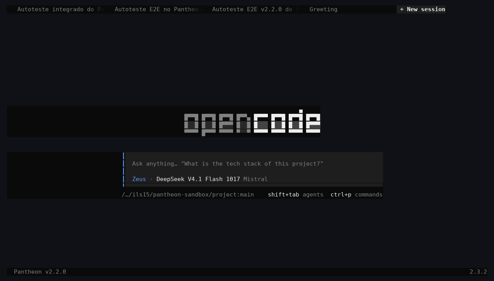
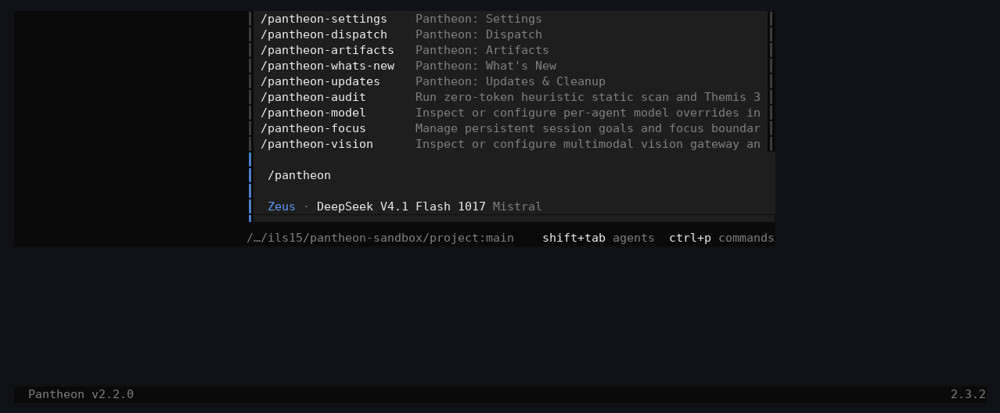
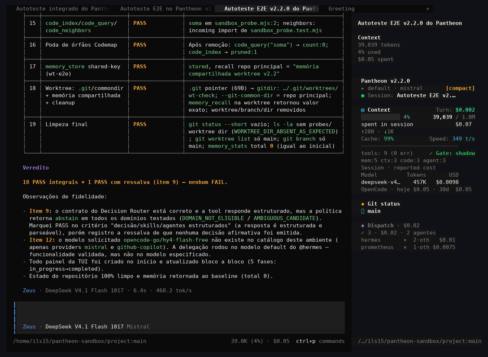
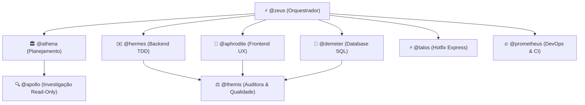

# 🏛️ Bem-vindo à Wiki do Pantheon

> **Pantheon v2.2.0** é um framework de orquestração multi-agente nativo para o **OpenCode 2.x**: 14 agentes especializados, 25 skills canônicas, 26 ferramentas TypeScript nativas e uma TUI completa no terminal e Desktop.

---

## 🧭 Navegação Rápida

| Página da Wiki | Descrição |
|---|---|
| [Tour Visual: TUI, Settings & Artefatos](TUI-and-Artifacts.md) | Prints reais do `/pantheon-settings`, `/pantheon-artifacts`, `/dispatch` e Sidebar |
| [Matriz de Agentes](Agent-Matrix.md) | Quem é quem no Olimpo: permissões, ferramentas e papéis dos 14 agentes |
| [Guia do Deepwork](Deepwork-Guide.md) | Planejamento arquitetural em JSON, DAGs Mermaid, step ledger e `/pantheon-artifacts` |
| [Pantheon Vision](Pantheon-Vision.md) | Como colar imagens e configurar o modelo de visão sem poluir o chat |
| [Perguntas Frequentes (FAQ)](FAQ.md) | Instalação nativa, atualização sem lixo legado, worktrees e Windows/WSL2 |

> 📖 **Documentação Completa:** [Mapa em Português](../docs/pt-BR/index.md) · [English Docs](../docs/index.md) · [Site GitHub Pages](https://ils15.github.io/pantheon-opencode/)

---

## ⚡ Início Rápido em 3 Passos

```bash
# 1. Instale o plugin nativo no OpenCode 2.x (zero arquivos copiados, funciona em qualquer pasta)
opencode plugin add pantheon-opencode

# 2. Inicie o OpenCode com a TUI
opencode

# 3. Explore os comandos ou dispare sua primeira tarefa
/pantheon-settings
```



---

## 💬 Paleta de Comandos & Sidebar ao Vivo

Digite `/pantheon` no compositor (ou pressione `Ctrl+P`) para acessar ajustes, novidades, inspeção de artefatos, despacho de subagentes e governança:



Durante a execução, a barra lateral exibe contexto, uso de cache, ferramentas, status do portão `J1` e o resumo consolidado do **Dispatch** por especialista:



---

## 👥 Arquitetura dos Especialistas


