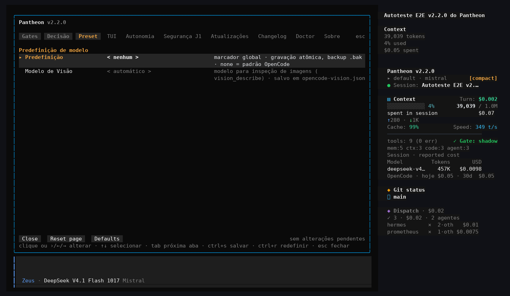

# Pantheon Vision: Análise Visual

O **Pantheon Vision** permite inspecionar interfaces visuais, prints de erro e layouts colando imagens diretamente no OpenCode — mantendo o contexto da conversa enxuto via `vision_describe`.

---

## Como Usar

1. Copie qualquer imagem para a área de transferência (`Ctrl+C` ou captura de tela).
2. Cole no chat do OpenCode (`Ctrl+V`).
3. Descreva o objetivo:
   ```text
   ajustar o alinhamento do cabeçalho, melhorar o contraste do botão primário e revisar a responsividade
   ```

---

## Configuração do Modelo Visual

Você pode configurar qual modelo analisa as imagens sem alterar seu modelo principal de código:

* **Na TUI:** `/pantheon-settings` ➔ aba **Preset** ➔ **Modelo de Visão** (`< automático >` ou modelo específico).
* **No arquivo:** `.opencode/opencode-vision.json`.
* **Por variável de ambiente:** `export PANTHEON_VISION_MODEL="opencode-go/mimo-v2.6-flash"`.



> 📖 Guia completo: [Visão Multimodal](../docs/pt-BR/guides/vision.md) · [English Vision Guide](../docs/guides/vision.md)
