# 🖥️ Tour Visual: TUI, Configurações & Artefatos

> Guia visual completo das interfaces nativas do Pantheon `v2.2.0` no OpenCode 2.x.
> Documentação de referência: [Configurações & TUI](../docs/pt-BR/SETTINGS.md) · [Artefatos](../docs/pt-BR/ARTIFACTS.md).

---

## 1. Painel de Configurações (`/pantheon-settings`)

Abre via `/pantheon-settings` (também funciona direto na tela inicial, pela paleta `Ctrl+P`, ou clicando no selo `↑ vX.Y.Z` na Home/Sidebar). Navegação completa por teclado (`Tab`, setas, `Enter`, `Ctrl+S`) ou mouse.

### `Gates` — Regras & Portões em Tempo Real
Ative/desative skills (`Auto-continue`, `TDD with agents`, `Code review checklist`, `Prompt refinery`) e portões de execução (`Idle todo enforcer`, `Context pruner`, `J1 risk gate`) no escopo **global** ou do **projeto**:

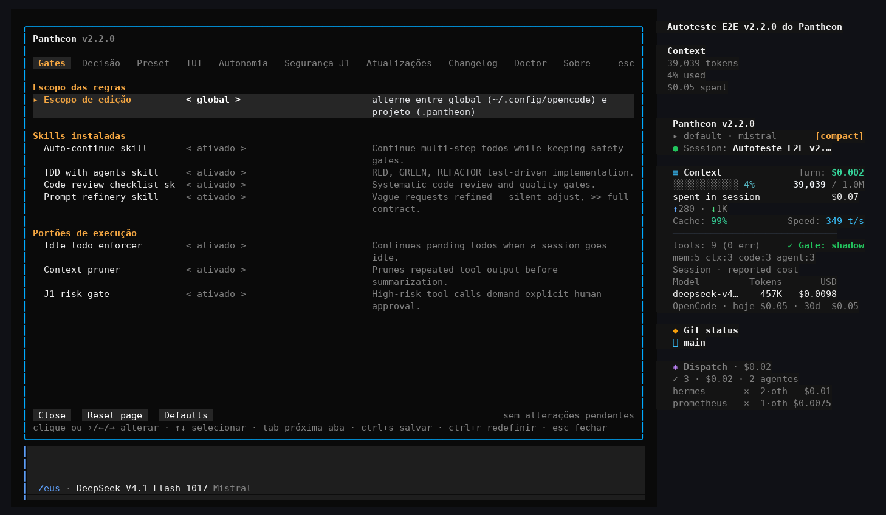

### `Decisão`, `Preset`, `TUI` & `Autonomia`
Configure arbitragem Jev, tier global de modelos + modelo de visão, idioma (`pt-BR`/`en`/`auto`), barras da sidebar e tetos de autonomia/orçamento:

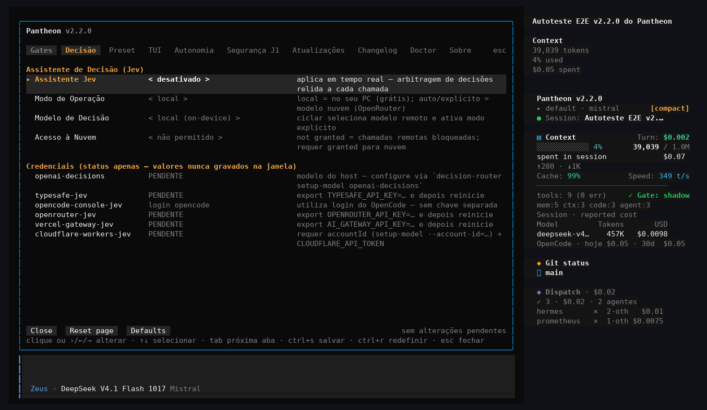

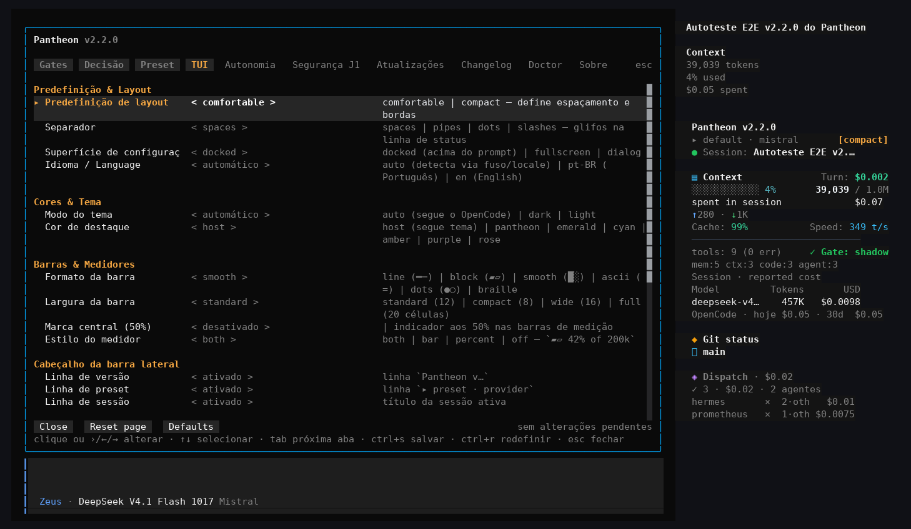

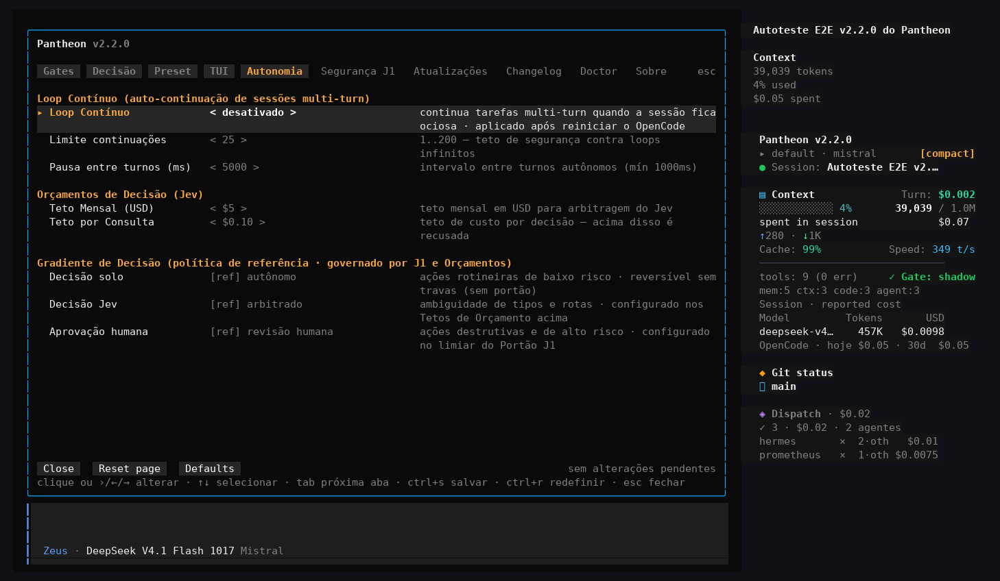

### `Atualizações`, `Doctor` & `Sobre`
Verifique canal npm (`latest`/`beta`), execute limpeza segura de caches antigos e legado V1 (`~/.cache/opencode/npm/pantheon-opencode*`), cheque saúde do ambiente e consulte as **30 Native Tools** no inventário ao vivo:

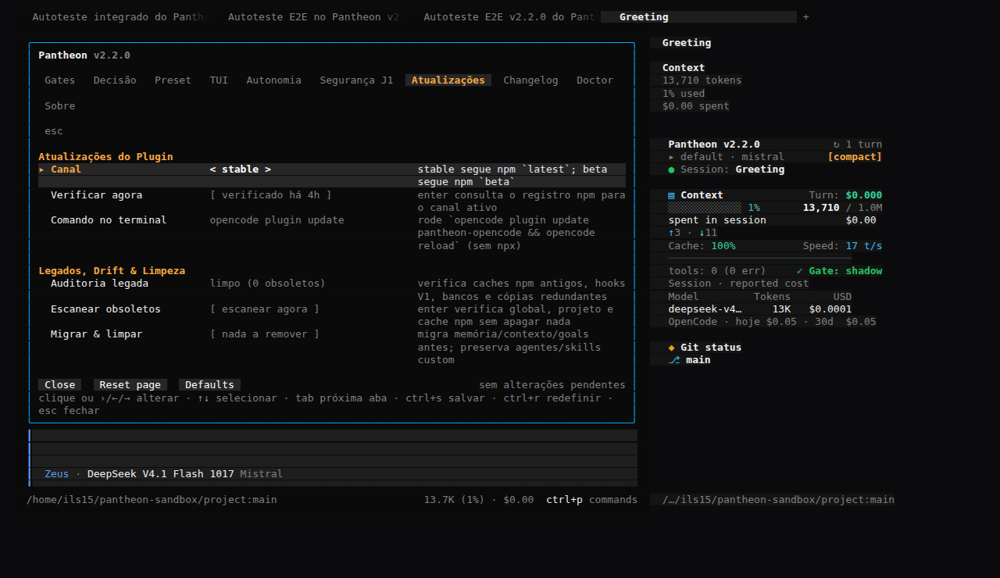

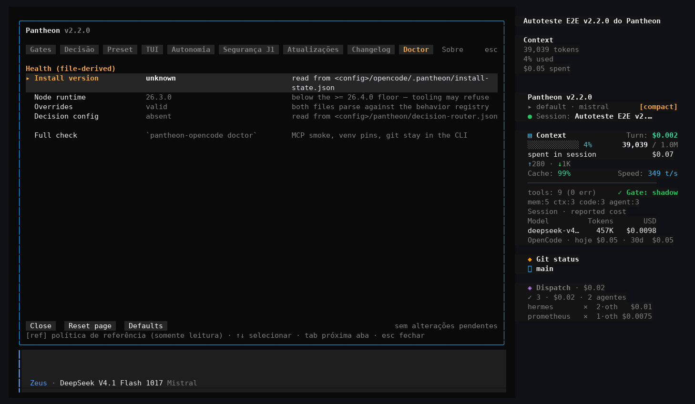

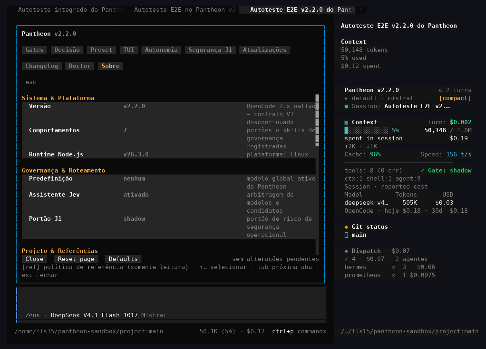

---

## 2. Mission Control Cockpit (`/pantheon-cockpit`)

Painel de observabilidade ao vivo em 3 abas (`1–3` ou `Tab`), com `Overview` (tokens/velocidade, gauges, health/work map), `Swarm` (árvore de delegação, barras Gantt concorrentes e stream semântico) e `Flightdeck` (matriz de permissões/gates J1 e telemetria):

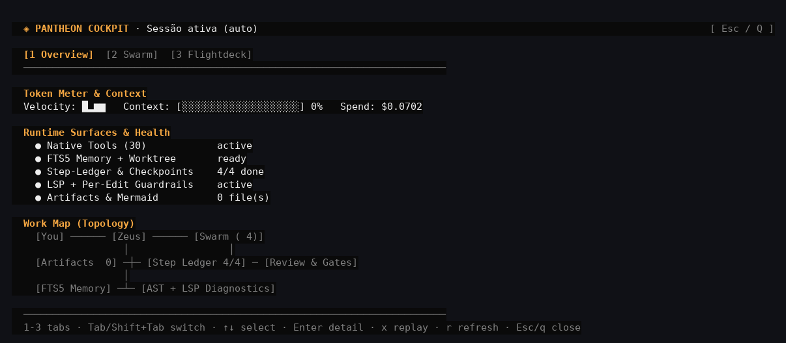

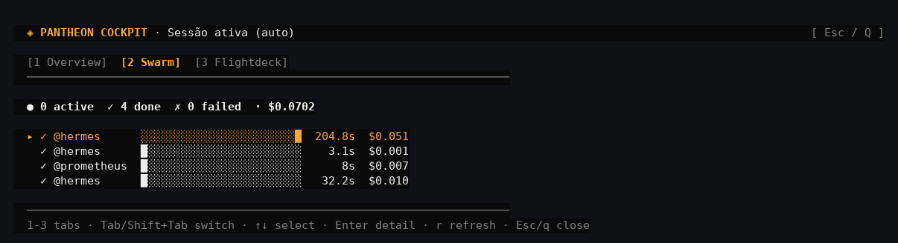

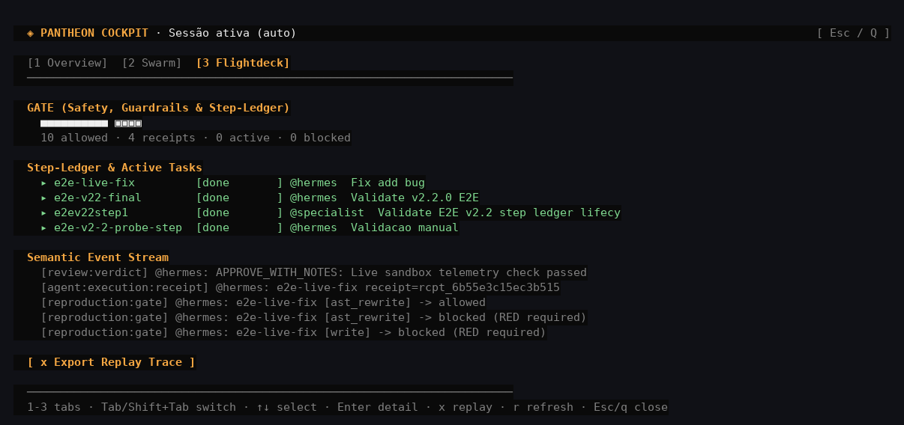

---

## 2. Visualizador de Artefatos (`/pantheon-artifacts`)

Liste e leia planos Deepwork (`.pantheon/deepwork/*/PLAN.md`), relatórios (`.pantheon/reports/*.md`) e ADRs (`docs/adr/*.md`) com paginação no terminal — inclusive a partir de git worktrees ligadas ao repositório principal:

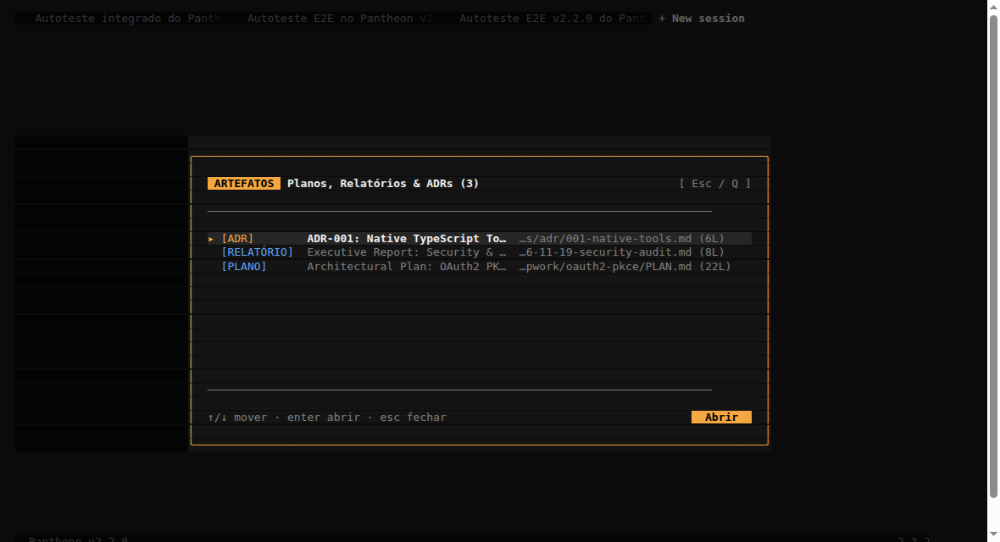

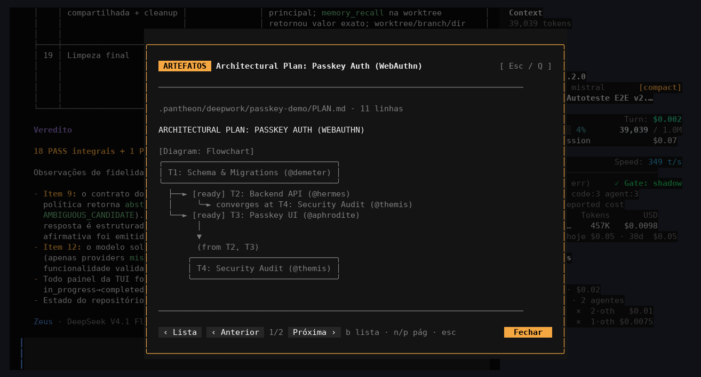

---

## 3. Painel `/dispatch` & `What's New`

Acompanhe cada subagente filho (`hermes`, `prometheus`, `athena`, `themis`) com tokens e custo individual em `/dispatch`, e reveja destaques da versão a qualquer momento em `/pantheon-whats-new` (`/whats-new`):

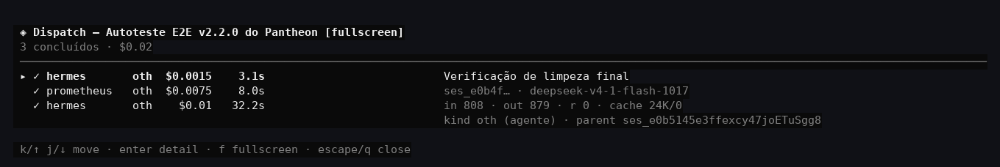

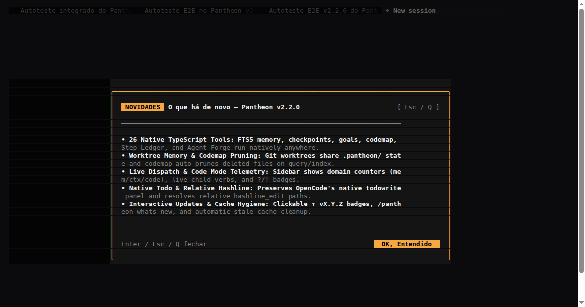
